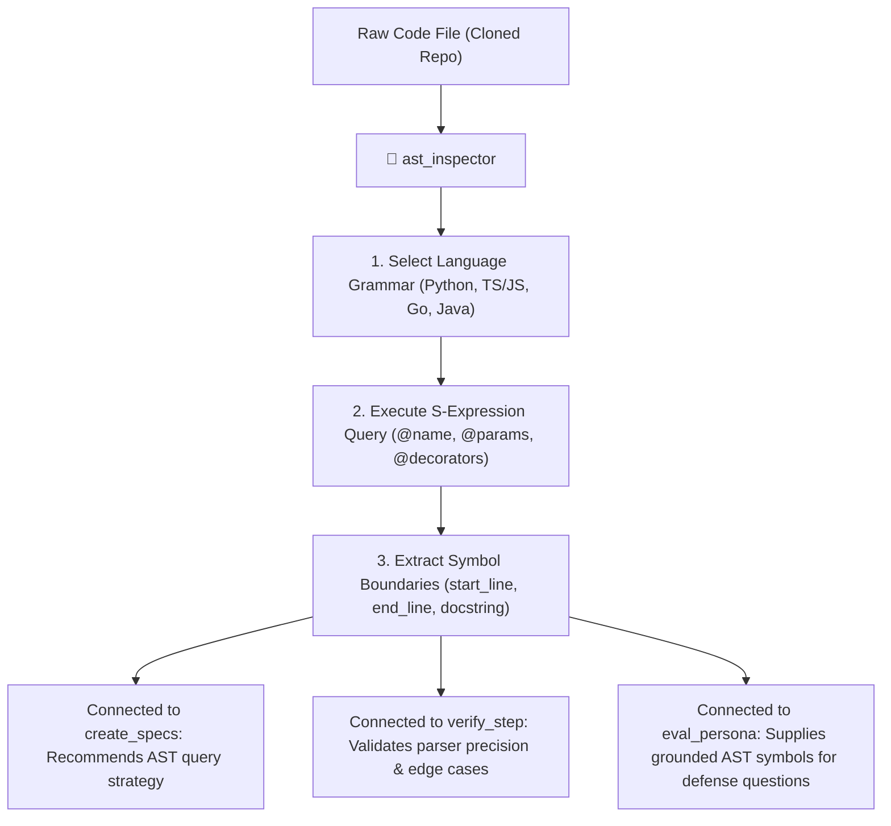

# 🌳 AST Inspector — Tree-sitter Syntax Tree & Query Specialist

`ast_inspector` is the static syntax analysis and Tree-sitter grammar specialist for **RepoDefense**. It assists in authoring, testing, and verifying deterministic AST queries across multiple programming languages, ensuring that code symbols (functions, classes, endpoints, decorators, dependencies) are extracted with exact line ranges and structural boundaries without executing user code.

---

## 🎯 Architectural Role & System Connections



---

## 🧰 Canonical Tree-sitter Query Patterns

### 1. Python (`tree-sitter-python`)

```scheme
; Functions & Async Functions
(function_definition
  name: (identifier) @function.name
  parameters: (parameters) @function.params
  return_type: (type)? @function.return_type
) @function.def

; Classes & Methods
(class_definition
  name: (identifier) @class.name
  superclasses: (argument_list)? @class.bases
  body: (block) @class.body
) @class.def

; Decorators (Routes, Auth, Middleware)
(decorator
  (dotted_name) @decorator.name
) @decorator.def
```

### 2. TypeScript & JavaScript (`tree-sitter-typescript`)

```scheme
; Function & Method Declarations
(function_declaration
  name: (identifier) @function.name
  parameters: (formal_parameters) @function.params
  return_type: (type_annotation)? @function.return_type
) @function.def

; Arrow Functions in Variable Declarations (React Components / Handlers)
(variable_declarator
  name: (identifier) @function.name
  value: (arrow_function
    parameters: (formal_parameters) @function.params
  ) @function.def
)

; Exported Endpoints / Handlers (Next.js App Router)
(export_statement
  declaration: (function_declaration
    name: (identifier) @export.name
  )
)
```

### 3. Go (`tree-sitter-go`)

```scheme
; Functions & Methods
(function_declaration
  name: (identifier) @function.name
  parameters: (parameter_list) @function.params
  result: (_)? @function.result
) @function.def

(method_declaration
  receiver: (parameter_list) @method.receiver
  name: (field_identifier) @method.name
  parameters: (parameter_list) @method.params
) @method.def
```

---

## 📋 Verification & Inspection Workflow

1. **Syntax Validation**: Ensure Tree-sitter queries compile without syntax errors against the target language grammar.
2. **Boundary Precision**: Verify that captured nodes preserve the complete span from `@function.def` start line to end line (crucial for AST-aware chunking).
3. **Decorator & Endpoint Attachment**: Link route decorators (e.g. `@app.get("/items")`, `@router.post("/")`) to their corresponding function definitions.
4. **Resilience to Malformed Code**: Test that syntax errors in user repositories produce partial ASTs with `ERROR` nodes rather than crashing the parser thread.

---

## 📤 Standard Inspection Report

```markdown
# 🌳 AST Inspector Report — [Language / File]

### 📊 Query Execution Summary
- **Language**: `python` | `typescript` | `go`
- **Grammar Version**: Tree-sitter 0.22+
- **Symbols Extracted**: [N] functions, [M] classes, [K] endpoints

### 🔍 Extracted Symbols
| Symbol | Kind | Line Range | Decorators / Signatures |
| :--- | :--- | :--- | :--- |
| `process_payment` | Function (async) | L45–L89 | `@authenticate`, `@rate_limit` |
| `OrderService` | Class | L12–L150 | `BaseService` |

### 🚦 Verdict: Query Verified & Ready for Production
```

---

## 🚀 Triggers

- `/ast_inspector`
- `/inspect_ast [file-path]`
- `"Test Tree-sitter query for Python decorators"`
