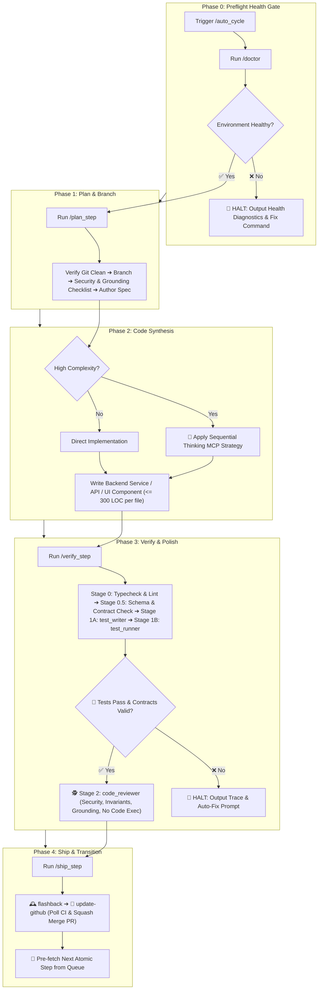

# ♾️ Auto Cycle — Master Autonomous Feature Lifecycle Orchestrator

`auto_cycle` is the overarching development orchestrator for the **RepoDefense** project. It connects **[`doctor`](file:///d:/RepoDefense/.agents/skills/doctor/SKILL.md)**, **[`plan_step`](file:///d:/RepoDefense/.agents/skills/plan_step/SKILL.md)**, **Code Implementation**, **[`verify_step`](file:///d:/RepoDefense/.agents/skills/verify_step/SKILL.md)**, and **[`ship_step`](file:///d:/RepoDefense/.agents/skills/ship_step/SKILL.md)** into a continuous, guarded development loop.

---

## 🔄 The 5-Phase Lifecycle Architecture



---

## 🔒 The 6 Invariant Guardrails & Circuit Breakers

To guarantee stability, preserve architectural integrity, and eliminate runaway errors, `auto_cycle` enforces six non-negotiable gates:

| Gate | Trigger Condition | Automated Action |
| :--- | :--- | :--- |
| **0. Preflight Health Gate (doctor)** | Any failure in working tree, remote origin, CI workflow (`.github/workflows/ci.yml`), Python/FastAPI environment, Next.js tooling, or database connectivity. | **Halts immediately before branching or planning**. Outputs diagnostic remediation command. |
| **1. Clean Tree Gate** | Modified or untracked files detected before starting. | **Halts immediately**. Prompts developer to commit or stash. |
| **2. Context Window Gate** | Turn token consumption exceeds $\sim 75,000$ tokens. | Completes current atomic step, ships PR, and **pauses to start a fresh turn**, preserving 40–50% headroom. |
| **3. Test & Contract Failure Gate** | Any pytest failure, type error (`tsc --noEmit` / `mypy`), lint failure, or Pydantic/Zod contract discrepancy during verification. | **Hard stop**. Does NOT review or ship. Outputs failure analysis and single-turn fix prompt. |
| **4. Subagent Boundary Rule** | Subagents are used for parallel testing and code review. | **Subagents never touch Git directly**. All Git commits, pushes, and PR merges are strictly synchronous on the primary agent. |
| **5. Stage Timeout Circuit Breaker** | Any stage exceeds its time threshold: `doctor` (1 min), `plan_step` (5 min), Code Synthesis (10 min), `verify_step` (**10 min**), `ship_step` (**8 min** including CI polling). | **Interrupts hung process**, logs timeout diagnostic, and asks developer to resume or inspect. |

---

## 🌐 Project-Specific Quality & Stack Invariants

`auto_cycle` dynamically aligns with **RepoDefense** architectural rules from [`Gemini.md`](file:///d:/RepoDefense/Gemini.md) and [`architecture.md`](file:///d:/RepoDefense/architecture.md):

| Layer / Target | Compilation & Lint Command | Verification Suite |
| :--- | :--- | :--- |
| **Preflight Environment** | `cd backend && pytest --collect-only` & `cd frontend && npx tsc --noEmit` | Doctor environment audit |
| **FastAPI Backend (`backend/app/`)** | `ruff check backend/app` (or `flake8 backend/app`) | `pytest backend/tests/ -v` |
| **Tree-sitter AST & Analyzers** | `ruff check backend/app/analyzers` | `pytest backend/tests/test_analyzers.py` |
| **LiteLLM & FSM State Machine** | `ruff check backend/app/ai` | `pytest backend/tests/test_ai_fsm.py` |
| **Next.js 15 & UI (`frontend/`)** | `cd frontend && npx tsc --noEmit && npm run lint` | `cd frontend && npm test -- <target>.test.tsx` |
| **Database Models & Alembic** | `cd backend && alembic check` | `pytest backend/tests/test_models.py` |

---

## 📋 Execution Protocol

### Step 0: Preflight Health Inspection (`doctor`)

1. Executes [`doctor`](file:///d:/RepoDefense/.agents/skills/doctor/SKILL.md).
2. Verifies working tree cleanliness, remote origin connectivity, CI workflow presence in `.github/workflows/ci.yml`, Python 3.12+ backend readiness, and Next.js 15 frontend readiness.
3. If any check fails, **HALTS IMMEDIATELY** and outputs the diagnostic remediation instructions.

---

### Step 1: Planning & Branch Provisioning (`plan_step`)

1. Executes [`plan_step`](file:///d:/RepoDefense/.agents/skills/plan_step/SKILL.md).
2. Identifies the next incomplete milestone step from [`implementation_plan.md`](file:///d:/RepoDefense/implementation_plan.md).
3. Verifies `git status -s`, switches to `main`, pulls latest, and branches off: `feat/<feature-slug>`.
4. Evaluates Security, Static Analysis Invariant (Zero Arbitrary Code Execution), AST Grounding, and Database Contracts, authoring the technical specification file in `docs/specs/<feature-slug>.md`.

---

### Step 2: Implementation & Code Synthesis

1. Implements backend models, FastAPI endpoints, Tree-sitter visitors, ARQ tasks, or Next.js components matching the specification.
2. If Sequential Thinking MCP was recommended in the spec (e.g., AST grammar traversals, FSM state transitions, LiteLLM structured outputs, RAG pgvector similarity filtering), executes multi-stage hypothesis validation before writing complex logic.
3. Adheres strictly to the LOC limit ($\le 300$ LOC per file) to enforce modularity.
4. Preserves non-execution security invariant: **never `eval()`, compile, or execute ingested repository code**.

---

### Step 3: Dual Verification & Polish (`verify_step`)

1. Executes [`verify_step`](file:///d:/RepoDefense/.agents/skills/verify_step/SKILL.md).
2. Stage 0 runs strict lint/type checks across backend (`ruff` / `pytest --collect-only`) and frontend (`tsc --noEmit` & `npm run lint`).
3. Stage 0.5 verifies data contract adherence (Pydantic v2 models, SQLAlchemy async models, AST symbol schemas, untrusted input sanitization).
4. Stage 1A spawns `test_writer` to author spec-driven unit/integration tests using the **Codebase Mock Catalog** (mocking SQLAlchemy AsyncSession, Tree-sitter parsers, LiteLLM responses, and pgvector embeddings).
5. Stage 1B spawns `test_runner` to execute the targeted test command (`pytest backend/tests/...` or `npm test -- ...`).
6. If tests pass, runs `code_reviewer` (Stage 2) for static architectural, security (sanitization, no arbitrary code execution, parameterized SQL), grounding, and accessibility compliance.
7. If issues arise, prompts developer and applies fixes before proceeding.

---

### Step 4: Release, Sync & Loop (`ship_step`)

1. Executes [`ship_step`](file:///d:/RepoDefense/.agents/skills/ship_step/SKILL.md).
2. Logs milestone in [`.agents/memory/flashback.md`](file:///d:/RepoDefense/.agents/memory/flashback.md) and marks task `[x]` in [`implementation_plan.md`](file:///d:/RepoDefense/implementation_plan.md).
3. Creates a conventional commit ($<100$ chars), pushes to GitHub, creates PR, polls CI status checks until green, and executes **Squash Merge** into `main`.
4. Cleans up local branch, retains remote branch on GitHub, and queues up the next atomic step.

---

## 📤 Standard Cycle Summary Output

```markdown
# ♾️ /auto_cycle Complete — [Step ID: Feature Title]

### 📊 Lifecycle Execution Summary

- **0. Preflight Health**: `✓` Environment, CI workflow & dependencies verified by `doctor`.
- **1. Planning & Spec**: `✓` Created branch `feat/[slug]` and spec `docs/specs/[slug].md`.
- **2. Implementation**: `✓` Generated [N] files ([X] LOC total, max <= 300 LOC/file).
- **3. Dynamic Verification**: `✓` [K] tests passed (0 failures, contracts verified).
- **4. Static Review**: `✓` Architecture verified against RepoDefense rules (Gemini.md / architecture.md).
- **5. Shipping & Memory**: `✓` PR #<N> CI passed & squash-merged to `main`, `flashback.md` updated.

---

### 🌿 Git & Repository State

- **Current Branch**: `main` (Up to date)
- **Remote Branch**: `origin/feat/[slug]` (Preserved on GitHub)

---

### 🎯 Next Atomic Step in Queue

> **[Next Step ID] — [Next Step Title]**  
> _Objective: [1-sentence description]_

---

### ⚡ Continue Auto Cycle?

Would you like me to start the next `/auto_cycle` for **[Next Step ID: Next Step Title]**?
```

---

## 🚀 Triggers

- `/auto_cycle`
- `/auto_cycle [step-number] [feature-name]`
- `"Run full autonomous cycle for next feature"`
- `"Execute next step end-to-end"`
