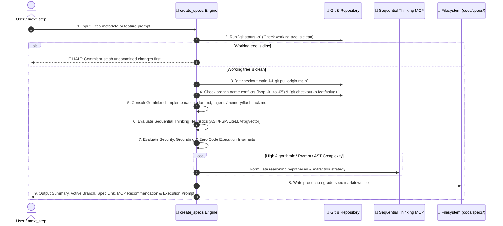

# 📝 Create Specs — Technical Specification & Git Branch Provisioner

`create_specs` is the technical authoring and branch preparation engine for **RepoDefense**. It takes a proposed atomic step (from `/next_step` or user input), verifies workspace cleanliness, creates a dedicated Git feature branch off the latest `main`, evaluates algorithmic and AST parsing complexity for Sequential Thinking MCP acceleration, embeds Security & Grounding safety rules, and generates a rigorous, production-grade technical specification markdown file saved to `docs/specs/<feature-slug>.md`.

---

## 🔒 Step-by-Step Provisioning Workflow



---

## 🛠️ Execution Pipeline

### Step 1 — Check Working Directory Cleanliness

Run:

```bash
git status -s
```

- **Hard Gate**: Check for uncommitted, unstaged, or untracked changes.
- If any modified or untracked files exist, **STOP IMMEDIATELY** and notify the developer:
  > _"Working directory has uncommitted changes. Please commit or stash changes before creating a new spec and branch."_
- **DO NOT CONTINUE** until the working directory is clean.

---

### Step 2 — Parse Arguments & Metadata

Extract metadata from `/next_step` handoff or user prompt:

1. `step_number`: e.g. `1.1`, `1.5`, `2.2`
2. `feature_title`: Human-readable title in Title Case (e.g. `Tree-sitter Python AST Symbol Extractor`)
3. `feature_slug`: Git- and filename-safe slug in lowercase kebab-case (e.g. `step-1-7-treesitter-extractor`)
4. `branch_name`: Format `feat/<feature_slug>` (max 40 chars)

---

### Step 3 — Check Branch Name Availability & Conflict Resolution

Run:

```bash
git branch --list "<branch_name>*"
```

- **Conflict Resolution Loop**:
  - If `<branch_name>` does not exist: use `<branch_name>`.
  - If `<branch_name>` exists: iterate suffixes `-01`, `-02`, `-03`, `-04`, `-05` until an unused branch name is found.
  - Set `RESOLVED_BRANCH` to the unique candidate name.

---

### Step 4 — Switch to Main and Pull Latest

Run:

```bash
git checkout main
git pull origin main
```

#### 🚨 Git Error Recovery Protocol:
1. **Pull Merge Conflict**: If `git pull` encounters conflicts with local stashes, run `git stash`, pull upstream, and resolve.
2. **Untracked Overwrite**: Move or clean untracked build files before checkout.
3. **Upstream Divergence**: If local `main` diverged, verify with `git log --oneline -n 5` before rebasing.

---

### Step 5 — Create and Switch to Feature Branch

Run:

```bash
git checkout -b <RESOLVED_BRANCH>
```

---

### Step 6 — Deep Research & Cross-Referencing

Mandatorily read and verify against:

- 📖 [`Gemini.md`](file:///d:/RepoDefense/Gemini.md) — Canonical rules, architecture principles, tech stack locks.
- 🗺️ [`implementation_plan.md`](file:///d:/RepoDefense/implementation_plan.md) — Phased task checklists, acceptance criteria, AI coding prompts.
- 🕰️ [`.agents/memory/flashback.md`](file:///d:/RepoDefense/.agents/memory/flashback.md) — Canonical living memory ledger, active phase, ADRs.
- 📐 [`design.md`](file:///d:/RepoDefense/design.md) & [`architecture.md`](file:///d:/RepoDefense/architecture.md) — System diagrams, module layouts, database schemas.

---

### Step 7 — Sequential Thinking MCP Decision Heuristics

Evaluate complexity against the following criteria to determine whether to recommend `sequential-thinking` MCP:

#### Complexity Triggers:
1. **Tree-sitter AST Traversals & Symbol Extraction** (Consult [`ast_inspector`](file:///d:/RepoDefense/.agents/skills/ast_inspector/SKILL.md)):
   - Complex multi-language grammar queries (Python, TS, Go, Java).
   - Extracting function parameters, decorators, endpoints, and inheritance hierarchies.
2. **Smart Code Chunking & Boundary Splitting** (Consult [`eval_rag`](file:///d:/RepoDefense/.agents/skills/eval_rag/SKILL.md)):
   - Splitting source files along AST function/class boundaries without slicing syntax constructs.
   - Vector dimension compatibility (384-dim `all-MiniLM-L6-v2`) and pgvector index tuning.
3. **FSM State Machine Logic (`app/ai/fsm.py`)** (Consult [`eval_persona`](file:///d:/RepoDefense/.agents/skills/eval_persona/SKILL.md)):
   - Evidence → Claim → Defense → Stress Test → Evaluation → Mentor loop state transitions.
   - Grounding verification and pushback threshold evaluation algorithms.
4. **Prompt Injection Defense & Untrusted Repo Sanitization** (Consult [`security_auditor`](file:///d:/RepoDefense/.agents/skills/security_auditor/SKILL.md)):
   - Delimiter boundary isolation for untrusted candidate code chunks.
   - Sanitization algorithms protecting against zip bombs, path traversal, and malicious AST structures.

#### Action on Match:
- When a task matches ANY complexity trigger:
  1. Include `## 4. 🧠 Sequential Thinking Strategy` in the spec.
  2. Add recommendation prompt in output summary.
  3. During implementation, invoke `call_mcp_tool` with `ServerName: "sequential-thinking"` and `ToolName: "sequentialthinking"`.

---

### Step 8 — Security, Grounding & Database Contract Checklist

Evaluate whether the feature impacts security, static analysis, or database contracts:

1. **Security & Untrusted Code** (Audited by [`security_auditor`](file:///d:/RepoDefense/.agents/skills/security_auditor/SKILL.md)):
   - Zero Arbitrary Code Execution invariant preserved.
   - Path traversal validation applied on file operations (`Path.is_relative_to`).
   - Secret redaction enabled on ingested text.
2. **AI Grounding** (Audited by [`eval_persona`](file:///d:/RepoDefense/.agents/skills/eval_persona/SKILL.md) & [`eval_rag`](file:///d:/RepoDefense/.agents/skills/eval_rag/SKILL.md)):
   - System prompts strictly require grounding against AST symbols or pgvector chunks.
   - Output structured using Pydantic response models.
3. **Database Integrity** (Audited by [`db_migrator`](file:///d:/RepoDefense/.agents/skills/db_migrator/SKILL.md)):
   - Parameterized queries only (SQLAlchemy 2.0 async).
   - Alembic migration included if tables/columns modified (Vector(384), HNSW index).

---

### Step 9 — Destination Path Determination

Save the specification file to:

```
docs/specs/<feature-slug>.md
```

---

### Step 10 — Author the Specification File

The generated markdown spec file MUST follow this exact structure:

````markdown
# 📄 Technical Specification: [Feature Title]

> **Step ID**: `[Step ID]`  
> **Target Module**: `[backend/app/... | frontend/src/...]`  
> **Git Feature Branch**: `[branch_name]`  
> **Status**: 📋 Draft / Ready for Implementation  
> **Created**: YYYY-MM-DD

---

## 1. Executive Summary

[2-3 sentence overview of what is being built, the architectural role it plays, and how it fits into the RepoDefense core loop.]

---

## 2. Dependencies & Prerequisites

- **Depends on**: [List of previous milestones, models, or services required]
- **Blocked by**: [None or specific prerequisite]
- **Tech Stack Invariant**: [Confirm adherence to Gemini.md — no new unapproved libraries]

---

## 3. 🛡️ Security, Grounding & Invariants Impact

- [ ] **Zero Code Execution**: Strictly static analysis; no eval/exec or container execution.
- [ ] **Path Traversal Defense**: Untrusted paths validated within safe workspace root.
- [ ] **Evidence Grounding**: All LLM claims mapped to AST symbols or code chunks.
- [ ] **Parameterized SQL**: SQLAlchemy ORM or parameterized text queries only.

---

## 4. 🧠 Sequential Thinking Strategy _(Included if high complexity)_

- **AST / Algorithm Hypotheses**: [Validation of parser queries, chunk boundary logic, or FSM transitions]
- **Edge Cases & Error Fallbacks**: [Timeout, syntax error recovery, malformed code handling]

---

## 5. Data Contracts & Interfaces

### 5.1 Pydantic / SQLAlchemy / TypeScript Schemas

```python
# Concrete Python Pydantic v2 schemas or SQLAlchemy models
from pydantic import BaseModel, Field

class FeaturePayload(BaseModel):
    # ...
```

---

## 6. Step-by-Step Implementation Sequence

1. **Phase A: Schemas, Models & Core Logic**
   - [ ] Define schemas in `backend/app/schemas/<module>.py`
   - [ ] Implement service/analyzer in `backend/app/<module>/...` (<= 300 LOC per file)
2. **Phase B: API Endpoints / UI Components**
   - [ ] Wire FastAPI router or Next.js 15 component
3. **Phase C: Tests & Verification**
   - [ ] Author targeted tests using Codebase Mock Catalog

---

## 7. Verification & Acceptance Criteria

### Automated Tests
```bash
pytest backend/tests/test_<feature>.py -v
```

### Acceptance Checklist
- [ ] Passes all unit tests with >= 80% coverage
- [ ] Max file length <= 300 lines
- [ ] Zero code execution vulnerabilities
- [ ] Type checks clean
````

---

## 📤 Standard Output Format

```markdown
### 📌 Feature Summary: [Feature Title]
- **Scope**: [1-2 bullet points summarizing the technical scope]
- **Key Files**: List of `[NEW]` and `[MODIFY]` target files.

---

### 🧠 Sequential Thinking MCP Recommendation
*(Include if task meets high complexity heuristics)*
> 🧠 **Recommendation**: Use Sequential Thinking MCP for multi-stage reasoning on **[Complex Area]** (`Approve` / `Skip`).

---

### 🌿 Git Feature Branch
`[branch_name]` *(Created and checked out from latest main)*

---

### 📁 Technical Spec Created
- [docs/specs/feature-slug.md](file:///d:/RepoDefense/docs/specs/feature-slug.md)

---

### ⚡ Ready to Implement?
Would you like me to begin executing the implementation tasks in this specification?
```

---

## 🚀 Triggers

- `/create_specs [step-number] [feature-name]`
- `/create-spec [feature-name]`
- `"Create spec for tree-sitter parser"`
- Automatic invocation from `/next_step`
