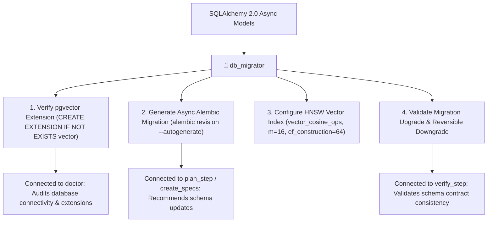

# 🗄️ DB Migrator — PostgreSQL 17, pgvector & Alembic Async Engineer

`db_migrator` is the database schema and migration assistant for **RepoDefense**. It manages SQLAlchemy 2.0 models and Alembic async migrations using the `asyncpg` driver on PostgreSQL 17 (Supabase), ensuring that relational tables and `pgvector` vector columns are created, indexed, and rolled back safely.

---

## 🎯 Architectural Role & System Connections



---

## 🧰 Canonical Alembic & pgvector Patterns

### 1. Initial Migration: Enabling `pgvector`

In your initial Alembic migration `versions/001_initial_schema.py`:

```python
from alembic import op
import sqlalchemy as sa
from pgvector.sqlalchemy import Vector

def upgrade() -> None:
    # 1. Mandatory vector extension enablement
    op.execute("CREATE EXTENSION IF NOT EXISTS vector;")
    
    # 2. Relational tables (User, Project, AnalyzedFile, CodeSymbol, Evidence)
    # ...
    
    # 3. Vector table with 384-dimensional embeddings (all-MiniLM-L6-v2)
    op.create_table(
        "code_embeddings",
        sa.Column("id", sa.String(36), primary_key=True),
        sa.Column("project_id", sa.String(36), sa.ForeignKey("projects.id", ondelete="CASCADE"), nullable=False),
        sa.Column("file_path", sa.String(512), nullable=False),
        sa.Column("chunk_content", sa.Text(), nullable=False),
        sa.Column("embedding", Vector(384), nullable=False),
        sa.Column("created_at", sa.DateTime(timezone=True), server_default=sa.func.now()),
    )
    
    # 4. HNSW Vector Index for sub-millisecond cosine similarity search
    op.execute("""
        CREATE INDEX IF NOT EXISTS ix_code_embeddings_hnsw
        ON code_embeddings
        USING hnsw (embedding vector_cosine_ops)
        WITH (m = 16, ef_construction = 64);
    """)

def downgrade() -> None:
    op.drop_table("code_embeddings")
    op.execute("DROP EXTENSION IF EXISTS vector;")
```

---

## 📋 Migration Validation Checklist

- [ ] **Asyncpg Compatibility**: Alembic configured with `async_engine` in `env.py`.
- [ ] **Vector Dimension Accuracy**: Column is strictly `Vector(384)` matching `all-MiniLM-L6-v2`.
- [ ] **HNSW Index Operator**: Index explicitly specifies `vector_cosine_ops` to match the `<=>` cosine distance operator.
- [ ] **Foreign Key Cascades**: Ingested code chunks cascade delete when a `Project` is deleted.
- [ ] **Reversible Downgrade**: Every `upgrade()` has an exact, tested `downgrade()`.

---

## 📤 Standard Migration Report

```markdown
# 🗄️ Database Migration Report — [Revision ID: Name]

### 📊 Migration Summary
- **Target Revision**: `001_initial_schema`
- **Database**: PostgreSQL 17 + pgvector (Supabase)
- **Tables Affected**: `projects`, `analyzed_files`, `code_symbols`, `code_embeddings`

### 🔍 Invariant Verification
- [x] Extension `vector` enabled: `PASSED`
- [x] Vector column dimension = 384: `PASSED`
- [x] HNSW index with `vector_cosine_ops`: `PASSED`
- [x] Clean upgrade and downgrade tested: `PASSED`

### 🚦 Verdict: MIGRATION VERIFIED & READY TO APPLY
```

---

## 🚀 Triggers

- `/db_migrator`
- `/migrate_db`
- `"Generate Alembic migration for models"`
- `"Check pgvector index and schema"`
