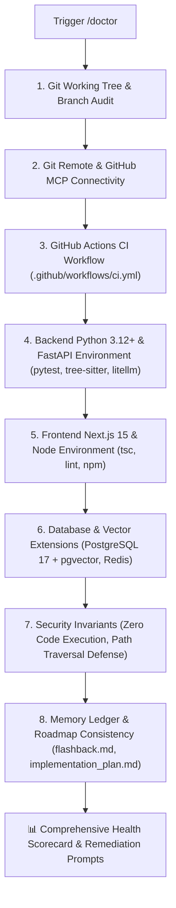

# 🩺 Doctor — Environment & Preflight Health Inspector

`doctor` is the automated preflight verification and diagnostic engine for **RepoDefense**. It audits workspace health, git remote connectivity, GitHub Actions CI workflows, backend Python & FastAPI environments, Next.js 15 frontend tooling, database vector extensions, and architectural security invariants before launching `/auto_cycle` or embarking on a new implementation phase.

---

## 🔍 Preflight Diagnostic Checklist



---

## 🛠️ Audit Vectors & Verification Commands

### 1. Git Working Tree & Branch Integrity
- **Command**: `git status -s && git branch --show-current`
- **Expected**:
  - Clean working directory (0 modified/untracked files).
  - On branch `main` before starting planning or cycle runs.
- **Remediation**:
  ```bash
  git stash # or commit active changes
  git checkout main
  git pull origin main
  ```

### 2. Git Remote & GitHub MCP Connectivity
- **Command**: `git remote -v`
- **Expected**: `origin` remote configured pointing to the user's GitHub repository.
- **Remediation**:
  ```bash
  git remote add origin https://github.com/<user>/<repo>.git
  ```

### 3. GitHub Actions CI Configuration
- **Target File**: [`.github/workflows/ci.yml`](file:///d:/RepoDefense/.github/workflows/ci.yml)
- **Expected**: Workflow present, triggering on `pull_request` and `push` to `main`, validating backend (`pytest`, `ruff`) and frontend (`tsc --noEmit`, `npm run lint`, `npm test`).
- **Why It Matters**: Prevents `ship_step` and `update-github` from hanging or timing out while polling CI status checks.

### 4. Backend Python 3.12+ & Dependency Health
- **Target**: `backend/`
- **Audit**:
  - Python version $\ge 3.12$.
  - Virtual environment activated or packages installed (`fastapi`, `pydantic`, `sqlalchemy`, `asyncpg`, `pgvector`, `tree-sitter`, `litellm`, `sentence-transformers`, `arq`, `pytest`).
- **Command**: `pytest --collect-only` (or check python modules)
- **Why It Matters**: Guarantees deterministic AST parsing and asynchronous background job processing.

### 5. Frontend Next.js 15 & TypeScript Health
- **Target**: `frontend/`
- **Audit**:
  - Node version $\ge 20$.
  - Next.js 15, React 19, TypeScript, Tailwind CSS, shadcn/ui.
- **Command**: `npx tsc --noEmit && npm run lint`
- **Why It Matters**: Prevents broken type contracts and layout regressions in the defense interface.

### 6. Database & Cache Connectivity
- **Audited by**: [`db_migrator`](file:///d:/RepoDefense/.agents/skills/db_migrator/SKILL.md)
- **Audit**:
  - PostgreSQL 17 connectivity (Supabase or local Docker Compose).
  - `pgvector` extension enabled in DB (`CREATE EXTENSION IF NOT EXISTS vector`).
  - Redis available for ARQ job queue (Upstash or local Redis container).
- **Why It Matters**: Relational data, symbol indexes, and vector embeddings rely on a single unified database.

### 7. Security & Static Analysis Invariants
- **Audited by**: [`security_auditor`](file:///d:/RepoDefense/.agents/skills/security_auditor/SKILL.md)
- **Audit**:
  - ZERO instances of `eval()`, `exec()`, or `subprocess` executing arbitrary user code.
  - Path traversal checks present in file cloning and extraction routines (`Path.is_relative_to`).
  - Secrets detection patterns present in `backend/app/security/`.
- **Why It Matters**: User repositories are untrusted input; arbitrary code execution is strictly forbidden.

### 8. Living Memory & Master Roadmap Consistency
- **Target Files**:
  - Master Roadmap: [`implementation_plan.md`](file:///d:/RepoDefense/implementation_plan.md)
  - Memory Ledger: [`.agents/memory/flashback.md`](file:///d:/RepoDefense/.agents/memory/flashback.md)
- **Audit**:
  - `flashback.md` contains all 4 canonical sections (Executive Status Snapshot, ADRs, Phase Tracker, Activity Log).
  - The next incomplete step in `implementation_plan.md` matches the active phase in `flashback.md`.

---

## 📤 Standard Diagnostic Report Output

```markdown
# 🩺 RepoDefense — Doctor Health Inspection Report

### 📊 Health Scorecard

| Check Vector | Status | Findings / Details |
| :--- | :--- | :--- |
| **Git Working Tree** | 🟢 PASS | Clean tree on `main` |
| **Remote Connectivity** | 🟢 PASS | Remote `origin` detected |
| **GitHub Actions CI** | 🟢 PASS | `.github/workflows/ci.yml` present |
| **Backend Environment** | 🟢 PASS | Python 3.12+, FastAPI, pytest & Tree-sitter verified |
| **Frontend Tooling** | 🟢 PASS | Next.js 15, TypeScript & lint verified |
| **Database & pgvector** | 🟢 PASS | PostgreSQL 17 + pgvector extension verified |
| **Security Invariants** | 🟢 PASS | Zero code execution & path traversal defense verified |
| **Roadmap & Memory** | 🟢 PASS | `flashback.md` synced with `implementation_plan.md` |

---

### 🚦 Verdict: 100% HEALTHY — Ready for /auto_cycle

All preflight diagnostics passed. The repository is configured for reliable, hands-off autonomous execution.
```

---

## 🚀 Triggers

- `/doctor`
- `/preflight`
- `"Run doctor check"`
- `"Check environment and project health"`
