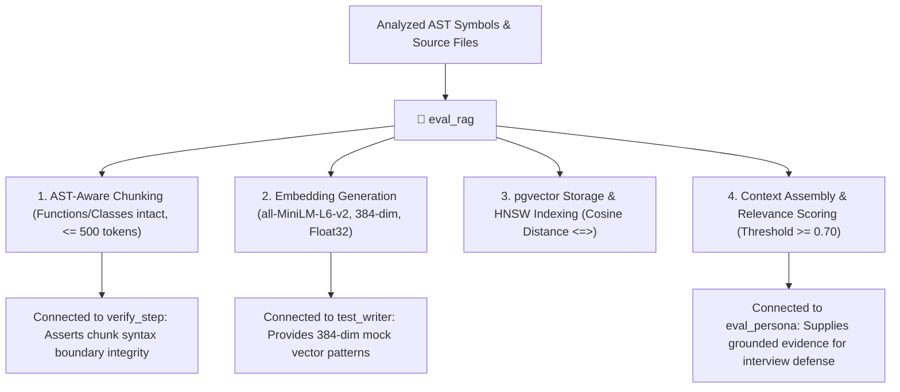

# 📐 Eval RAG — Code Chunking & pgvector Retrieval Benchmark

`eval_rag` is the retrieval quality auditor and chunking evaluator for **RepoDefense**. It guarantees that code repositories are chunked intelligently along AST syntax boundaries (never splitting a function or class in half), vectorized correctly using the local `all-MiniLM-L6-v2` model (384 dimensions), and retrieved with high semantic relevance via PostgreSQL 17 `pgvector`.

---

## 🎯 Architectural Role & System Connections



---

## 📋 Evaluation Vectors & Invariants

### 1. AST-Aware Chunking Boundaries
- **Rule**: Code must be chunked based on AST nodes (functions, methods, classes) rather than blind character or token offsets.
- **Checks**:
  - Chunks must NOT split mid-statement or cut opening/closing brackets.
  - Large functions ($> 500$ tokens) are sub-chunked logically by inner blocks or control flow statements.
  - Small helper functions within the same module are grouped into a cohesive chunk.

### 2. Embedding Vector Integrity
- **Model**: `all-MiniLM-L6-v2` via `sentence-transformers` (runs locally, zero API cost).
- **Dimension Check**: Exactly **384 dimensions**.
- **Normalization**: Vectors must be L2-normalized float32 arrays to ensure cosine similarity equals dot product.

### 3. Traceability Metadata Attachment
Every stored vector and retrieved chunk MUST include:
- `file_path`: Exact relative path in the repository (e.g. `src/services/auth.py`).
- `start_line` & `end_line`: 1-indexed line numbers.
- `symbol_name`: Name of the parent class/function if applicable.
- `language`: Target language tag (`python`, `typescript`, etc.).

### 4. Retrieval Benchmarking (`<=>` Cosine Distance)
- **SQL Operator**: PostgreSQL 17 `pgvector` cosine distance operator: `<=>`.
  ```sql
  SELECT chunk_id, file_path, start_line, end_line, content,
         1 - (embedding <=> :query_embedding) AS similarity_score
  FROM code_embeddings
  WHERE project_id = :project_id
  ORDER BY embedding <=> :query_embedding ASC
  LIMIT 5;
  ```
- **Relevance Threshold**: Discard chunks with similarity score $< 0.50$ to prevent noisy context injection.

---

## 📤 Standard RAG Evaluation Report

```markdown
# 📐 RAG Evaluation Report — [Target Project / Module]

### 📊 Benchmark Summary

| Evaluation Vector | Status | Metrics / Notes |
| :--- | :--- | :--- |
| **AST Chunk Integrity** | 🟢 PASS | 100% of chunks split at function/class boundaries |
| **Vector Dimensions** | 🟢 PASS | 384-dim L2-normalized float32 verified |
| **pgvector HNSW Index** | 🟢 PASS | `vector_cosine_ops` index active |
| **Retrieval Precision@5** | 🟢 PASS | Avg similarity score: 0.82 (Top chunk: `auth_middleware`) |
| **Context Traceability** | 🟢 PASS | All chunks include `file_path` and `line_range` |

---

### 🚦 Verdict: RAG PIPELINE CALIBRATED & ACCURATE
```

---

## 🚀 Triggers

- `/eval_rag`
- `/benchmark_rag`
- `"Evaluate code chunking and pgvector search"`
- `"Check embedding dimensions and retrieval relevance"`
