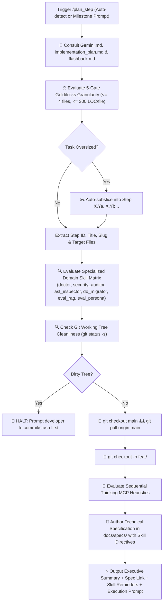

# 🚀 Plan Step — Automated Planning, Branch Provisioning & Skill Advisory Pipeline

`plan_step` is the automated front-end of the **RepoDefense** development lifecycle. It eliminates manual planning and Git branch overhead by unifying **[`next_step`](file:///d:/RepoDefense/.agents/skills/next_step/SKILL.md)**, **[`create_specs`](file:///d:/RepoDefense/.agents/skills/create_specs/SKILL.md)**, and the **Specialized Domain Skills** into a single, cohesive command.

---

## 🔄 End-to-End Pipeline Workflow



---

## 🛑 MANDATORY STOP GATE: Anti-Auto-Advance Rule

> **CRITICAL RULE**: After `/plan_step` completes branch creation, skill advisory mapping, and specification authoring, the agent **MUST IMMEDIATELY STOP** and await explicit developer approval.  
> **DO NOT** write application code.  
> **DO NOT** run `/verify_step`.  
> **DO NOT** run `/ship_step`.  
> The only exception is if the developer explicitly launched `/auto_cycle`.

---

## 🧭 Specialized Domain Skill Matrix

RepoDefense features 6 dedicated domain skills. They are not meant to run on every trivial task, but are **mandatorily activated whenever a milestone impacts their specific domain**:

| Specialized Skill | Trigger Conditions & Target Modules | Verification & Quality Impact |
| :--- | :--- | :--- |
| **[`doctor`](file:///d:/RepoDefense/.agents/skills/doctor/SKILL.md)** | Phase transitions, new third-party dependency additions, environment anomalies, pre-flight checks. | Audits Python 3.12+, Node/Next.js 15, DB connection configs, Git remote, and `.github/workflows/ci.yml`. |
| **[`security_auditor`](file:///d:/RepoDefense/.agents/skills/security_auditor/SKILL.md)** | Touches `app/security/`, `app/workers/cloner.py`, repository ingestion, external file parsing, or secret detection. | Asserts strict zero arbitrary code execution (`eval/exec`), directory traversal containment (`is_relative_to`), and secret redactions. |
| **[`ast_inspector`](file:///d:/RepoDefense/.agents/skills/ast_inspector/SKILL.md)** | Touches `app/analyzers/ast/`, Tree-sitter query patterns, symbol extractions (classes, methods, decorators, endpoints). | Validates deterministic S-expression symbol boundaries, 1-indexed line spans, and multi-language AST fixtures. |
| **[`db_migrator`](file:///d:/RepoDefense/.agents/skills/db_migrator/SKILL.md)** | Touches `app/models/`, Alembic migrations (`backend/alembic/`), table schemas, foreign keys, or vector columns. | Validates SQLAlchemy 2.0 asyncpg mappings, `Vector(384)` fields, HNSW index parameters, and migration upgrade/downgrade safety. |
| **[`eval_rag`](file:///d:/RepoDefense/.agents/skills/eval_rag/SKILL.md)** | Touches `app/analyzers/chunker.py`, `app/analyzers/embeddings.py`, or pgvector semantic search (`<=>`). | Benchmarks AST-aware chunk token boundaries, local `all-MiniLM-L6-v2` embeddings, and cosine retrieval ranking accuracy. |
| **[`eval_persona`](file:///d:/RepoDefense/.agents/skills/eval_persona/SKILL.md)** | Touches `app/ai/prompts.py`, `app/ai/fsm.py`, `app/ai/evaluator.py`, question schemas, or evaluation rubrics. | Audits Principal Engineer persona tone, XML boundary prompt injection defense, structured JSON schema conformity, and evidence grounding. |

---

## 🔒 Automated Execution Stages

### Stage 1: Reference Ingestion & Task Sizing (`next_step`)

1. Mandatorily reads all three core project references:
   - 📖 [`Gemini.md`](file:///d:/RepoDefense/Gemini.md) — Master architecture rules, static analysis invariants, 300 LOC limit.
   - 🗺️ [`implementation_plan.md`](file:///d:/RepoDefense/implementation_plan.md) — Phased master task checklists and milestones.
   - 🕰️ [`.agents/memory/flashback.md`](file:///d:/RepoDefense/.agents/memory/flashback.md) — Canonical active phase, ADRs, and recent changelog.
2. Identifies the first incomplete milestone `[ ]` or processes the developer's manual feature argument.
3. Evaluates the task against the **5-Gate Goldilocks Standard**:
   - Target files: $\le 4$ files total.
   - Code volume: $\le 300$ LOC per file (strict limit).
   - Single architectural concern.
   - 1 targeted verification command.
   - $\ge 40\%$ context window headroom.
4. If oversized, automatically sub-slices into `Step X.Ya`, `Step X.Yb`, etc.

---

### Stage 1.5: Specialized Domain Skill Assignment & Reminders

1. Evaluates target files and architecture against the **Specialized Domain Skill Matrix**.
2. Identifies which skill(s) apply to the milestone.
3. Formulates explicit reminders to present to the developer in the plan summary.
4. Mandates that the generated technical specification includes a dedicated **Specialized Skills Directive** section defining what checks must be validated during implementation and in `/verify_step`.

---

### Stage 2: Git Cleanliness & Branch Creation (`create_specs`)

1. Runs `git status -s`. If any uncommitted changes exist:
   - **HARD STOP**: Alerts developer to stash or commit changes. Halts execution.
2. Checks out latest `main` and pulls upstream:
   ```bash
   git checkout main
   git pull origin main
   ```
3. Checks existing branches (`git branch`) and creates the dedicated feature branch:
   ```bash
   git checkout -b feat/<feature-slug>
   ```

---

### Stage 3: Sequential Thinking MCP Evaluation & Spec Generation

1. Evaluates AST parsing complexity, FSM state machines, vector embedding dimensions, prompt injection defense, or complex UI synchronization:
   - Tree-sitter query cursor traversal and language grammar handling.
   - Grounding algorithms matching user claims to AST symbols.
   - Deterministic FSM state transitions (`app/ai/fsm.py`).
   - Untrusted repository input sanitization without code execution.
2. Determines destination path: `docs/specs/<feature-slug>.md`.
3. Writes production-grade technical specification markdown file with data contracts, implementation sequence, edge cases, test criteria, and **assigned specialized skill directives**.

---

## 📤 Standard Output Format

```markdown
# 📋 /plan_step Complete — [Step ID: Feature Title]

### 🧭 Project Context

- **Active Phase**: Phase X — [Phase Name]
- **Target Files**: `[backend/app/... | frontend/src/...]`
- **Granularity Sizing**: Goldilocks Verified (~[X] LOC, [N] files, ~45% context headroom reserved)

---

### 🌿 Git Feature Branch

`feat/[feature-slug]` _(Checked out and synchronized from origin/main)_

---

### 📁 Technical Specification Created

- [docs/specs/spec.md](file:///d:/RepoDefense/docs/specs/spec.md)

---

### 🩺 Specialized Domain Skill Advisory & Reminders

- **Active Skill(s) for This Milestone**: `[e.g. security_auditor | eval_persona | db_migrator | None (pure UI/glue)]`
- **Quality Checks Assigned**: `[Summary of specific checks that will be enforced in /verify_step]`
- **💡 Reminder**: _(Reminds developer to trigger the skill directly if they want pre-flight audit, e.g. "Run `/eval_persona` to audit prompt calibration.")_

---

### 🧠 Sequential Thinking MCP Recommendation

_(Appears only if task meets high complexity heuristics)_

> 🧠 **Recommendation**: Use Sequential Thinking MCP for multi-stage reasoning on **[Complex Area]** (`Approved` / `Skipped`).

---

### ⚡ Ready to Implement?

The specification is locked, specialized skill directives are registered, and the branch is clean. Would you like me to begin implementing this feature now?
```

---

## 🚀 Triggers

- `/plan_step` (Auto-locates next unchecked milestone from `implementation_plan.md`)
- `/plan_step [step-number] [feature-name]`
- `"Plan next step and create branch"`
- `"Start next feature"`
