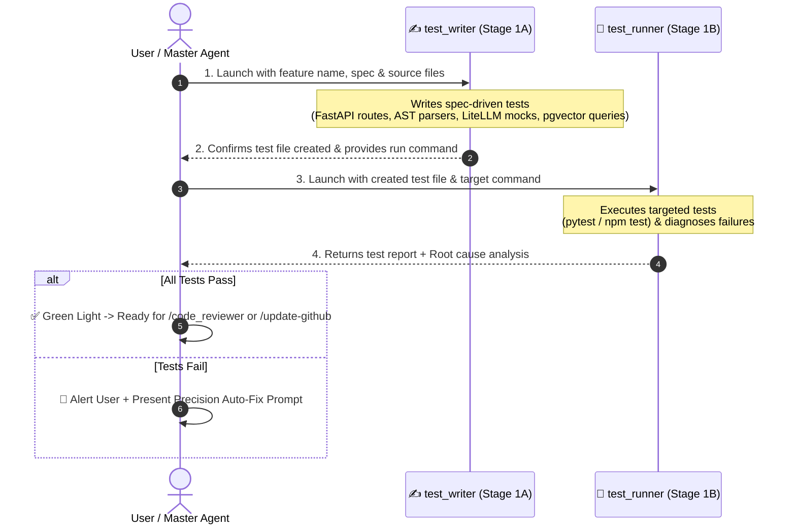

# 🧪 Test Runner — Two-Stage Test Authoring & Execution Pipeline

`test_runner` is an automated testing workflow designed to guarantee behavioral correctness, security constraints, and prevent regressions across the **RepoDefense** platform. It enforces a strict **two-stage sequential pipeline** where test authoring ([`test_writer`](file:///d:/RepoDefense/.agents/skills/test_writer/SKILL.md)) is decoupled from test execution, diagnosis, and root-cause analysis (`test_runner`).

---

## 🎯 Architecture: Two-Stage Sequential Pipeline



---

## 🔒 Strict Handoff & Safety Rules

1. **Strict Sequential Execution**: `test_runner` must NEVER start until `test_writer` has fully completed writing the test file and verified its syntax and imports.
2. **Targeted Execution**: Run ONLY the test file authored for the target feature (e.g. `pytest backend/tests/test_parsers.py -v` or `npm test -- src/components/CodeViewer.test.tsx`). Do not run unrelated full test suites during rapid iteration.
3. **Zero In-Flight Code Mutation**: Neither subagent is permitted to alter application source code during the testing pipeline. They report findings and provide an actionable fix prompt.
4. **Spec-Driven Over Implementation-Driven**: `test_writer` writes tests based on what the specifications in [`Gemini.md`](file:///d:/RepoDefense/Gemini.md), [`implementation_plan.md`](file:///d:/RepoDefense/implementation_plan.md), and `docs/specs/` require, not merely copying existing implementation quirks.
5. **Security & Zero Execution Invariants**: Tests must assert that untrusted code is never evaluated, path traversals are rejected, and secrets are redacted.
6. **Coverage Threshold Invariant**:
   - Line coverage: $\ge 80\%$
   - Branch coverage: $\ge 70\%$
7. **Timeout & Execution Guardrails**:
   - Stage 1A (`test_writer` authoring): Max 120s wall-clock time limit.
   - Stage 1B (`test_runner` execution): Max 60s per test file execution limit.

---

## 🛠️ Test Commands & Execution

All test commands align with project tools:

| Domain | Target Directory | Targeted Execution Command | Full Suite & Coverage |
| :--- | :--- | :--- | :--- |
| **Backend API & Services** | `backend/tests/` | `pytest backend/tests/test_api.py -v` | `pytest --cov=backend/app` |
| **AST Analyzers & Parsers**| `backend/tests/` | `pytest backend/tests/test_analyzers.py -v`| `pytest --cov=backend/app/analyzers` |
| **AI State Machine & LLM** | `backend/tests/` | `pytest backend/tests/test_ai_fsm.py -v` | `pytest --cov=backend/app/ai` |
| **Security & Sanitization**| `backend/tests/` | `pytest backend/tests/test_security.py -v` | `pytest --cov=backend/app/security` |
| **Frontend UI Components** | `frontend/src/**/__tests__/`| `cd frontend && npm test -- <file>.test.tsx` | `npm run test:coverage` |

---

## 🏷️ RepoDefense Failure Classification Taxonomy

When test assertions fail, classify the failure using this project-specific taxonomy:

| Failure Type | Root Cause Indicator | Typical Solution |
| :--- | :--- | :--- |
| `DB_SESSION_MOCK` | AsyncSession leaks or uncommitted rollbacks | Ensure async session fixture uses rollback in `pytest_asyncio` fixture. |
| `TREE_SITTER_PARSE_FAIL` | Syntax tree traversal error or grammar crash | Check query cursor string syntax and handle missing AST node gracefully. |
| `PGVECTOR_DIM_MISMATCH` | Embedding dimensions not 384 or cosine query error | Ensure `all-MiniLM-L6-v2` output dimensions match the `Vector(384)` column. |
| `LITELLM_MOCK_FAIL` | Mocked completion schema mismatch or rate limit error | Configure mock to return valid Pydantic JSON schema payload. |
| `ARQ_REDIS_LOCK` | Job queue execution timeout or Redis connection refused | Mock ARQ pool or use fakeredis fixture in background job tests. |
| `SECURITY_FILTER_BYPASS`| Path traversal or unredacted secret detected | Verify `Path.resolve().is_relative_to(safe_root)` and regex secret scrubbers. |
| `FASTAPI_ROUTE_ERROR` | HTTP 422 Unprocessable Entity or missing dependency | Verify Pydantic request body matches schema and dependencies are overridden. |
| `REACT_ACT_WARNING` | Component state update outside act | Wrap state updates in `await waitFor(...)` or `act(...)`. |
| `TYPE_ERROR` | Python mypy / Pydantic or TypeScript error | Resolve interface / schema attribute mismatch. |
| `ASSERTION_FAIL` | Expected value does not equal actual returned value | Business logic bug in service or incorrect test expectation. |
| `TIMEOUT` | Async operation exceeded test timeout limit | Ensure mocked async calls resolve without hanging. |

---

## 📋 Execution Procedure

### Step 1 — Authoring Tests ([`test_writer`](file:///d:/RepoDefense/.agents/skills/test_writer/SKILL.md))

Invoke `test_writer` with:
- **Feature / Target**: e.g., `backend/app/analyzers/treesitter_parser.py`
- **Spec References**: `docs/specs/<feature-slug>.md`
- **Requirements to Cover**:
  - Happy paths & standard symbol extraction
  - Boundary limits (oversized files, unsupported syntax)
  - Path traversal and security rejection
  - Error recovery & timeout fallbacks

_Wait for `test_writer` to finish before proceeding._

---

### Step 2 — Running & Diagnosing Tests (`test_runner`)

Invoke `test_runner` with:
- **Test File Path**: Path generated by `test_writer`.
- **Execution Command**: `pytest <path-to-test> -v`
- **Context Source Files**: Implementation files to inspect if failures occur.

---

## 📤 Standard Report Output Format

````markdown
# 🧪 Testing Pipeline Report — [Feature Name]

### ✍️ Step 1 — Tests Authored (test_writer)

- **Target File**: `[backend/tests/test_analyzers.py](file:///d:/RepoDefense/backend/tests/test_analyzers.py)`
- **Key Test Cases Covered**:
  - `test_python_function_extraction`: Validates function name, parameters, and line numbers.
  - `test_malformed_syntax_graceful_recovery`: Asserts parser handles syntax errors without crashing.
  - `test_path_traversal_rejection`: Asserts path outside safe root raises `SecurityException`.

---

### 🏃 Step 2 — Execution Results (test_runner)

- **Command Executed**: `pytest backend/tests/test_analyzers.py -v`
- **Results**: `5 passed, 0 failed`
- **Coverage**: `Line: 91%, Branch: 82%`

---

### 🚨 Failure Analysis & Root Cause (Only if tests fail)

#### Failure: `test_path_traversal_rejection`

- **Classification**: `SECURITY_FILTER_BYPASS`
- **Location in Code**: `[backend/app/services/cloner.py:42](file:///d:/RepoDefense/backend/app/services/cloner.py#L42)`
- **Expected**: `SecurityException` raised when path resolves outside workspace.
- **Actual**: File was opened normally.
- **Root Cause**: Missing `is_relative_to` root directory assertion.

---

### 🚦 Verdict

- [ ] ✅ **Ready for Code Review**: All tests passed without issues.
- [ ] ❌ **Needs Fixes**: See the curated fix prompt below.

---

### ⚡ Curated Auto-Fix Prompt (If tests failed)

> ```text
> Fix the failing tests in [Feature Name]:
> 1. In [backend/app/services/cloner.py:L42], add `is_relative_to` verification raising `SecurityException`.
> 2. Re-run `pytest backend/tests/test_analyzers.py -v` to confirm all assertions pass.
> ```
````

---

## 🚀 Triggers

- `/test_runner [feature-name]`
- `/test-feature [feature-name]`
- `"Run tests for tree-sitter parser"`
- `"Write and run tests for interview fsm"`
