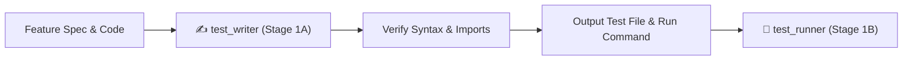

# ✍️ Test Writer — Spec-Driven Test Authoring Engine

`test_writer` is the dedicated test authoring subagent and skill for **RepoDefense**. It synthesizes robust, spec-driven unit and integration tests based on technical specifications in [`Gemini.md`](file:///d:/RepoDefense/Gemini.md), [`implementation_plan.md`](file:///d:/RepoDefense/implementation_plan.md), [`architecture.md`](file:///d:/RepoDefense/architecture.md), and `docs/specs/`.

---

## 🎯 Architecture: Role & Decoupled Execution

`test_writer` operates strictly in **Stage 1A** of the verification pipeline:

1. It receives the target feature name, specification path, and implemented source code.
2. It writes comprehensive, non-tautological tests covering happy paths, edge cases, async DB sessions, AST node extractions, and mocked LLM completions.
3. It validates syntax and imports before handing off to **`test_runner`** (Stage 1B) for execution.



---

## 🔒 Non-Negotiable Invariants & Principles

1. **Spec-Driven Over Implementation-Driven**:
   - Write tests based on what the specification requires, NOT by copying implementation bugs or quirks.
   - Never write trivial/tautological tests that assert `True is True`.
2. **Zero Arbitrary Code Execution Invariant**:
   - Tests must assert that untrusted user code is parsed via AST only and never executed via `eval()`, `exec()`, or subshells.
3. **Security & Sanitization**:
   - Tests must assert that paths outside the sandbox root raise security exceptions.
   - Tests must assert that secrets (API keys, DB tokens) are detected and redacted.
4. **Coverage Threshold Requirements**:
   - Line coverage: $\ge 80\%$
   - Branch coverage: $\ge 70\%$
5. **Hermetic & Isolated**:
   - Tests must NOT make live network calls to FreeLLMAPI, OpenAI, or external GitHub repositories.
   - Use in-memory mocks from the **RepoDefense Mock Catalog**.

---

## 🧰 RepoDefense Mock Catalog & Testing Patterns

### 1. FastAPI AsyncClient & DB Session Mock Pattern

When testing FastAPI endpoints with SQLAlchemy async sessions:

```python
import pytest
from httpx import AsyncClient, ASGITransport
from unittest.mock import AsyncMock
from app.main import app
from app.core.database import get_db

@pytest.mark.asyncio
async def test_create_project_endpoint():
    mock_session = AsyncMock()
    app.dependency_overrides[get_db] = lambda: mock_session

    async with AsyncClient(transport=ASGITransport(app=app), base_url="http://test") as ac:
        response = await ac.post("/api/projects", json={"github_url": "https://github.com/owner/repo"})

    assert response.status_code == 200
    assert response.json()["status"] == "pending"
    app.dependency_overrides.clear()
```

---

### 2. Tree-sitter AST Parser Mock & Fixture Pattern

When testing language analyzers without executing external code:

```python
import pytest
from app.analyzers.python_parser import PythonASTParser

def test_extract_symbols_from_python_code():
    code_fixture = """
class OrderService:
    @authenticate
    async def process_payment(self, amount: float) -> bool:
        return True
"""
    parser = PythonASTParser()
    symbols = parser.extract_symbols(code_fixture, file_path="services/order.py")

    assert len(symbols.classes) == 1
    assert symbols.classes[0].name == "OrderService"
    assert len(symbols.functions) == 1
    assert symbols.functions[0].name == "process_payment"
    assert "authenticate" in symbols.functions[0].decorators
```

---

### 3. LiteLLM Completion Mock Pattern

When testing AI question generation, stress-test formulation, and FSM transitions:

```python
import pytest
from unittest.mock import patch, AsyncMock
from app.ai.question_generator import generate_defense_question
from app.schemas.ai import QuestionPayload

@pytest.mark.asyncio
async def test_generate_defense_question_grounded():
    mock_response = {
        "choices": [{
            "message": {
                "content": '{"question": "Why use custom middleware?", "file_path": "middleware.ts", "symbol": "auth", "depth_target": "deep"}'
            }
        }]
    }

    with patch("litellm.acompletion", new_callable=AsyncMock) as mock_llm:
        mock_llm.return_value = mock_response
        result: QuestionPayload = await generate_defense_question(code_snippet="export function auth() {}")

        assert result.symbol == "auth"
        assert result.file_path == "middleware.ts"
        assert mock_llm.called
```

---

### 4. Local Embedding (`all-MiniLM-L6-v2`) Mock Pattern

When testing pgvector ingestion without running PyTorch models in unit tests:

```python
import pytest
from unittest.mock import MagicMock, patch
import numpy as np

def test_embed_code_chunks():
    mock_model = MagicMock()
    mock_model.encode.return_value = np.zeros((1, 384), dtype=np.float32)

    with patch("app.services.embedder.get_embedding_model", return_value=mock_model):
        from app.services.embedder import embed_text
        vector = embed_text("def hello(): pass")

        assert len(vector) == 384
        assert isinstance(vector[0], float)
```

---

### 5. ARQ Background Task Mock Pattern

When testing asynchronous ingestion tasks:

```python
import pytest
from unittest.mock import AsyncMock, patch

@pytest.mark.asyncio
async def test_enqueue_repo_ingestion():
    mock_redis = AsyncMock()
    with patch("app.workers.queue.get_arq_redis", return_value=mock_redis):
        from app.workers.queue import enqueue_ingestion
        job = await enqueue_ingestion(project_id="proj_123")

        mock_redis.enqueue_job.assert_awaited_once_with("process_repository", project_id="proj_123")
```

---

## 📋 Input & Output Contract

### Input Contract:
- `feature_name`: e.g. `step-1-7-treesitter-extractor`
- `spec_path`: `docs/specs/<feature-slug>.md`
- `source_files`: Array of implemented source files

### Output Contract:
- `test_file_path`: Path to generated test file (e.g. `backend/tests/test_analyzers.py`)
- `run_command`: Exact command line to execute the test file (e.g. `pytest backend/tests/test_analyzers.py -v`)
- `test_count`: Total number of test assertions written

---

## 🚀 Triggers

- Automatic invocation from `/verify_step` (Stage 1A)
- Automatic invocation from `/test_runner` (Step 1)
- Manual command: `/test_writer [feature-name]`
