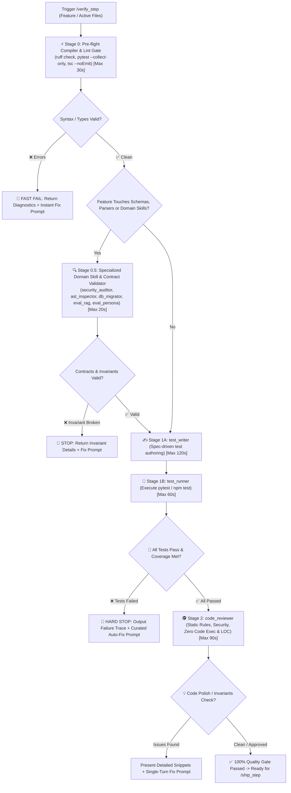

# 🧪 Verify Step — Dynamic & Static Quality Gate Pipeline

`verify_step` is the automated quality gate for **RepoDefense**. It guarantees that newly written code **actually works dynamically** (automated unit/integration tests pass with $\ge 80\%$ coverage), **conforms to database, API, and AST schemas** (Pydantic models, SQLAlchemy async models & Tree-sitter contracts), AND **is architecturally sound statically** (reviewed for zero arbitrary code execution, path traversal defense, 300 LOC limit, and evidence grounding) before any code is committed or merged into `main`.

---

## 🔄 End-to-End Pipeline Workflow



---

## 🛑 MANDATORY STOP GATE: Anti-Auto-Advance Rule

> **CRITICAL RULE**: After `/verify_step` completes compiler checks, contract validation, dynamic tests, and static code review, the agent **MUST IMMEDIATELY STOP** and present the Quality Gate Report.  
> **DO NOT** commit changes to git.  
> **DO NOT** push to GitHub.  
> **DO NOT** open a PR or merge into main.  
> **DO NOT** trigger `/ship_step` automatically.  
> Wait for the developer to review and explicitly trigger `/ship_step`. The only exception is `/auto_cycle`.

---

## 🔒 Automated Execution Stages

### Stage 0: Pre-flight Compiler & Lint Gate

Before invoking testing subagents, execute a fast static compilation sweep:

1. **Backend Python Lint & Syntax Check**:
   ```bash
   ruff check backend/app backend/tests
   pytest backend/tests/ --collect-only
   ```
2. **Frontend TypeScript & Next.js Lint**:
   ```bash
   cd frontend && npx tsc --noEmit && npm run lint
   ```
3. **Fast-Fail Gate**:
   - If syntax, import, lint, or type errors are discovered, **HALT IMMEDIATELY**.
   - Output the exact compiler errors and provide an instant fix prompt without wasting token cycles on dynamic tests.

---

### Stage 0.5: Specialized Domain Skill & Contract Validator

_(Triggered conditionally when the milestone touches schemas, analyzers, models, AI prompts, or security)_

1. **Target Modules Audited**:
   - `backend/app/schemas/`, `backend/app/models/`, `backend/app/analyzers/`, `backend/app/security/`, `backend/app/ai/`, `backend/alembic/versions/`.
2. **Domain Skill Invariants Enforced**:
   - **`security_auditor`**: Asserts strict zero dynamic code execution (`eval/exec`), path traversal containment (`Path.is_relative_to`), secret redactions, and Supabase `public` schema RLS + `anon`/`authenticated` privilege lockdown.
   - **`ast_inspector`**: Asserts Tree-sitter AST symbol boundaries preserved without mid-statement splits and exact 1-indexed line spans.
   - **`db_migrator`**: Asserts PostgreSQL 17 + `Vector(384)` schema conformity, HNSW cosine distance index parameter integrity, `public` table RLS lockdown (`ENABLE ROW LEVEL SECURITY`), and asyncpg transaction handling.
   - **`eval_rag`**: Asserts token budgeting on chunks (~500 max tokens) and pgvector cosine distance `<=>` search ranking accuracy.
   - **`eval_persona`**: Asserts Principal Engineer persona calibration, XML boundary sanitization against prompt injection, and Pydantic v2 structured output conformance.
   - **File Length Gate**: Strictly $\le 300$ LOC per file across all application and test modules.
3. If contract drift or security vulnerabilities are detected, **HALT IMMEDIATELY** and report the discrepancy before authoring tests.

---

### Stage 1: Dynamic Behavioral Verification (`test_writer` ➔ `test_runner`)

#### Stage 1A — Test Authoring ([`test_writer`](file:///d:/RepoDefense/.agents/skills/test_writer/SKILL.md)):
1. Reads target feature specification (`docs/specs/...`) and [`Gemini.md`](file:///d:/RepoDefense/Gemini.md) contracts.
2. Employs standardized module fixtures from the **RepoDefense Mock Catalog** (AsyncSession mock, Tree-sitter mock, LiteLLM mock, SentenceTransformer mock).
3. Writes tests targeting:
   - Line coverage: $\ge 80\%$
   - Branch coverage: $\ge 70\%$
4. Saves tests to `backend/tests/` or `frontend/src/**/__tests__/`.

#### Stage 1B — Test Execution (`test_runner`):
1. Runs strictly **AFTER** `test_writer` completes and validates test syntax.
2. Executes targeted test command: `pytest <path-to-test> -v` or `npm test -- <path>`.
3. Parses assertion results and coverage.
4. **Hard Failure Gate**:
   - If any test fails or coverage is unmet, **HALT IMMEDIATELY**.
   - Do NOT run `code_reviewer` on broken code.
   - Output exact file & line number, expected vs actual behavior, failure classification, and an executable auto-fix prompt.

---

### Stage 2: Static Architecture, Security & Code Quality Review ([`code_reviewer`](file:///d:/RepoDefense/.agents/skills/code_reviewer/SKILL.md))

_(Triggered only after all tests pass 100%)_

1. Inspects `git diff` against **RepoDefense Invariants**:
   - **Static Analysis Invariant**: Strictly zero arbitrary code execution (verified by [`security_auditor`](file:///d:/RepoDefense/.agents/skills/security_auditor/SKILL.md)).
   - **Untrusted Input Security**: Aggressive path traversal prevention and secret detection.
   - **File Length Gate**: $\le 300$ LOC per file.
   - **Async DB Sessions**: SQLAlchemy asyncpg transactions handled cleanly.
   - **Evidence Grounding**: Prompt templates enforce strict AST mapping (calibrated by [`eval_persona`](file:///d:/RepoDefense/.agents/skills/eval_persona/SKILL.md)).
2. Formats all suggestions with concrete line numbers, drop-in replacement snippets, and a single-turn copy-pasteable fix prompt.

---

## 📤 Standard Output Format

````markdown
# 🛡️ /verify_step Quality Gate Report — [Feature Name]

### ⚡ Stage 0 — Pre-flight Compilation & Lint

- **Commands**: `ruff check backend/app`, `pytest --collect-only`, `npx tsc --noEmit`
- **Status**: `✅ 0 type errors, 0 lint errors`

---

### 🔍 Stage 0.5 — Specialized Domain Skill & Contract Validation

- **Active Skill Checks**: `[security_auditor | ast_inspector | db_migrator | eval_rag | eval_persona | doctor]`
- **Status**: `✅ Pydantic schemas validated, zero code execution verified, <= 300 LOC verified`

---

### 🧪 Stage 1 — Dynamic Test Execution

- **Stage 1A (Authoring)**: `test_writer` generated `[backend/tests/test_feature.py](file:///d:/RepoDefense/backend/tests/test_feature.py)`
- **Stage 1B (Execution)**: `pytest backend/tests/test_feature.py -v`
- **Status**: `✅ X passed, 0 failed`
- **Coverage**: `Line: 89%, Branch: 81%`

---

### 🕵️ Stage 2 — Static Architecture & Security Review

#### 🛡️ Architecture & Invariants Audit
- [x] Zero code execution (Static analysis only): `PASSED`
- [x] Path traversal & secret redaction verified: `PASSED`
- [x] File length <= 300 lines: `PASSED`
- [x] Evidence grounding intact: `PASSED`
- [x] Parameterized SQL queries: `PASSED`

---

### 🚦 Final Quality Gate Verdict

- [ ] ❌ **BLOCKED**: Compilation, contracts, or tests failed. Run the curated fix prompt above.
- [ ] 🟢 **100% READY TO SHIP**: All tests passed, contracts verified, security checks passed, and code is clean. Ready for `/ship_step`.
````

---

## 🚀 Triggers

- `/verify_step`
- `/verify_step [feature-name]`
- `"Verify implementation and run tests"`
- `"Run full quality gate on recent changes"`
