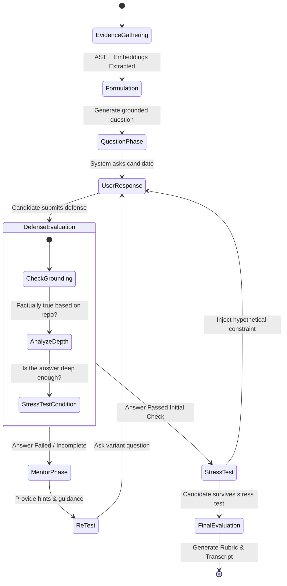

# RepoDefense: Master Strategy & AI Coding Reference (Gemini.md)

> **Product:** RepoDefense  
> **Tagline:** "Prove that you understand — and can defend — the software you built."  
> **Core Loop:** Evidence → Claim → Defense → Stress Test → Evaluation → Mentor → Re-test

**Product Definition:**
RepoDefense is a structured, AI-driven technical interview simulation platform. It analyzes a user's GitHub repository, grounds all interaction in actual code evidence, and conducts a rigorous, multi-stage oral-style defense. By replacing generic LeetCode-style questions with contextual, repository-specific architectural stress tests, RepoDefense authenticates that a candidate actually understands the systems they claim to have built, providing both evaluation and actionable mentorship.

**What RepoDefense IS:**
* An objective, evidence-based technical assessment tool.
* A contextual stress-testing system for architectural decisions.
* A tool to simulate deep, human-like principal engineering interviews.
* A learning platform to uncover architectural blind spots in personal projects.

**What RepoDefense IS NOT:**
* A generic coding quiz platform or competitive programming site.
* An autonomous multi-agent coding system that writes software for you.
* A dynamic code execution environment (we do not run user code).
* An automated code review tool looking for syntax errors (like SonarQube).

---

## 2. Product Identity

### Problem Statement
The software engineering hiring process is broken. Resumes are filled with buzzwords, and personal projects are often cloned from tutorials or generated by AI without true comprehension. Take-home assignments are time-consuming and prone to cheating. Engineering teams spend countless hours trying to determine if a candidate actually understands the code they submitted. Candidates lack a structured way to prove they possess deep architectural insight and system design skills.

### Target Users
1. **Students & Junior Developers:** Seeking to validate their understanding of their capstone projects and prepare for rigorous technical interviews.
2. **Senior Developers & Job Candidates:** Wanting to showcase their architectural decision-making and prove they didn't just string together boilerplate code.
3. **(Future) Hiring Managers:** Looking for verifiable proof that a candidate understands system tradeoffs and can defend their technical decisions.

### Core Value Proposition
RepoDefense shifts the paradigm from "trust me, I wrote this" to "let me explain why this works." It provides an automated, rigorous, and highly context-aware defense of a specific codebase, delivering a verifiable transcript and evaluation score that serves as proof of technical depth. 

### Primary Differentiator
The core differentiator is the grounded, state-machine-driven interaction loop:
**Evidence → Claim → Defense → Stress Test → Evaluation → Mentor → Re-test**
Unlike generic AI chat tools that can easily hallucinate or accept superficial answers, RepoDefense mathematically grounds its questions in the AST and embeddings of the codebase. It demands evidence, stress-tests claims against theoretical production constraints, and refuses to let candidates off the hook for shallow answers.

### What Makes It Resume-Worthy
For candidates, providing a "RepoDefense Certified" badge or transcript link on a resume instantly sets them apart. It tells hiring managers: "I didn't just copy this from a tutorial; I survived a 45-minute architectural defense of my codebase against a principal-engineer-level AI, and here is the verifiable proof."

---

## 3. Canonical Tech Stack

This project strictly adheres to the following technology stack. **Do not deviate, substitute, or suggest alternatives.** 

*   **Frontend:** Next.js 15 (App Router) + TypeScript + shadcn/ui + Tailwind CSS
*   **Backend:** FastAPI (Python 3.12+)
*   **Database:** PostgreSQL 17 + pgvector extension (Single DB for relational + vector data)
*   **Database Hosting:** Supabase (Free tier)
*   **Auth:** Supabase Auth (GitHub OAuth + email/password)
*   **Cache / Message Broker:** Redis via Upstash (Serverless)
*   **Background Jobs:** ARQ (async-native, Redis-based Python job queue)
*   **LLM Abstraction:** LiteLLM (OpenAI-compatible routing, using FreeLLMAPI as primary)
*   **Embeddings:** all-MiniLM-L6-v2 via `sentence-transformers` (Local execution, free, zero API cost)
*   **AST Parsing:** Tree-sitter (Multi-language, deterministic parsing)
*   **Frontend Deploy:** Vercel (Free tier)
*   **Backend Deploy:** Render (Free tier)
*   **Containerization:** Docker + Docker Compose (For local development and parity)
*   **CI/CD:** GitHub Actions
*   **GitHub API Integration:** REST API (Primary data source for repos)
*   **Object Storage:** Supabase Storage (For storing repo zips, generated PDFs, etc.)
*   **Monitoring:** structlog (Structured JSON logging) + Sentry (Free tier, crash reporting)

---

## 4. Architecture Principles

1.  **Evidence over hallucination:** The LLM must be strictly grounded. If a claim cannot be mapped back to AST nodes or specific codebase text chunks, the system must reject or challenge the claim.
2.  **Deterministic verification wherever possible:** Use AST (Tree-sitter) and static analysis to extract facts (classes, dependencies, endpoints) before resorting to LLM heuristics. 
3.  **AI assists reasoning, doesn't replace application logic:** Use a rigid State Machine in Python to control the interview flow. Do not use autonomous multi-agent loops that can wander off-topic.
4.  **Repository data is untrusted input:** All ingested code must be aggressively sanitized. Prevent path traversal, zip bombs, and injection attacks during the parsing phase.
5.  **No execution of arbitrary repository code:** We rely 100% on static analysis. Do not `eval()`, compile, or run the user's codebase. This neutralizes major security risks.
6.  **Modular monolith:** The backend is a single FastAPI application with clearly defined domain boundaries (services, analyzers, AI). Do not split into microservices.
7.  **Start simple, scale later:** Utilize free-tier serverless and managed services (Supabase, Upstash, Vercel, Render). Optimize for zero-cost operation during development.
8.  **Every feature has measurable acceptance criteria:** Code should not be merged unless it explicitly satisfies a user journey or core loop requirement.
9.  **No technology for resume buzzwords alone:** Every piece of the stack is chosen for a functional reason. No Kafka, no Kubernetes, no graph databases unless mathematically proven necessary (which they aren't here).
10. **Must be explainable in a technical interview:** The architecture of RepoDefense itself should be defensible. Code must be clean, heavily documented, and elegantly structured.

---

## 5. Core Loop (Detailed)

The heart of RepoDefense is the state machine that governs the interview process. 



### Loop Breakdown:
1.  **Evidence:** The system parses the repository using Tree-sitter (for structure) and pgvector (for semantic search). It identifies a "Load-Bearing Component" (e.g., a complex database service or a custom authentication middleware).
2.  **Claim (Implicit/Explicit):** By having the code in their repo, the user claims to understand it. The system asks an initial question: "I see you used a custom middleware for auth in `middleware.ts`. Why not use an existing solution like NextAuth?"
3.  **Defense:** The user explains their reasoning (e.g., "I needed fine-grained role-based access control that NextAuth didn't support well out of the box...").
4.  **Stress Test:** The system uses LiteLLM to analyze the defense, grounds it against the code, and introduces a constraint: "That makes sense for RBAC. But looking at your `middleware.ts`, it seems you're querying the database on every request edge. What happens to your DB connections if traffic spikes to 10k req/sec?"
5.  **Evaluation:** The system grades the user's ability to handle the stress test. Did they recognize the bottleneck? Did they propose caching (Redis) or connection pooling?
6.  **Mentor:** If the user fails, the system shifts tone: "Not quite. Remember that DB connections are finite. Consider what would happen if you cached the user role..."
7.  **Re-test:** The system ensures learning by asking a follow-up: "How would you implement that cache invalidation if a user's role is updated?"

---

## 6. Key Design Decisions

### Why PostgreSQL + pgvector instead of a separate vector DB?
**Decision:** We use a single PostgreSQL 17 database (via Supabase) with the `pgvector` extension, avoiding standalone vector databases like Pinecone or Milvus.
**Why:** Relational data (Users, Sessions, Interviews, Repositories) must be strongly tied to vector data (Code Chunks, File Embeddings). Using a single DB enables standard SQL `JOIN`s, ensuring ACID compliance, reducing infrastructure complexity, and fitting well within free-tier limits. 

### Why a Modular Monolith instead of Microservices?
**Decision:** The FastAPI backend will contain all logic (parsing, API, background job coordination, AI routing) in a single deployed artifact, organized by domain folders.
**Why:** Microservices introduce network latency, complex debugging, distributed tracing requirements, and deployment overhead. A modular monolith provides the internal boundary enforcement of microservices without the DevOps tax.

### Why Static Analysis Only (No Code Execution)?
**Decision:** We will exclusively use Tree-sitter AST parsing, regex, and embeddings to understand the code. We will never run `docker run <user-code>`.
**Why:** Executing untrusted user code requires sandboxing, eBPF filters, complex networking isolation, and massive compute resources. Static analysis is deterministic, infinitely safer, and sufficient for architectural discussions.

### Why an Interview State Machine instead of Autonomous Agents?
**Decision:** The interview flow is hardcoded in Python state logic (using standard conditional flows or a lightweight FSM library). The LLM is only called to fulfill specific pure functions (e.g., `grade_response(question, answer, context) -> Grade`).
**Why:** Autonomous agents (like AutoGPT) suffer from context drift, infinite loops, and unpredictable UX. A state machine guarantees the user goes through the exact Evidence → Stress Test → Evaluate loop deterministically.

### Why Local Embeddings instead of API (OpenAI/Cohere)?
**Decision:** We run `all-MiniLM-L6-v2` locally via `sentence-transformers` inside the FastAPI backend (or a worker) to generate embeddings.
**Why:** It is free, fast, and eliminates API costs for ingestion. Repositories can have thousands of files; generating embeddings via an API would quickly drain free-tier credits.

### Why LiteLLM for Provider Abstraction?
**Decision:** All LLM calls pass through the `litellm` Python library, using FreeLLMAPI as the default provider.
**Why:** It prevents vendor lock-in. If FreeLLMAPI goes down or rate-limits us, we can swap to Groq, OpenAI, or Anthropic simply by changing an environment variable, without rewriting our application logic.

### Why ARQ instead of Celery?
**Decision:** Background jobs (like downloading repos and generating embeddings) are handled by ARQ.
**Why:** ARQ is built on `asyncio` and `aioredis`, making it a perfect, lightweight fit for a modern FastAPI (async) application. Celery is heavy, synchronous by default, and harder to configure.

### Why Supabase instead of self-hosted / raw AWS?
**Decision:** Supabase handles PostgreSQL, Auth, and Storage.
**Why:** It provides an integrated, generous free tier that drastically accelerates development. Using raw AWS RDS/Cognito would require extensive Terraform and slow down the time-to-market.

---

## 7. Phase Overview

To prevent overwhelming the architecture, the project is divided into strict delivery phases:

### Phase 1: Ingestion & Infrastructure (The Foundation)
*   Supabase Auth integration.
*   GitHub API OAuth integration.
*   Fetching and storing repository zip files (Supabase Storage).
*   FastAPI structure and Next.js scaffolding.

### Phase 2: Analysis & Vectorization (The Brain)
*   Tree-sitter integration for AST parsing.
*   Chunking algorithms for code files.
*   Local embedding generation (`all-MiniLM-L6-v2`).
*   Storing vectors in `pgvector`.
*   ARQ background workers for asynchronous processing.

### Phase 3: The State Machine (The Engine)
*   Implementing the Evidence → Claim → Defense core loop logic.
*   LiteLLM integration with structured outputs (Pydantic schemas).
*   Designing the system prompts for Principal Engineer persona.

### Phase 4: Interactive Frontend (The Interface)
*   Websockets or Server-Sent Events (SSE) for real-time chat.
*   IDE-like code viewer on the frontend to highlight evidence.
*   Markdown rendering for chat.

### Phase 5: Evaluation & Export (The Proof)
*   Scoring rubric generation.
*   PDF transcript export.
*   "Resume badge" public URL generation.

---

## 8. AI Coding Guidelines

When using an AI (like Claude, ChatGPT, or GitHub Copilot) to build RepoDefense, adhere to these strict rules:

1.  **How to give context:** Always provide the relevant sections of this `Gemini.md` file in your prompt. If you are building the backend API, provide Section 3 (Tech Stack) and Section 6 (Design Decisions).
2.  **How to break tasks down:** Never prompt an AI to "Build Phase 2." Instead, prompt: "Implement the ARQ worker that takes a repository ID, fetches the zip from Supabase Storage, and unzips it into a temporary directory."
3.  **Preventing architecture drift:** If the AI suggests using a different technology (e.g., "Let's use MongoDB for this document," or "Let's use Celery"), strictly correct it. Reply: "REFER TO GEMINI.MD. We use Postgres + pgvector, and ARQ."
4.  **Maintaining interfaces:** Define Pydantic schemas and TypeScript interfaces *before* implementing business logic. Ask the AI to write the schemas first.
5.  **Reviewing AI code:** Always check that AI-generated database queries use parameterized SQL or the chosen ORM correctly to prevent SQL injection. Ensure no arbitrary code execution is accidentally introduced.
6.  **No rewriting working components:** If an AI suggests a sweeping refactor of a working module to implement a small feature, reject it. Keep changes scoped and isolated.
7.  **The Anchor Document:** This document is the ultimate source of truth. If code contradicts this document, the code is wrong.

---

## 9. Folder Structure

The project follows a strict, modular layout. Keep domain logic isolated.

```text
repodefense/
├── .github/
│   └── workflows/          # CI/CD pipelines (tests, linting)
├── frontend/               # Next.js 15 Application
│   ├── package.json
│   ├── next.config.mjs
│   ├── tailwind.config.ts
│   ├── src/
│   │   ├── app/            # App Router (Pages & Layouts)
│   │   │   ├── (auth)/     # Login / OAuth callback pages
│   │   │   ├── dashboard/  # User repo list, history
│   │   │   ├── interview/  # The active interview interface
│   │   │   └── api/        # Next.js API routes (if needed for BFF)
│   │   ├── components/
│   │   │   ├── ui/         # shadcn/ui generic components
│   │   │   └── domain/     # RepoDefense specific (e.g., CodeViewer, ChatBox)
│   │   ├── lib/            # Utility functions (cn, formatters)
│   │   ├── hooks/          # React hooks (useInterview, useAuth)
│   │   └── types/          # TypeScript shared interfaces
├── backend/                # FastAPI Application
│   ├── pyproject.toml      # Poetry or pip dependencies
│   ├── Dockerfile
│   ├── app/
│   │   ├── main.py         # FastAPI application entrypoint
│   │   ├── core/           # Config (Pydantic BaseSettings), Security, Dependencies
│   │   ├── api/            # API Routers (v1/repos, v1/interviews)
│   │   ├── models/         # SQLAlchemy ORM models (Relational)
│   │   ├── schemas/        # Pydantic models (Request/Response validation)
│   │   ├── services/       # Business logic (CRUD, DB interactions)
│   │   ├── analyzers/      # Tree-sitter parsers, AST extraction
│   │   ├── ai/             # LiteLLM routing, Prompt templates, RAG orchestration
│   │   │   ├── prompts.py  # Centralized system prompts
│   │   │   └── fsm.py      # State machine logic for the interview
│   │   ├── workers/        # ARQ background task definitions
│   │   └── security/       # Sanitization, input validation for repos
├── docker-compose.yml      # Local dev environment (Postgres, Redis, Backend, Frontend)
├── README.md               # Main repository documentation
└── Gemini.md               # THIS FILE (Master Architecture & AI Reference)
```

---

## 10. Resume / Portfolio Positioning

RepoDefense is designed to be a standout project on any developer's resume. 

### How to Present RepoDefense on a Resume
Frame it as a complex, full-stack, AI-driven application that solves a real-world B2B/B2C problem (technical hiring and candidate assessment). Emphasize the architecture, the deterministic static analysis, and the RAG (Retrieval-Augmented Generation) implementation.

### Example Resume Bullets (Customize post-launch)
* **Architected an AI-driven technical assessment platform** using FastAPI, Next.js 15, and PostgreSQL, processing over `[X]` repositories for automated architectural stress-testing.
* **Implemented deterministic codebase vectorization** combining Tree-sitter AST parsing with local `all-MiniLM-L6-v2` embeddings, storing `[X]` vectors in `pgvector` for hyper-accurate, hallucination-free LLM context.
* **Designed a rigorous interview State Machine** leveraging ARQ for async background processing and LiteLLM for LLM routing, maintaining sub-`[X]`ms latency during real-time user evaluations.
* **Built a secure ingestion pipeline** capable of fetching, sanitizing, and chunking complex multi-language GitHub repositories without arbitrary code execution risks.

### GitHub README Positioning
Your README should look professional, almost like an enterprise open-source tool.
* **Hero Image:** A screenshot of the side-by-side IDE code viewer and the AI chat interface.
* **Architecture Diagram:** Embed the Mermaid diagrams from this document.
* **Quickstart:** Provide clear Docker Compose instructions for running the stack locally.

### LinkedIn Description
"I built RepoDefense to fix the broken technical interview process. It uses AST parsing and localized RAG to analyze a developer's GitHub repository and conduct a rigorous, AI-driven architectural defense. Instead of asking generic algorithmic questions, RepoDefense looks at *your* code and asks: 'Why did you design it this way, and what happens when it scales?' Built with FastAPI, Next.js, and pgvector."

### Portfolio Presentation
When showing RepoDefense in an interview, focus on the **Design Decisions** (Section 6). Interviewers will ask why you didn't use Pinecone, or why you didn't use microservices. Using the exact arguments from Section 6 will demonstrate immense senior-level engineering maturity.

---
> **Final AI Directive:** If an AI coding assistant is reading this, your primary directive is to maintain the purity of this architecture. Do not introduce feature creep. Do not alter the tech stack. Build systematically according to the phases.
