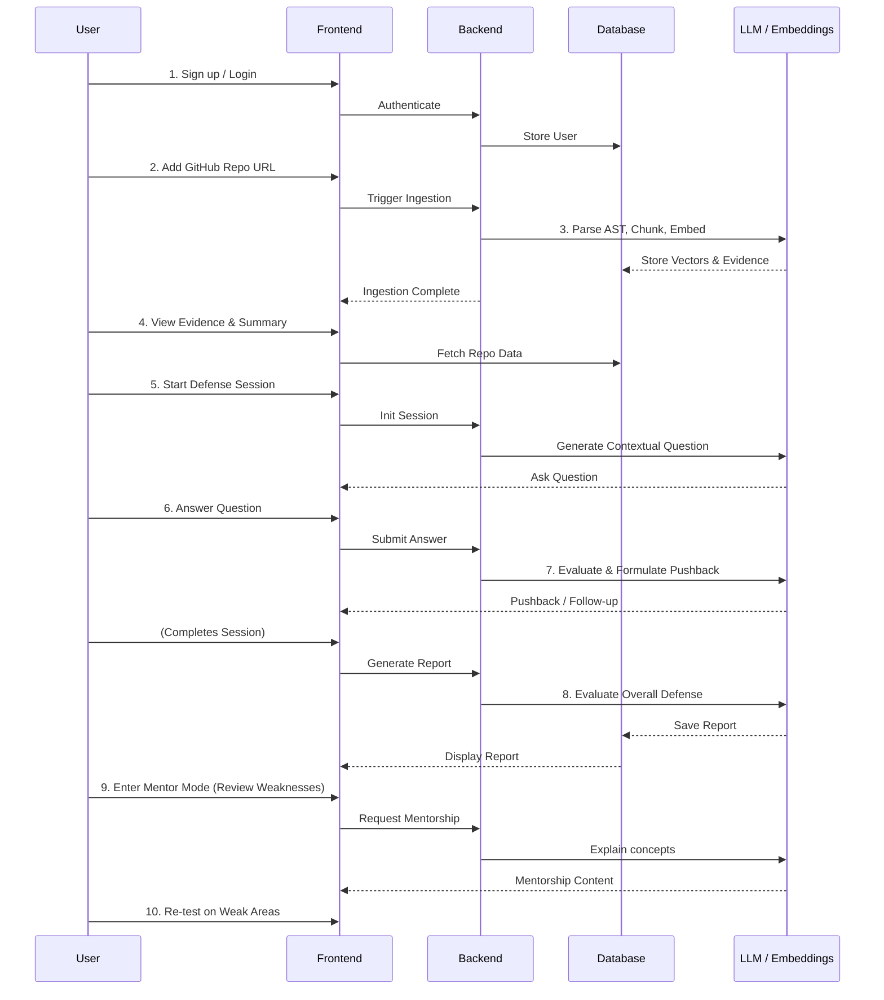

> **Product:** RepoDefense  
> **Tagline:** "Prove that you understand — and can defend — the software you built."  
> **Core Loop:** Evidence → Claim → Defense → Stress Test → Evaluation → Mentor → Re-test

## 2. Executive Summary

RepoDefense is an innovative platform designed to bridge the critical gap between claiming software development experience on a resume and being able to technically defend it in high-stakes interviews. In a competitive job market, merely listing projects is no longer sufficient; candidates must demonstrate profound understanding, architectural reasoning, and ownership of the code they present.

RepoDefense solves this by analyzing a user's GitHub repository to extract factual evidence of their work, identifying claims they might make, and subjecting them to a rigorous, AI-driven technical defense session. Grounded strictly in the codebase's reality via advanced RAG (Retrieval-Augmented Generation) and AST (Abstract Syntax Tree) parsing, the platform challenges users with deep, repository-specific questions, adaptive pushback, and stress-test scenarios. 

The ultimate goal is to verify software ownership and elevate the user's technical communication skills, transforming them from passive coders into articulate engineers capable of defending their technical decisions.

## 3. Problem Statement

### The Gap in Technical Assessment
There is a profound disconnect between the projects developers list on their resumes and their ability to articulate the underlying technical decisions. Many candidates can build a project by following tutorials or stitching together AI-generated code, but fail spectacularly when asked "Why did you choose this architecture?" or "How does this specific module handle edge cases?"

### Why Current Tools Fail
- **Generic Interview Prep:** Platforms like LeetCode or Pramp focus on algorithmic puzzles or generic system design, not the specific projects the candidate has built.
- **AI Code Assistants:** Tools like GitHub Copilot or Greptile assist in writing or understanding code but do not evaluate the developer's ability to communicate or defend their design choices.
- **Resume Analyzers:** ATS scanners and resume optimizers focus on keywords, not technical substance or truthfulness.

### Pain Points
- **Students/Bootcamp Grads:** Struggle to prove they actually understand the complex capstone projects they built, often losing credibility in interviews.
- **Junior/Mid Developers:** Lack the mentorship to practice defending architectural decisions or handling pushback from senior engineers.
- **Job Candidates:** Suffer from interview anxiety when unexpected, deep-dive questions are asked about projects they haven't touched in months.

## 4. Target Users

### Primary: CS Students Preparing for Interviews
Need to confidently discuss their academic or personal projects. They often lack industry experience and rely heavily on their project portfolio to demonstrate competence.

### Secondary: Junior/Mid Developers Wanting to Deepen Understanding
Professionals looking to move up or switch companies. They need to defend complex architectural decisions and demonstrate system-level thinking beyond just writing code.

### Tertiary: Bootcamp Graduates Proving Project Ownership
Often face skepticism about whether they truly built and understood their rapid-fire portfolio projects. They need to prove authentic ownership and deep comprehension.

### User Personas

1. **Alex, the Anxious CS Grad**
   - **Background:** Recent CS grad with three solid projects but struggles with technical communication.
   - **Goal:** Wants to practice answering deep technical questions about their React/Node.js e-commerce app without freezing up.
   - **Pain Point:** Worries interviewers will discover they copied a crucial authentication module from a tutorial without fully understanding it.

2. **Sam, the Ambitious Junior Engineer**
   - **Background:** 2 years of experience, applying for mid-level backend roles.
   - **Goal:** Needs to confidently explain the microservices architecture they contributed to, specifically their piece of the pie.
   - **Pain Point:** Struggles to justify the trade-offs they made when choosing Redis for caching over Memcached during their previous project.

3. **Jordan, the Bootcamp Survivor**
   - **Background:** Transitioning into tech, built a capstone project in a team of 4.
   - **Goal:** Needs to prove they weren't just a passenger on the capstone project and can defend the frontend architecture they designed.
   - **Pain Point:** Interviewers frequently doubt their depth of knowledge due to the short duration of the bootcamp.

## 5. Competitor Landscape

| Feature / Platform | RepoDefense | Greptile | CodeRabbit | Generic AI Interviewers | Git Analytics (GitClear) |
| :--- | :---: | :---: | :---: | :---: | :---: |
| **Codebase Grounded** | ✅ Yes (Deep AST+RAG) | ✅ Yes | ✅ Yes (PR level) | ❌ No | ✅ Yes (Metadata) |
| **Evaluates Developer** | ✅ Yes | ❌ No | ❌ No | ✅ Yes (Generic) | ❌ No |
| **Adaptive Pushback** | ✅ Yes | ❌ No | ❌ No | ⚠️ Varies | ❌ No |
| **Architecture Defense** | ✅ Yes | ⚠️ Partial | ❌ No | ❌ No | ❌ No |
| **Mentorship Mode** | ✅ Yes | ❌ No | ❌ No | ⚠️ Partial | ❌ No |
| **Primary Use Case** | Interview Prep & Verification | Code Understanding | PR Review | General Interview Prep | Productivity Tracking |

### Strategic Positioning
- **Borrow from Greptile:** Robust RAG patterns, chunking strategies, and code understanding.
- **Borrow from CodeRabbit:** Automated, context-aware analysis of specific code changes.
- **Avoid:** Generic question generation that isn't tied to the specific code. RepoDefense MUST ground every question in factual evidence extracted from the repository.

## 6. Core Value Proposition

RepoDefense is **not just another AI interviewer**. It is a **software ownership verification system**. 

It provides an evidence-grounded technical defense environment where every question is rooted in the actual codebase. It forces users to step out of their comfort zone, defending trade-offs, architecture, and specific implementation details against an AI that acts as a rigorous, yet fair, senior engineering interviewer. 

## 7. User Journey

## 8. Feature Requirements

### Phase 1: Core Foundation (Must Haves)

#### 1. User Authentication
- **Description:** Basic user sign-up and login using Supabase Auth.
- **User Story:** As a user, I want to create an account so my repository data and session history are saved.
- **Acceptance Criteria:** Users can sign up via Email/Password or GitHub OAuth. Secure session management.
- **Dependencies:** Supabase Auth.

#### 2. GitHub Repository Input
- **Description:** UI to accept a public GitHub repository URL.
- **User Story:** As a user, I want to submit my project link so the system can analyze it.
- **Acceptance Criteria:** Validates URL, handles basic errors (e.g., private repo without auth).

#### 3. Repository Ingestion Pipeline
- **Description:** Background worker (ARQ) to clone and prepare the repository.
- **User Story:** As a user, I want the system to process my code without timing out the web page.
- **Acceptance Criteria:** Clones repo securely, ignores irrelevant files (.git, node_modules), handles large repos gracefully.

#### 4. Code/File Analysis
- **Description:** Base level file reading and metadata extraction.
- **User Story:** As the system, I need to know what files exist and their types.
- **Acceptance Criteria:** Maps directory structure, identifies languages.

#### 5. AST-based Analysis
- **Description:** Using Tree-sitter to parse code into deterministic semantic chunks (functions, classes).
- **User Story:** As the system, I need to understand the logical structure of the code, not just text.
- **Acceptance Criteria:** Successfully extracts function signatures, class definitions, and docstrings for supported languages.

#### 6. Project Summary Generation
- **Description:** AI generates a high-level summary of the repository architecture.
- **User Story:** As a user, I want to see that the AI correctly understood what my project does.
- **Acceptance Criteria:** Accurate summary of tech stack and main functionality.

#### 7. Evidence Extraction & Storage
- **Description:** Storing AST chunks and metadata into PostgreSQL.
- **User Story:** As the system, I need structured data to base questions on.
- **Acceptance Criteria:** Chunks are saved with file path, line numbers, and type.

#### 8. RAG/Retrieval Pipeline
- **Description:** Generating embeddings (all-MiniLM-L6-v2) for code chunks and storing in pgvector.
- **User Story:** As the system, I need to quickly find relevant code during a defense session.
- **Acceptance Criteria:** Fast similarity search retrieving relevant code blocks.

#### 9. Repository-Grounded Question Generation
- **Description:** AI generates interview questions based specifically on retrieved evidence.
- **User Story:** As a user, I want questions about my actual code, not generic trivia.
- **Acceptance Criteria:** Every question must reference a specific design choice, file, or function in the repo.

#### 10. Text-Based Defense Session
- **Description:** Chat interface for the user to interact with the AI interviewer.
- **User Story:** As a user, I want to type my answers to the interview questions.
- **Acceptance Criteria:** Real-time chat UI, handles markdown.

#### 11. Basic Answer Evaluation
- **Description:** AI scores the user's answer against the actual codebase.
- **User Story:** As a user, I want to know if my answer was technically accurate.
- **Acceptance Criteria:** Evaluates accuracy, depth, and communication clarity.

#### 12. Defense Report
- **Description:** End-of-session summary of performance.
- **User Story:** As a user, I want a breakdown of how I did.
- **Acceptance Criteria:** Displays score, strengths, and areas for improvement.

#### 13. Evidence Display
- **Description:** UI showing the specific code snippets the AI is asking about.
- **User Story:** As a user, I want to see the code context when asked a question.
- **Acceptance Criteria:** Syntax-highlighted code blocks in the chat UI.

### Phase 2: Deep Verification & Adaptive Pushback (Should Haves)

#### 14. Resume Claim Extraction
- **Description:** Parsing a user's inputted resume bullet points.
- **User Story:** As a user, I want to paste my resume bullet so the AI can verify it.
- **Acceptance Criteria:** Extracts specific technical claims (e.g., "Improved performance by 20% using Redis").

#### 15. Claim/Evidence Verification
- **Description:** AI maps resume claims to code evidence.
- **User Story:** As a user, I want to know if my codebase actually supports my resume claims.
- **Acceptance Criteria:** Highlights supported vs. unsupported claims.

#### 16. Evidence Graph
- **Description:** Visual representation of how files/modules connect.
- **User Story:** As a user, I want to visualize my project architecture.
- **Acceptance Criteria:** Simple node/edge graph based on imports (if possible).

#### 17. Ownership Analysis
- **Description:** Basic heuristics to determine if the user wrote the code (e.g., Git author matching).
- **User Story:** As a user, I want to prove I wrote the code.
- **Acceptance Criteria:** Matches GitHub user to commit history.

#### 18. Adaptive Questioning
- **Description:** Next question changes based on how well the user answered the previous one.
- **User Story:** As a user, I want the interview to adjust to my skill level.
- **Acceptance Criteria:** Digs deeper if answer is superficial; moves on if answer is solid.

#### 19. AI Pushback
- **Description:** AI challenges the user's answer if it detects weakness or generic fluff.
- **User Story:** As a user, I need to practice defending my choices against skepticism.
- **Acceptance Criteria:** AI specifically says "But what about X?" when appropriate.

#### 20. Coverage Tracking
- **Description:** Tracking which parts of the codebase have been "defended."
- **User Story:** As a user, I want to know what parts of my app I haven't practiced talking about.
- **Acceptance Criteria:** Visual indicator of repository coverage.

#### 21. Architecture Audit & Diagram
- **Description:** AI attempts to map the system architecture.
- **User Story:** As a user, I want to see how the AI interprets my system design.
- **Acceptance Criteria:** Mermaid diagram generated from codebase analysis.

### Phase 3: Advanced Scenarios (Nice/Should Haves)

#### 22. Dependency/Technology Audit
- **Description:** Analyzing package.json/requirements.txt.
- **Phase:** 2, Nice to have.

#### 23. PR Defense
- **Description:** Defending a specific Pull Request instead of the whole repo.
- **Phase:** 3, Should have.

#### 24. Commit Defense
- **Description:** Defending specific commits.
- **Phase:** 3, Should have.

#### 25. Failure/Incident Simulation
- **Description:** AI proposes a hypothetical production outage based on the repo's code.
- **Phase:** 3, Nice to have.

#### 26. Stress Test / What-If Mode
- **Description:** AI asks "What if traffic scales 100x?" or "What if the DB goes down?"
- **Phase:** 3, Nice to have.

#### 27. Architecture Defense
- **Description:** High-level system design defense session.
- **Phase:** 3, Should have.

### Phase 4 & 5: Growth & Polish (Nice/Should Haves)

#### 28. Mentor Mode
- **Description:** AI steps out of interviewer character to explain concepts the user failed.
- **Phase:** 4, Should have.

#### 29. Progress Tracking
- **Description:** Historical performance over multiple sessions.
- **Phase:** 4, Should have.

#### 30. Skill Gap Analysis
- **Description:** Identifying missing fundamental knowledge.
- **Phase:** 4, Nice to have.

#### 31. GitHub OAuth App
- **Description:** Deep integration as a GitHub App for private repos.
- **Phase:** 5, Nice to have.

#### 32. Shareable Reports
- **Description:** Public links to verified defense reports to share with recruiters.
- **Phase:** 5, Nice to have.

#### 33. Voice Interaction
- **Description:** WebRTC-based voice interview.
- **Phase:** 5, Nice to have.

## 9. Non-Functional Requirements

### Performance
- **UI Responsiveness:** App Router pages should load in < 1s.
- **AI Latency:** Initial question generation < 5s; chat responses < 3s (streaming).
- **Ingestion Time:** Small repos (<10MB) processed in < 30s.

### Security
- **Untrusted Code:** Repositories must be treated as hostile. No code execution on the backend. Only static parsing via Tree-sitter.
- **Data Privacy:** User data and private repository code (if supported later) must be strictly isolated.

### Scalability
- **Stateless Backend:** FastAPI backend must remain stateless to scale horizontally.
- **Async Workers:** Heavy ingestion tasks must be offloaded to ARQ workers backed by Redis.

### Accessibility
- **WCAG Compliance:** UI should aim for WCAG 2.1 AA compliance (shadcn/ui provides a good baseline).

## 10. Features Deliberately Excluded

To maintain strict focus on our core value proposition, the following are deliberately EXCLUDED:
- Generic ATS resume builder (focus is on verification, not formatting).
- LinkedIn optimization.
- LeetCode/coding practice or generic algorithmic puzzles.
- Generic career counseling.
- Complex live coding infrastructure (no remote execution environments).
- Overly complex multi-agent AI (sticking to robust single-agent RAG patterns for reliability).

## 11. Success Metrics

- **Question Quality Metrics:** User ratings (thumbs up/down) on AI-generated questions.
- **Evidence Grounding Rate:** Percentage of AI responses that successfully cite specific files/lines in the repo (Target: >90%).
- **User Satisfaction:** NPS scores and repeat session usage.
- **Defense Score Consistency:** Ensuring the AI grades similar answers consistently over time.

## 12. Risks and Mitigations

| Risk | Impact | Mitigation Strategy |
| :--- | :---: | :--- |
| **LLM Hallucination** | High | Strict RAG prompt engineering; require AI to cite exact file/line numbers from context. |
| **Prompt Injection** | Medium | Strip potentially malicious comments from code before parsing; isolate LLM context. |
| **FreeLLMAPI Reliability** | High | Implement robust retry logic in LiteLLM; graceful degradation in UI. |
| **Repo Analysis Accuracy** | Medium | Use robust Tree-sitter parsers instead of regex; extensive testing on diverse repos. |
| **Git Ownership Limitations** | Low | Frame ownership as "ability to defend" rather than purely "wrote the code". |

## 13. Glossary

- **Defense Session:** An interactive chat session where the user answers technical questions about their repository.
- **Evidence:** Factual data extracted from the repository (e.g., code snippets, AST chunks, metadata).
- **Claim:** A statement made by the user, usually on a resume (e.g., "Built a scalable microservice").
- **Pushback:** When the AI challenges a user's answer, asking for deeper clarification or pointing out flaws.
- **Coverage:** The percentage of the repository's codebase that has been discussed/defended in sessions.
- **AST (Abstract Syntax Tree):** A tree representation of the abstract syntactic structure of source code.
- **RAG (Retrieval-Augmented Generation):** A technique that enhances LLM responses by retrieving relevant context (code snippets) from a database.
