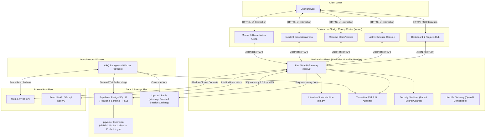
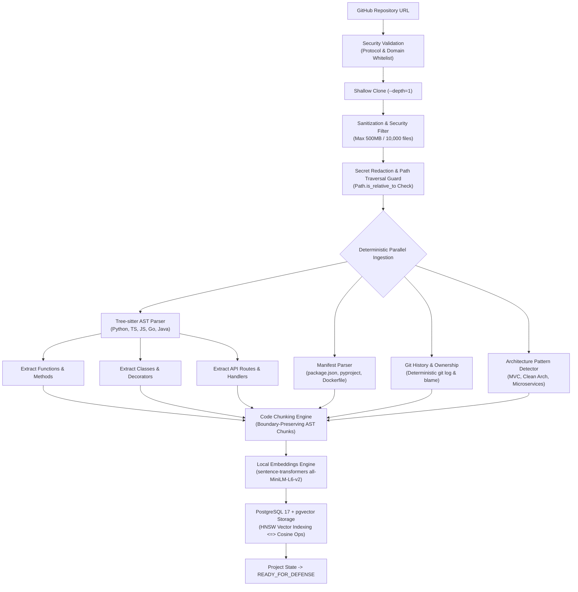
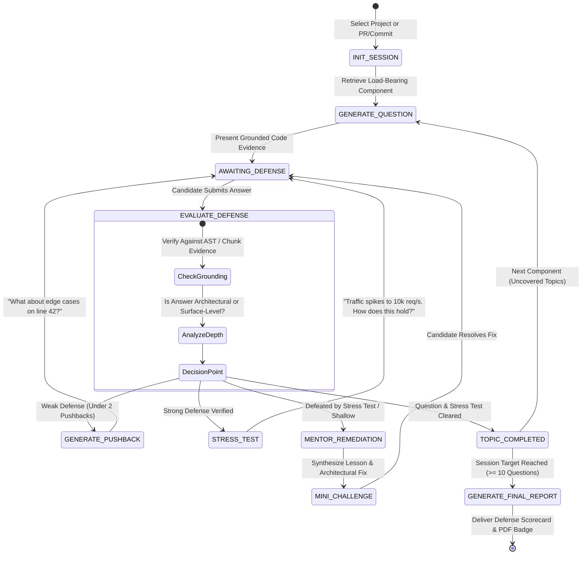
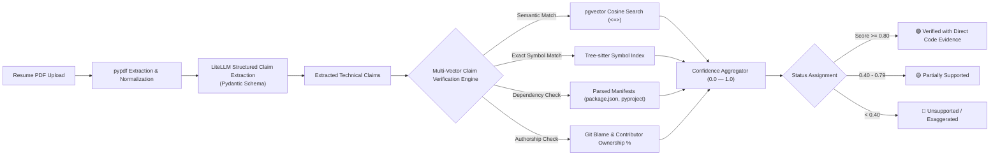
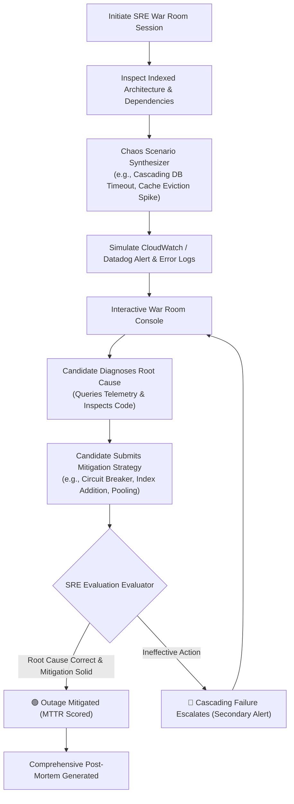

# 🛡️ RepoDefense

<div align="center">

**Prove that you understand — and can defend — the software you built.**

*An evidence-grounded, AI-driven technical interview simulation and software ownership verification platform.*

[](LICENSE)
[](https://www.python.org/)
[](https://fastapi.tiangolo.com/)
[](https://nextjs.org/)
[](https://www.typescriptlang.org/)
[](https://github.com/pgvector/pgvector)
[](https://tree-sitter.github.io/)
[](https://arq-docs.helpmanual.io/)
[](https://github.com/BerriAI/litellm)

---

[Key Features](#-key-features) • [System Architecture](#-system-architecture) • [Core Loop](#-the-core-defense-loop) • [Interactive Flow Diagrams](#-interactive-flow-diagrams) • [Tech Stack & ADRs](#-canonical-tech-stack--adrs) • [Directory Structure](#-directory-structure) • [Quickstart](#-quickstart--local-setup) • [API Reference](#-api-endpoints-overview) • [Security](#-security--untrusted-code-invariants)

</div>

---

## 📌 Executive Summary

The software engineering hiring process is broken. Resumes are filled with buzzwords, take-home projects are copied from tutorials or synthesized by AI, and LeetCode puzzles fail to evaluate whether a developer understands the systems they claim to have built.

**RepoDefense shifts the paradigm from *"Trust me, I built this"* to *"Let me explain why this works, why I chose this architecture, and how it handles 10,000 req/s."***

By statically parsing a candidate's GitHub repository using **Tree-sitter ASTs** and local **pgvector semantic search**, RepoDefense grounds every question in actual code evidence. It conducts a multi-stage, oral-style defense with an adaptive **Principal Engineer AI Persona**, stress-tests claims against real production constraints, tracks coverage, identifies blind spots, and provides remediation mentorship.

### What RepoDefense Is vs. What It Is Not

| Capability | RepoDefense | Generic AI Interviewers | LeetCode / Pramp | SonarQube / Linters |
| :--- | :---: | :---: | :---: | :---: |
| **Grounded in Candidate's Actual Codebase** | ✅ **100% Deterministic AST & RAG** | ❌ Hallucinated / Generic | ❌ Synthetic puzzles | ⚠️ Syntax/static issues only |
| **Architectural Trade-Off Defense** | ✅ **Yes (State Machine Governed)** | ⚠️ Unstructured Chat | ❌ No | ❌ No |
| **Zero Arbitrary Code Execution** | ✅ **Safe (Static analysis only)** | ⚠️ Varies | ❌ Executes untrusted code | ✅ Safe |
| **Production Stress-Testing & SRE War Room** | ✅ **Yes (Chaos & Scaling Scenarios)** | ❌ No | ❌ No | ❌ No |
| **Resume Claim Cross-Verification** | ✅ **Evidence Link to AST & Commits** | ❌ No | ❌ No | ❌ No |
| **Adaptive Mentorship & Mini-Challenges** | ✅ **Yes (Remediation Mode)** | ⚠️ Generic tips | ❌ Editorial only | ❌ No |

---

## 🔄 The Core Defense Loop

RepoDefense is strictly governed by a deterministic state machine:

$$\text{Evidence} \longrightarrow \text{Claim} \longrightarrow \text{Defense} \longrightarrow \text{Stress Test} \longrightarrow \text{Evaluation} \longrightarrow \text{Mentor} \longrightarrow \text{Re-Test}$$

1. **Evidence:** The system indexes the repository, identifying load-bearing components (middleware, DB connection pools, auth providers, async workers).
2. **Claim:** The system detects an implicit or explicit architectural claim (e.g., *"Custom token-based auth middleware in `middleware.ts`"*).
3. **Defense:** The system prompts the candidate to defend their choice. Candidate provides technical reasoning.
4. **Stress Test:** The AI introduces production constraints: *"Looking at lines 42–58, you query the database on every edge request. What happens when traffic surges to 10k req/s?"*
5. **Evaluation:** The system assesses whether the candidate recognized the bottleneck and proposed viable solutions (e.g., Redis caching, connection pooling).
6. **Mentor:** If the response is shallow or incomplete, the system transitions into constructive mentorship mode, surfacing lessons and conceptual explanations.
7. **Re-Test:** The candidate is challenged with an architectural mini-challenge to prove mastery.

---

## 🏗️ System Architecture

RepoDefense is architected as a **Modular Monolith** prioritizing developer velocity, zero network serialization latency between internal modules, and unified deployment while enforcing strict domain isolation.



---

## 📊 Interactive Flow Diagrams

### 1. Ingestion, Security Sanitization & AST Vectorization Pipeline

Untrusted code repositories are ingested safely via shallow cloning and processed entirely in memory or temporary isolated directories without code execution.



---

### 2. Interview State Machine & Principal Engineer Persona Flow

The interview state machine (`backend/app/ai/fsm.py`) ensures deterministic question progression, preventing LLM drift or circular dialogues.



---

### 3. Resume Claim Verification Engine

Connects claims made on a candidate's resume (e.g., *"Architected high-throughput caching layer with Redis"*) directly to code evidence.



---

### 4. Incident Simulation & SRE War Room

Simulates real-world production incidents against the candidate's actual architecture to test their operational and troubleshooting readiness under pressure.



---

## ✨ Key Features

### 🛡️ 1. Zero Arbitrary Code Execution & Untrusted Sandbox
- Strictly performs static analysis and AST traversal. User code is **never executed**, compiled, or container-run.
- Protection against path traversal (`os.path.commonpath`, `Path.is_relative_to`), zip bombs, symlink attacks, and oversized repositories (500 MB / 10,000 files max limit).
- Sensitive credentials, API keys, and environment variables are automatically masked before LLM ingestion.

### 🌳 2. Deterministic AST Parsing with Tree-sitter
- Multi-language AST support for **Python, TypeScript, JavaScript, Go, and Java**.
- Accurately identifies classes, methods, decorators, API route endpoints (FastAPI, Express, Next.js), and call graphs before involving any AI heuristics.

### 🧠 3. Zero-Cost Vector RAG with Local Embeddings
- Runs `all-MiniLM-L6-v2` locally via `sentence-transformers` producing 384-dimensional vector embeddings with zero external API fees.
- Vectors are stored in **PostgreSQL 17 with pgvector** using cosine distance indexes (`vector_cosine_ops`), allowing unified SQL queries combining relational and semantic data.

### 🤖 4. Principal Engineer AI Persona & LiteLLM Gateway
- LiteLLM abstraction layer allowing instant swapping between **FreeLLMAPI, OpenAI, Groq, Anthropic, or Ollama** via environment variables.
- Prompt templates strictly budgeted (~4,800 tokens max) to prevent token spillover and ensure high-speed, cost-effective inference.

### 📄 5. Resume Claim Verification & Ownership Attribution
- Parses uploaded resume PDFs into normalized claims.
- Maps claims against AST symbol tables, dependency manifests, and `git blame` authorship data to calculate authentic ownership percentages.

### 🚨 6. Incident Simulation & "What-If" Stress Arena
- Injects hypothetical production constraints: sudden 50x traffic surges, database connection pool exhaustion, downstream payment gateway timeout, or split-brain cache states.
- Evaluates whether the candidate understands caching, backpressure, idempotency, and graceful degradation.

### 🧑‍🏫 7. Mentorship Mode & Skill Remediation
- Automatically tracks candidate weaknesses across architectural dimensions (e.g., concurrency, caching, data modeling, authentication).
- Synthesizes personalized learning modules and interactive mini-challenges to re-test understanding until mastery is demonstrated.

### 🗺️ 8. Interactive Architecture Diagrams & Coverage Heatmaps
- Renders dynamic Mermaid flowcharts of the project's topology, component dependencies, and directory structures.
- Provides an interactive visual heatmap showing which parts of the codebase have been tested and defended.

---

## 🛠️ Canonical Tech Stack & ADRs

The architectural choices are recorded in formal **Architecture Decision Records (ADRs)**:

| Layer | Technology | Decision Rationale (ADR) |
| :--- | :--- | :--- |
| **Frontend** | **Next.js 15 (App Router)** + TypeScript + Tailwind CSS + shadcn/ui | Modern React server components, high SEO, fast client transitions, rich component ecosystem. |
| **Backend API** | **FastAPI (Python 3.12+)** + Pydantic v2 + structlog | High-performance asynchronous execution, native OpenAPI documentation, type-safe data schemas. |
| **Database** | **PostgreSQL 17 + pgvector** (Supabase) | **[ADR-002]** Relational data and vector embeddings live in one database. Eliminates data sync drift and avoids paid vector DBs. |
| **AST Parser** | **Tree-sitter** (Python, TypeScript, JavaScript) | **[ADR-003]** Deterministic extraction of syntax trees and symbol definitions. Zero arbitrary code execution risk. |
| **Embeddings** | **all-MiniLM-L6-v2** via `sentence-transformers` | **[ADR-005]** Free, local execution inside the backend/worker. Zero API cost during large repository ingestion. |
| **Background Jobs** | **ARQ** (Async Redis Queue) | **[ADR-006]** Native `asyncio` and `aioredis` job handling, perfectly suited for FastAPI without Celery's overhead. |
| **Cache & Broker** | **Redis** (Local Docker / Upstash Serverless) | High-speed job broker for ARQ, session state caching, and distributed rate limiting. |
| **LLM Gateway** | **LiteLLM** (OpenAI-compatible) | Unified LLM routing. Switch providers (FreeLLMAPI, Groq, OpenAI) with a single environment variable. |
| **Authentication** | **Supabase Auth** (GitHub OAuth + JWT) | Secure GitHub OAuth token exchange with Row-Level Security (RLS) enforcement on all user data. |

---

## 📁 Directory Structure

```text
RepoDefense/
├── .github/
│   └── workflows/                # GitHub Actions CI/CD pipelines
├── backend/                      # FastAPI Modular Monolith (Python 3.12+)
│   ├── app/
│   │   ├── main.py               # FastAPI entrypoint & middleware configuration
│   │   ├── api/v1/               # Clean REST API route endpoints
│   │   │   ├── projects.py       # Repository ingestion & overview
│   │   │   ├── defense.py        # Active interview defense session
│   │   │   ├── claims.py         # Resume claim extraction & verification
│   │   │   ├── incident_simulation.py # SRE War Room chaos engine
│   │   │   ├── stress_test.py    # "What-If" scaling arena
│   │   │   ├── arch_defense.py   # Architecture trade-off defense
│   │   │   ├── pr_defense.py     # Pull Request diff defense
│   │   │   ├── commit_defense.py # Commit-level defense
│   │   │   ├── mentor.py         # AI Mentorship & remediation
│   │   │   ├── skills.py         # Weakness tracking & telemetry
│   │   │   ├── diagram.py        # Dynamic Mermaid diagram engine
│   │   │   └── tech_audit.py     # Dependency security & semver audit
│   │   ├── core/                 # Settings (BaseSettings), security & DB engine
│   │   ├── models/               # SQLAlchemy 2.0 ORM models (Postgres + pgvector)
│   │   ├── schemas/              # Pydantic v2 request/response schemas
│   │   ├── services/             # Core business logic orchestrators
│   │   ├── analyzers/            # Tree-sitter parsers, Git blame & dependency analyzers
│   │   ├── ai/                   # LiteLLM routing, FSM state machine & prompts
│   │   │   ├── fsm.py            # Interview Finite State Machine
│   │   │   └── prompts.py        # Token-budgeted Principal Engineer prompts
│   │   ├── workers/              # ARQ async background task definitions
│   │   └── security/             # Path traversal guards & secret sanitization
│   ├── tests/                    # Pytest unit, integration & mock test suite
│   ├── Dockerfile                # Production backend container definition
│   └── pyproject.toml            # Poetry / setuptools configuration
├── frontend/                     # Next.js 15 Application (TypeScript)
│   ├── src/
│   │   ├── app/                  # App Router pages & layouts
│   │   │   ├── (auth)/           # Authentication & OAuth callback
│   │   │   ├── dashboard/        # Repository dashboard & status
│   │   │   ├── interview/        # Active interactive defense screen
│   │   │   ├── claims/           # Resume claim verification graph
│   │   │   ├── projects/         # Architecture visualizer & heatmaps
│   │   │   └── report/           # Defense evaluation scorecard & PDF
│   │   ├── components/           # UI & domain components (CodeViewer, ChatBox)
│   │   ├── lib/                  # Client utilities & Supabase client
│   │   └── types/                # TypeScript shared type definitions
│   ├── package.json              # Next.js 15 & Tailwind dependencies
│   └── tailwind.config.ts        # Tailwind styling & typography
├── docs/
│   └── specs/                    # Specification specs for all completed steps
├── docker-compose.yml            # Local development orchestration (Postgres, Redis, API)
├── architecture.md               # Deep system architecture documentation
├── design.md                     # UI/UX design specification
├── PRD.md                        # Product Requirements Document
├── Gemini.md                     # Master Architecture & AI Reference
└── README.md                     # Project documentation
```

---

## 🚀 Quickstart & Local Setup

### Prerequisites

Ensure you have the following installed on your machine:
- **Docker & Docker Compose** (Recommended for local database & cache)
- **Python 3.12+**
- **Node.js 20+** and **npm**
- **Git**

---

### Option A: Fast Local Development (Recommended)

#### 1. Clone the Repository
```bash
git clone https://github.com/agrawalshivam279/RepoDefense.git
cd RepoDefense
```

#### 2. Configure Environment Variables
Copy the template configuration:
```bash
cp .env.example .env
```
*(Open `.env` and fill in your Supabase credentials and FreeLLMAPI/OpenAI keys as needed)*

#### 3. Start Database & Redis via Docker Compose
```bash
docker-compose up -d postgres redis
```
This spins up:
- **PostgreSQL 17** with `pgvector` enabled on `localhost:5432`
- **Redis 7** on `localhost:6379`

#### 4. Setup and Run the FastAPI Backend
```bash
cd backend

# Create and activate virtual environment
python -m venv .venv

# On Linux / macOS:
source .venv/bin/activate
# On Windows (PowerShell):
.venv\Scripts\Activate.ps1

# Install backend dependencies
pip install -e ".[dev]"

# Apply database migrations
alembic upgrade head

# Start FastAPI dev server (with hot reload)
uvicorn app.main:app --host 0.0.0.0 --port 8000 --reload
```

In a separate terminal, start the **ARQ Background Worker**:
```bash
cd backend
source .venv/bin/activate  # or .venv\Scripts\Activate.ps1
arq app.workers.worker.WorkerSettings
```

The FastAPI backend will now be live at:
- **API Base:** [http://localhost:8000](http://localhost:8000)
- **Interactive Swagger Docs:** [http://localhost:8000/api/docs](http://localhost:8000/api/docs)
- **ReDoc:** [http://localhost:8000/api/redoc](http://localhost:8000/api/redoc)

#### 5. Setup and Run the Next.js Frontend
```bash
cd ../frontend

# Install dependencies
npm install

# Start development server
npm run dev
```

The frontend will be accessible at:
- **Web App:** [http://localhost:3000](http://localhost:3000)

---

### Option B: Full Stack Docker Compose

To run the entire platform (PostgreSQL, Redis, and Backend) in containerized mode:
```bash
# 1. Start Postgres and Redis services
docker-compose up -d postgres redis

# 2. Apply database migrations
docker-compose run --rm backend alembic upgrade head

# 3. Start all services
docker-compose up --build
```

---

## 🧪 Testing & Quality Assurance

RepoDefense maintains rigorous test coverage across AST parsers, API endpoints, and database vector operations:

```bash
# Run backend test suite with coverage report
cd backend
pytest -v --cov=app tests/

# Run Ruff linter and code formatter
ruff check app/
ruff format --check app/

# Run frontend typecheck & linting
cd ../frontend
npm run typecheck
npm run lint
```

---

## 🔌 API Endpoints Overview

The backend exposes a clean, modular REST API under `/api/v1`:

| Method | Endpoint | Description |
| :--- | :--- | :--- |
| `POST` | `/api/v1/projects` | Register a new GitHub repository URL for ingestion |
| `GET` | `/api/v1/projects/{id}` | Ingestion progress, status, and summary |
| `GET` | `/api/v1/projects/{id}/diagram` | Multi-tier Mermaid architecture diagram |
| `POST` | `/api/v1/projects/{id}/defense/start` | Initialize a new interactive defense interview |
| `POST` | `/api/v1/projects/{id}/defense/answer` | Submit a candidate defense answer to the FSM |
| `GET` | `/api/v1/projects/{id}/defense/report` | Retrieve scored defense evaluation rubric & report |
| `POST` | `/api/v1/projects/{id}/claims/upload` | Upload resume PDF and extract technical claims |
| `POST` | `/api/v1/projects/{id}/claims/verify` | Verify claims against AST and pgvector evidence |
| `POST` | `/api/v1/incident-simulation/start` | Launch an interactive SRE War Room incident scenario |
| `POST` | `/api/v1/stress-test/evaluate` | Inject scaling constraints and evaluate architecture |
| `GET` | `/api/v1/mentor/lessons/{topic_id}` | Retrieve AI-synthesized remediation lesson |
| `POST` | `/api/v1/mentor/challenges/verify` | Verify candidate solution to remediation challenge |
| `GET` | `/api/v1/progress/overview` | Retrieve unified candidate skill progress telemetry & overview |
| `GET` | `/api/v1/progress/timeline` | Daily proficiency trend points across trailing calendar window |
| `GET` | `/api/v1/progress/categories` | Per-category proficiency, evaluation volume, and mastery status |

---

## 🔒 Security & Untrusted Code Invariants

Because RepoDefense processes arbitrary public and private GitHub repositories, security is a tier-0 priority:

1. **Strict Zero Code Execution:** Repositories are treated purely as inert text and AST nodes. Code is never compiled, linked, or evaluated.
2. **Aggressive Path Traversal Defenses:** All extracted archive paths are strictly validated using `pathlib.Path.is_relative_to()` to prevent arbitrary file writes or `../` directory escapes.
3. **Repository Limits:** Max repository unpacked size is strictly capped at **500 MB** and **10,000 files** to neutralize decompression bombs.
4. **Secret Redaction:** Code containing high-entropy patterns, private keys, or API tokens is automatically masked before passing to vector embeddings or LLM contexts.
5. **Database Perimeter Security:** All tables in Supabase PostgreSQL enforce **Row-Level Security (RLS)**, ensuring users can only read and defend their own repositories.

---

## 🗺️ Roadmap & Phase Tracker

- [x] **Phase 1: Ingestion & Infrastructure**
  - Supabase Auth + GitHub OAuth integration
  - Untrusted repository shallow cloner & security sanitizer
  - Deterministic Tree-sitter AST parsers (Python, TypeScript, JavaScript)
  - Async ARQ ingestion queue on Redis
- [x] **Phase 2: Deep Analysis & Claim Verification**
  - Resume PDF parsing & structured claim extraction
  - Multimodal claim verification engine with pgvector
  - Dynamic defense coverage tracking & interactive heatmaps
  - Git blame attribution & code ownership visualizer
- [x] **Phase 3: Interactive Defense & Simulation Arena**
  - Commit & Pull Request specific diff defense
  - SRE War Room & Chaos Engineering incident simulator
  - "What-If" architectural scaling stress-test arena
- [x] **Phase 4: Mentorship & Remediation**
  - Longitudinal weakness tracking & skill taxonomy
  - AI Teaching Synthesizer & interactive remediation lessons
  - Remediation mini-challenges and verification engine
- [ ] **Phase 5: Evaluation, Certification & Export**
  - Automated rubric scorecards & hiring manager transcripts
  - Verifiable "RepoDefense Certified" badge & PDF export

---

## 📄 License

This project is licensed under the **MIT License** — see the [LICENSE](LICENSE) file for details.

<div align="center">

**RepoDefense** • Built with passion for software craft and genuine engineering ownership.

</div>
