# RepoDefense: System Architecture

## 1. Project North Star

> **Product:** RepoDefense  
> **Tagline:** "Prove that you understand — and can defend — the software you built."  
> **Core Loop:** Evidence → Claim → Defense → Stress Test → Evaluation → Mentor → Re-test

---

## 2. Architecture Overview

RepoDefense is designed as a **Modular Monolith**. This architectural choice prioritizes developer velocity, ease of deployment, and simplicity while maintaining strict internal boundaries to allow future extraction of services if strictly necessary. 

### Rationale
- **No Microservices:** The system operates in a single repository with a unified deployment model. Network boundaries between internal components introduce latency, point of failure, and operational overhead that RepoDefense does not need.
- **Single Database Strategy:** We use PostgreSQL 17 for both relational data (users, sessions, claims) and vector data (pgvector). This eliminates the need to synchronize data between a relational database and a separate vector database, significantly reducing complexity.
- **Deterministic First, AI Second:** We rely on deterministic parsers (Tree-sitter AST, git history) to extract ground truth. LLMs are used only for reasoning over this verified evidence. Code execution is strictly prohibited.

---

## 3. High-Level System Architecture (Diagram 1)

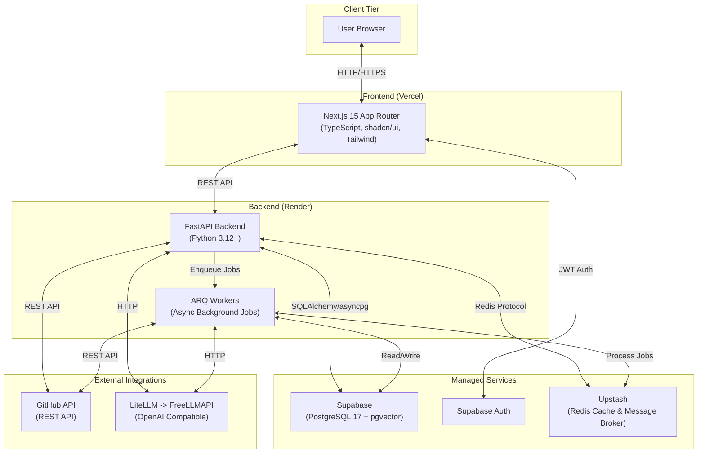

### Component Responsibilities:
- **Next.js 15 (Frontend):** Manages user interfaces, dashboards, and defense session interactions. Handles client-side routing and server-side rendering for optimal performance.
- **FastAPI (Backend API):** The core control plane. Handles HTTP requests from the frontend, orchestrates business logic, manages authentication checks, and coordinates immediate LLM interactions.
- **ARQ (Background Jobs):** Async-native background workers built on Redis. Processes heavy, long-running tasks like repository ingestion, AST parsing, embedding generation, and report aggregation.
- **Supabase (Database + Auth):** Stores all relational schema data, vector embeddings (via pgvector), and manages user authentication (GitHub OAuth).
- **Upstash (Redis):** Acts as the message broker for ARQ and as a high-performance caching layer for rate-limiting and frequently accessed data.
- **FreeLLMAPI (via LiteLLM):** The abstraction layer and provider for LLM inference (used for defense question generation, evaluation, and claim verification).

---

## 4. Backend Module Architecture

The FastAPI backend enforces strict directory and module boundaries. 

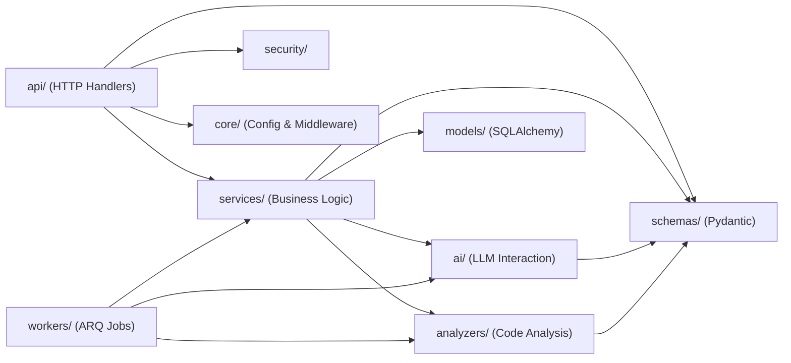

### Module Boundaries & Dependency Rules
- `api/`: Only defines routes and request/response validation. Must not contain business logic. Injects dependencies and calls `services/`.
- `services/`: The orchestration layer. Coordinates database calls, triggers `analyzers/`, and utilizes `ai/`. 
- `analyzers/`: Deterministic logic pipeline. Contains `file_scanner`, `language_detector`, `ast_parser` (Tree-sitter), and `git_analyzer`. Never calls the database directly.
- `ai/`: Contains `llm_client` (LiteLLM wrapper), `prompts/`, `rag/`, `evaluator`, and the defense `interviewer` state machine.
- `workers/`: Background job definitions. They act similarly to API routes but are invoked via Redis. They compose logic from `services/` and `analyzers/`.
- `security/`: Middleware for sanitization, dependency checking, and secret detection.
- `models/`: SQLAlchemy ORM classes. No business logic.
- `schemas/`: Pydantic models for validation. Used across all modules.
- `core/`: Application settings, logging configuration (structlog), database connection pools, and Sentry setup.

---

## 5. Repository Ingestion Pipeline (Diagram 2)

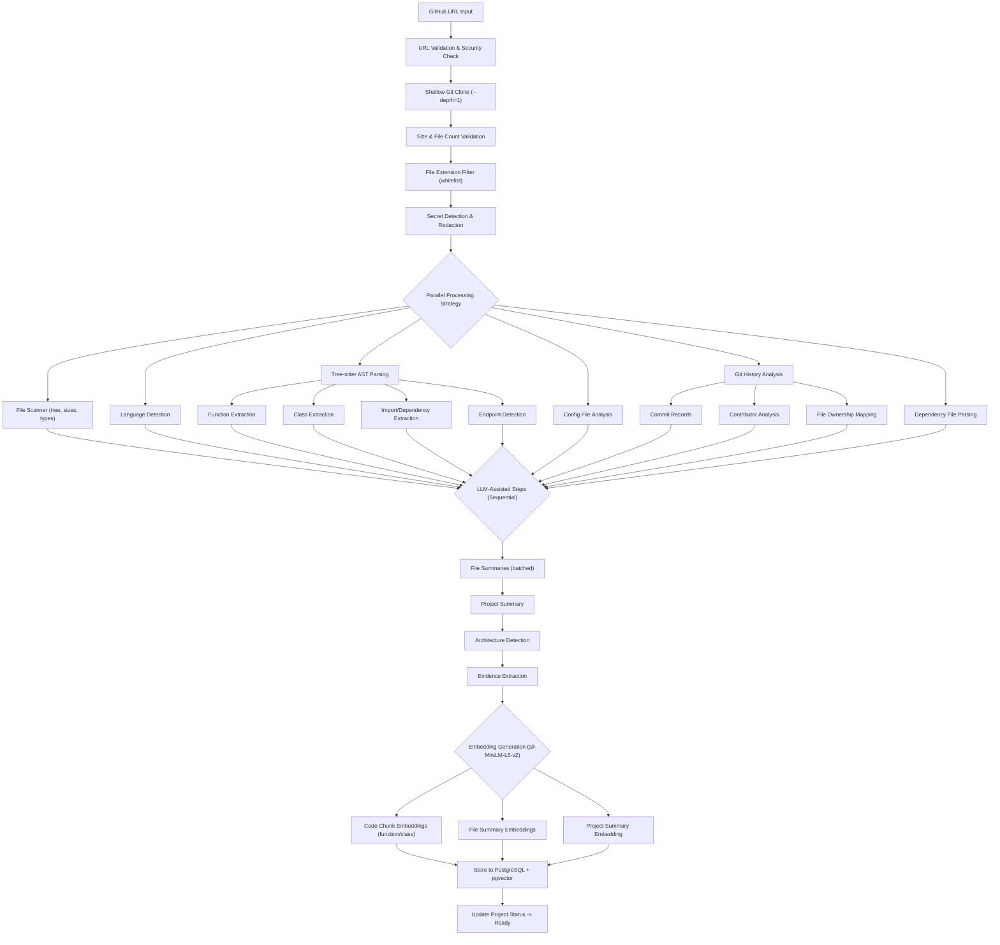

### Rationale & Design
- **Shallow Clone:** `git clone --depth=1` avoids downloading years of irrelevant history, vastly improving speed and limiting malicious payload depth.
- **Deterministic vs LLM:** We strictly extract relationships, dependencies, and structure using Tree-sitter (deterministic). LLMs are only used in the subsequent aggregation phase for generating summaries and architecture insights.
- **Parallelization:** I/O heavy operations and deterministic parsing run in parallel using asyncio tasks within the ARQ worker.
- **Error Handling:** If a single file fails parsing, it is logged and skipped. If core dependencies (e.g., `package.json`) fail, the ingestion process is marked as degraded but proceeds.
- **Estimated Time:** A typical repository (100 files, ~15k LOC) takes < 2 minutes to ingest.

---

## 6. AI/RAG Pipeline (Diagram 3)

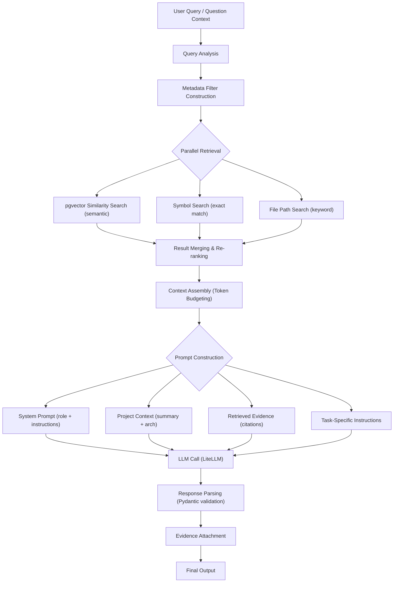

### Context Window Budgeting (~4800 tokens max to fit safely in standard 8K contexts)
- **System prompt:** ~500 tokens
- **Project summary:** ~500 tokens
- **Retrieved evidence:** ~2000 tokens (strict crop based on relevance score)
- **Conversation history:** ~1000 tokens (rolling window)
- **Task instructions:** ~300 tokens
- **Response budget:** ~500 tokens

---

## 7. Defense Session Flow (Diagram 4)

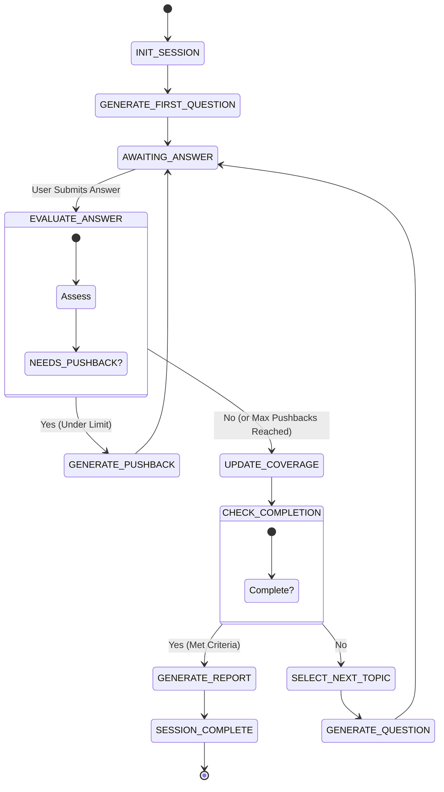

### Algorithm Details
- **Topic Selection:** Prioritizes un-defended architectural components first, followed by historically weak knowledge areas.
- **Pushback Limit:** A maximum of 2 pushbacks per topic to prevent the LLM from trapping the user in an infinite loop.
- **Completion Criteria:** A session ends when a minimum of 10 questions are answered, all core project topics are covered, or the user manually concludes it.
- **Score Aggregation:** Weighted average of deterministic confidence (from Code/Git) and LLM-evaluated confidence.

---

## 8. Claim Verification Flow (Diagram 5)

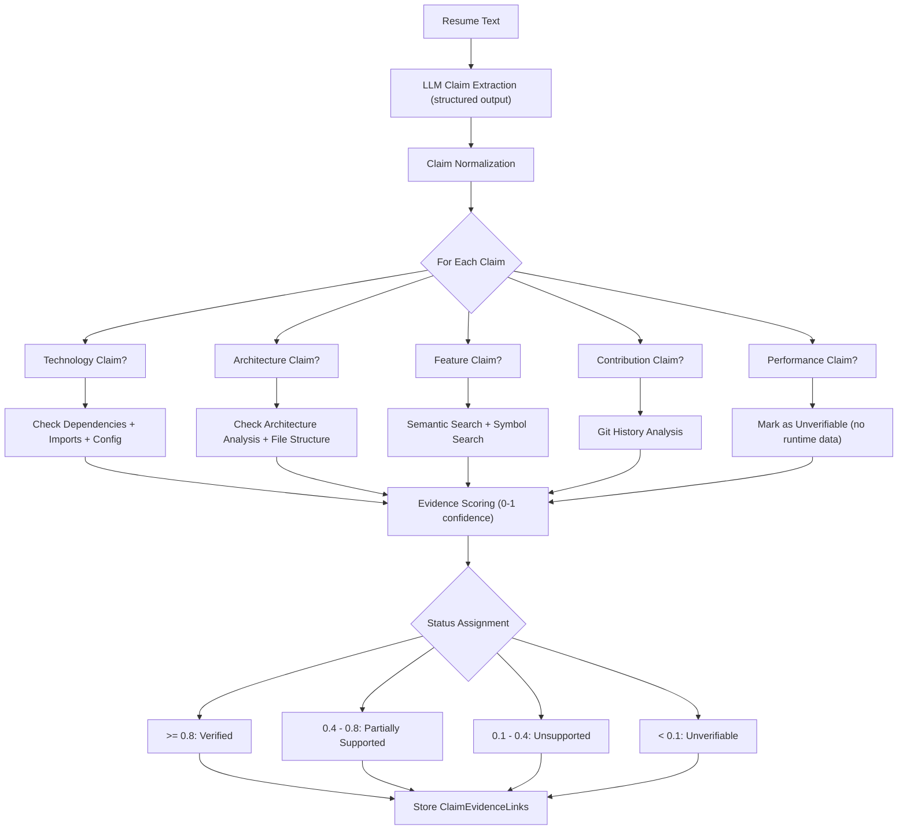

---

## 9. Ownership Analysis (Diagram 6)

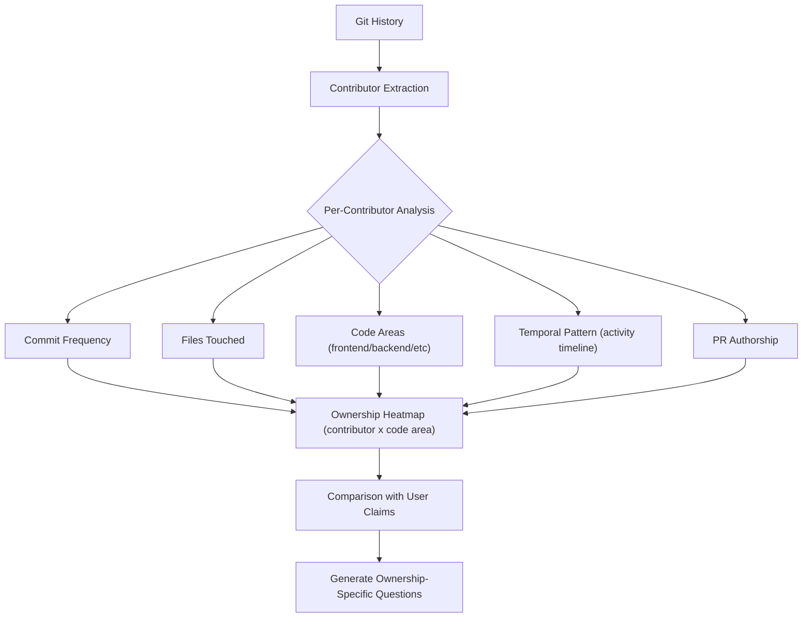

### Explicit Limitations
- **Cannot Detect Pair Programming:** Only the recorded commit author is verified.
- **Cannot Detect Dictated Code:** Copied/pasted or AI-generated code attributed to a user cannot be deterministically proven false by history alone (this is why the defense session exists).
- **Volume ≠ Quality:** Commit counts do not reflect code complexity or quality.
- **Squashed/Rewritten History:** Squashed PRs or force-pushes mask granular history.

---

## 10. PR/Commit Defense (Diagram 7)

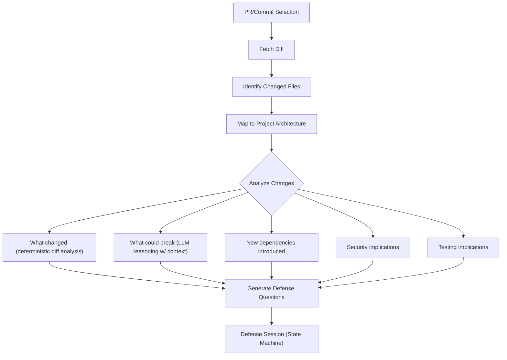

---

## 11. Incident Simulation (Diagram 8)

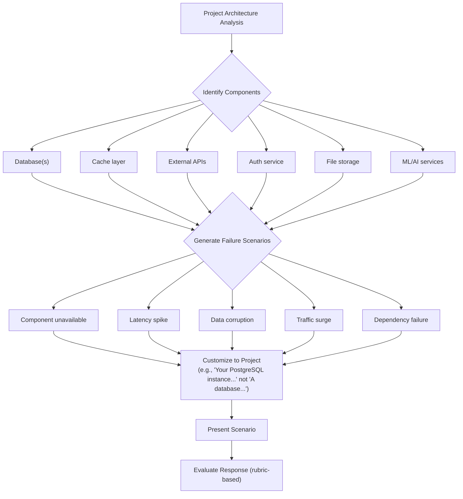

---

## 12. Mentor/Retesting Loop (Diagram 9)

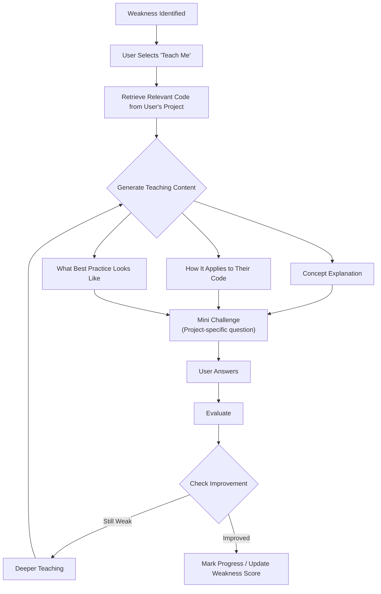

---

## 13. Deployment Architecture (Diagram 10)

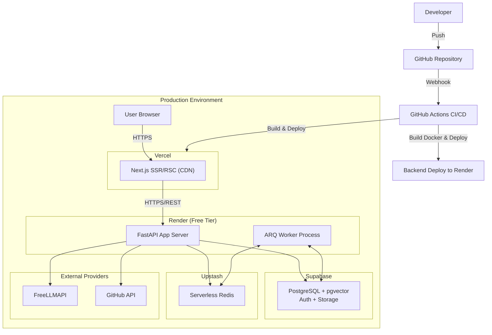

### Deployment Strategy
- **CI/CD:** Handled via GitHub Actions. Ensures passing tests, linting, and type checking before deployment.
- **Environment Management:** Environment variables are strictly injected via Vercel and Render dashboards.
- **Database Migrations:** Managed strictly via Alembic. The CI pipeline executes `alembic upgrade head` during the backend deployment phase.
- **Zero-Downtime:** Vercel handles frontend atomic deployments natively. Render rolling deploys update the FastAPI containers iteratively.
- **Cost Analysis (Free Tiers):** Vercel (Hobby), Render (Free Web Service + Background Worker hack/shared instance), Supabase (Free tier PostgreSQL + Auth), Upstash (Serverless Redis 10k requests/day), FreeLLMAPI (free tier). Code embeddings are processed locally via `sentence-transformers`, avoiding API costs.

---

## 14. Data Flow Architecture

1. **Intake:** User authorizes via Supabase Auth (GitHub OAuth) and submits a repository URL.
2. **Ingestion & Sync:** Frontend sends repo URL to Backend. Backend enqueues ARQ job and responds with 202 Accepted.
3. **Processing:** ARQ worker pulls the repository, executes AST extraction and Git history parsing, runs LLM batch jobs for summary generation, maps vectors, and updates status in Supabase.
4. **Session Init:** User initiates a defense session. Frontend requests an initialized state. Backend uses LiteLLM to analyze vectors, constructs the first question, and returns it.
5. **Interactive Defense:** User submits an answer. Backend evaluates the payload against strict rubrics, updates the pgvector session context, and generates the next node in the session graph.
6. **Reporting:** Once complete, ARQ job compiles a summary report of strengths, weaknesses, and a final grade.

---

## 15. Security Architecture

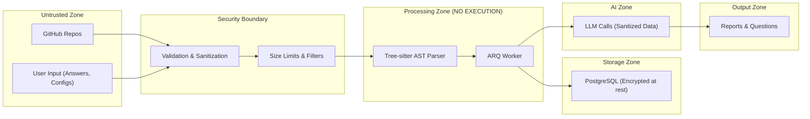

### Trust Boundaries
- **No Code Execution:** RepoDefense parses code via Tree-sitter. It *never* runs `eval()`, `exec()`, or executes user tests/scripts. This prevents RCE completely.
- **Data Redaction:** Potential secrets (API keys, passwords) are filtered *before* being sent to the LLM or stored in pgvector.

---

## 16. Component Communication

- **Synchronous (REST API):** Used for lightweight CRUD, authentication checks, fetching session states, and simple frontend-to-backend commands.
- **Asynchronous (ARQ / Redis):** Used for all heavy processing: cloning repos, embedding generation, deep git log analysis, and compiling the final defense reports.
- **Direct Function Calls:** Internal FastAPI routing ensures modules like `services/` and `analyzers/` communicate natively in Python without network boundaries.

---

## 17. Scalability Path

As RepoDefense grows beyond the free tier, the Modular Monolith allows horizontal scaling:
- **Phase 1 (Current):** Single Render instance running FastAPI, utilizing `asyncio.create_task` for background tasks or a co-located lightweight ARQ worker process.
- **Phase 2:** Move the ARQ worker to a dedicated Render Background Worker instance to isolate CPU-intensive operations (AST parsing, local embedding generation) from HTTP traffic.
- **Phase 3:** Scale out multiple ARQ worker instances listening to the same Upstash Redis queue. Upgrade Supabase to a paid tier to support high concurrency pgvector reads.
- **Phase 4:** If strictly required by team size or domain isolation, split the ingestion pipeline and the defense session engine into separate services (microservices), though the monolith will likely suffice up to millions of users due to stateless design.
