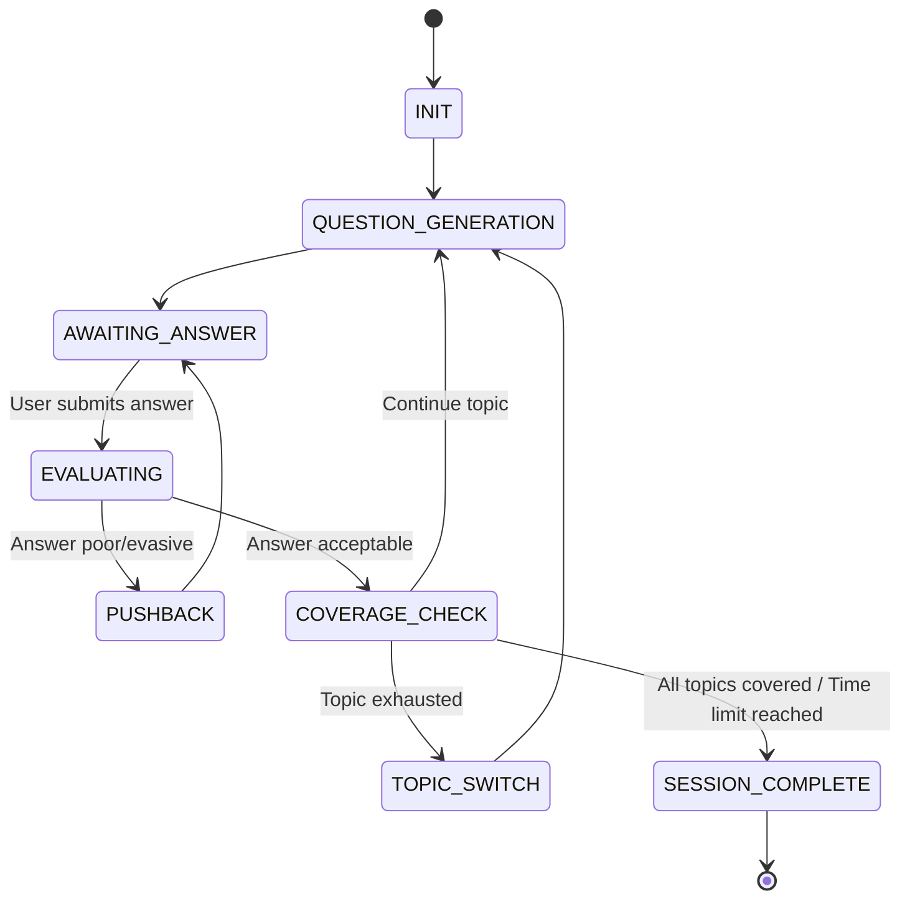
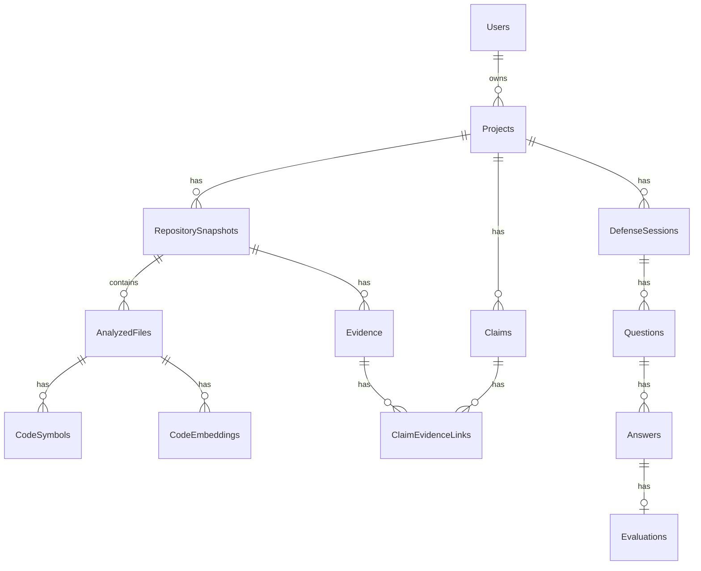
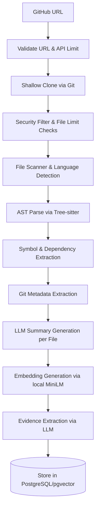

# Technical Design Document: RepoDefense

## 1. Project North Star

> **Product:** RepoDefense  
> **Tagline:** "Prove that you understand — and can defend — the software you built."  
> **Core Loop:** Evidence → Claim → Defense → Stress Test → Evaluation → Mentor → Re-test

## 2. AI Architecture (DELIVERABLE 5)

### LLM Provider Layer
- **LiteLLM Abstraction**: We use LiteLLM as an abstraction layer to interface with FreeLLMAPI. This provides a unified interface and allows seamless fallback and model rotation.
- **Model Selection Strategy**: We use the best available reasoning models (e.g., LLaMA-3-70B via FreeLLMAPI) for complex tasks like evaluation and scoring. For faster tasks like summarization, we use faster models (e.g., LLaMA-3-8B).
- **Fallback Strategy**: Automatic fallback is configured in LiteLLM to ensure high availability if the primary FreeLLMAPI endpoint fails.
- **Token Management**: Strict context window budgeting is enforced. Long files are either truncated or summarized recursively. Context is dynamically assembled to stay well within the model limits.
- **Reliability**: Exponential backoff for rate limits, 30-second timeouts for fast failures, and robust error handling wrap all LLM API calls.
- **Cost Tracking**: Handled via LiteLLM's built-in tracking features.
- **Hallucination Mitigation**: All prompts strictly enforce evidence grounding. The LLM is explicitly instructed to output "I cannot determine this from the provided code" if supporting evidence is lacking in the retrieved context. Structured output reduces hallucination vectors.

### Prompt Architecture
We use stateless prompt chains, NOT autonomous agents. The state is managed externally.
- `repository_analyst`: Analyzes repository structure, directories, and generates a structural summary.
- `project_summarizer`: Synthesizes code summaries into a cohesive, human-readable project overview.
- `claim_extractor`: Parses resume text and extracts distinct technical claims.
- `evidence_validator`: Matches extracted claims against database evidence to assess validity.
- `question_generator`: Generates evidence-grounded interview questions tailored to the candidate's codebase.
- `interviewer`: Manages the conversational flow and tone of the defense session, translating generated questions into a natural dialogue.
- `pushback_evaluator`: Evaluates whether a candidate's answer is evasive, generic, or incorrect, determining if pushback is required.
- `answer_evaluator`: Scores final answers against the retrieved code evidence and a structured grading rubric.
- `architecture_auditor`: Analyzes system architecture patterns inferred from the code.
- `incident_simulator`: Generates project-specific hypothetical failure scenarios (stress tests).
- `mentor`: Explains technical concepts using the candidate's own codebase as concrete examples.
- `report_generator`: Summarizes the session into a structured, final defense report.

### Retrieval Architecture
**RAG Pipeline**:
- **Embeddings**: Code file chunks (chunked smartly by Tree-sitter at function/class boundaries), file summaries, and project overviews are embedded using the `all-MiniLM-L6-v2` model locally via `sentence-transformers`.
- **Relational Data**: Metadata, AST symbols, dependencies, commits, claims, and evaluations remain in standard PostgreSQL tables to enable exact match and relational queries.
- **Filtering**: Queries are pre-filtered by language, file path, or topic category before vector search to improve relevance.
- **Retrieval Flow**: Query → Metadata Filter → pgvector Similarity Search (HNSW index) → Re-rank (optional) → Context Assembly.
- **Search Modalities**:
  - Keyword Search: Best for exact symbol lookup, file paths, or dependency name matching.
  - AST/Symbol Search: Best for finding function signatures, class hierarchies, and import analysis.
  - Vector Search: Best for conceptual similarity, natural language questions about code purpose.
- **Evidence Attachment**: Every retrieved chunk carries its `file_path`, `line_range`, `symbol_name`, and `relevance_score` to ensure perfect traceability.

### Structured Output
We enforce structured output via JSON mode or function-calling format using LiteLLM coupled with Pydantic models. This ensures outputs conform precisely to our required schemas. All outputs are validated; malformed outputs automatically trigger a retry.

### Adaptive Interview State Machine

The state machine utilizes deterministic logic. The LLM is called only at specific states for well-defined tasks.

### Mentor Mode Architecture
Triggered when a user fails a topic or demonstrates a weakness. It leverages the same RAG pipeline but with teaching-oriented prompts. Flow: Mini-challenge generation → Evaluation → Progress update.

## 3. Security Architecture (DELIVERABLE 6)

### Repository Input Security
- **URL validation**: Only valid GitHub repository URLs are accepted.
- **Size Limits**: 500MB maximum repository size (configurable), max 10,000 files, max 1MB per file.
- **Allowed Extensions**: Strict whitelist applied (source code, configs, docs only).
- **Restrictions**: No binary file processing, no archive/zip extraction, no symlink following. Path traversal prevention during cloning.

### Prompt Injection Defense
- Content sanitization applied before LLM prompts.
- Instruction boundary markers strictly enforced in prompts.
- Untrusted user code is wrapped in specific delimiters with explicit framing ("this is untrusted user code").
- README/markdown content is treated with extra suspicion.
- System prompts are completely isolated from user-controlled content.
- Output validation checks LLM responses for signs of hijacking.

### Secret Detection & Redaction
- Regex-based scanning for API keys, tokens, passwords, connection strings.
- Secrets are redacted before storage and before any LLM processing.
- Raw file content containing potential secrets is never logged.

### Resource Protection
- Strict tracking of GitHub API rate limits.
- Per-user repository analysis rate limits.
- Background job timeouts (max 10 min per analysis) via ARQ.
- LLM call timeouts (30 second default).
- Queue depth limits and memory limits on analysis workers.

### Static Analysis Only
- **CRITICAL RULE**: We NEVER execute repository code.
- We NEVER install repository dependencies.
- We NEVER run repository tests.
- Tree-sitter safely parses code into an AST without execution.
- If execution is ever needed in the future, it would require robust sandboxing (containers, resource limits, network isolation).

### Data Privacy
- Tenant isolation per user in the database.
- No cross-user data leakage in LLM prompts.
- Configurable data retention policies and the ability for users to hard-delete all their data.

## 4. Database Schema (DELIVERABLE 7)

**Database**: PostgreSQL 17 + pgvector extension (Supabase free tier).
**Strategy**: Single database for both relational metadata and vector embeddings. The vector store utilizes HNSW indexes on 384-dimensional vectors from `all-MiniLM-L6-v2`. Junction tables handle claim-to-evidence relationships without requiring a separate graph database.

### Core Entities:

#### Users
- `id` (UUID, PK), `supabase_auth_id`, `email`, `display_name`, `github_username`, `created_at`, `updated_at`

#### Projects
- `id` (UUID, PK), `user_id` (FK), `name`, `repo_url`, `description`, `status` (enum: pending/analyzing/ready/error), `current_snapshot_id` (FK), `created_at`, `updated_at`
- Indexes: `user_id`, `status`

#### RepositorySnapshots
- `id` (UUID, PK), `project_id` (FK), `commit_sha`, `analyzed_at`, `analysis_version`, `summary_json`, `architecture_json`, `tech_stack_json`, `status`
- Index: `project_id`

#### AnalyzedFiles
- `id` (UUID, PK), `snapshot_id` (FK), `file_path`, `language`, `size_bytes`, `content_hash`, `summary`, `is_test`, `is_config`, `is_doc`
- Indexes: `snapshot_id`, `file_path`, `language`

#### CodeSymbols
- `id` (UUID, PK), `file_id` (FK), `symbol_type` (enum), `name`, `start_line`, `end_line`, `signature`, `docstring`
- Indexes: `file_id`, `symbol_type`, `name`

#### CodeEmbeddings
- `id` (UUID, PK), `file_id` (FK), `chunk_text`, `chunk_type` (enum), `symbol_name`, `start_line`, `end_line`, `embedding` vector(384), `metadata_json`
- Indexes: pgvector HNSW on `embedding`, `file_id`, `chunk_type`

#### Evidence
- `id` (UUID, PK), `snapshot_id` (FK), `evidence_type` (enum), `label`, `description`, `confidence`, `source_files` (array), `source_lines_json`
- Indexes: `snapshot_id`, `evidence_type`

#### Claims
- `id` (UUID, PK), `project_id` (FK), `claim_text`, `claim_type` (enum), `source` (enum: resume/user_input/readme), `normalized_text`
- Index: `project_id`

#### ClaimEvidenceLinks
- `id` (UUID, PK), `claim_id` (FK), `evidence_id` (FK), `support_level` (enum), `reasoning`, `confidence_score`
- Indexes: `claim_id`, `evidence_id`

#### DefenseSessions
- `id` (UUID, PK), `project_id` (FK), `user_id` (FK), `session_type` (enum), `difficulty` (enum), `status` (enum), `started_at`, `completed_at`, `overall_score`, `state_json`, `coverage_json`
- Indexes: `project_id`, `user_id`

#### Questions, Answers, Evaluations
Track the full dialogue flow and scoring logic.

## 5. API Specification (DELIVERABLE 8)

Backend Framework: **FastAPI (Python 3.12+)**

### Core Endpoints:
- `POST /api/projects`: Create project from repo URL. Validates repo and queues async ARQ analysis job.
- `GET /api/projects/{id}`: Get project details + status.
- `GET /api/projects/{id}/files`: Get analyzed file tree.
- `POST /api/projects/{id}/claims`: Submit resume text for claim extraction.
- `GET /api/projects/{id}/claims`: Get extracted claims with verification status.
- `POST /api/projects/{id}/defense/start`: Start defense session (params: type, difficulty). Returns session ID.
- `POST /api/sessions/{id}/answer`: Submit answer to current question.
- `GET /api/sessions/{id}/next-question`: Retrieve next question or pushback based on state machine.
- `GET /api/sessions/{id}/report`: Retrieve full defense report.

All protected by Supabase Auth (Bearer tokens).

## 6. Repository Analysis Pipeline (DELIVERABLE 10)

## 7. Defense Engine (DELIVERABLE 11)

### Question Generation
Questions are generated dynamically from the retrieved evidence.
1. **Topic Selection**: The engine selects a topic (e.g., Database, Security, Architecture).
2. **Evidence Retrieval**: It fetches the most relevant `CodeEmbeddings` and `Evidence` metadata for that topic.
3. **LLM Prompting**: The `question_generator` prompt is fed the evidence and asked to generate a technical question that tests the candidate's understanding of the specific code snippet or design pattern.
4. **Validation**: The question must explicitly ground itself in the evidence (e.g., "In `auth.py`, you chose JWTs over session cookies. Why?").

### Answer Evaluation & Scoring
- Answers are evaluated by the `answer_evaluator` using the *same evidence* that generated the question.
- **Scoring Algorithm**: The LLM outputs a score (0-100) based on a rubric:
  - 90-100: Deep understanding, correct tradeoffs mentioned.
  - 70-89: Correct but lacks depth or specific details.
  - 40-69: Partially correct or generic.
  - <40: Incorrect or heavily evasive.
- **Score Calculation**: The final session score is a weighted average across all tested topics, weighted by the difficulty of the questions.

### Pushback Logic
- **Trigger**: If the `pushback_evaluator` determines an answer is evasive, overly generic, or dodges the core technical "why", it triggers a pushback state.
- **Aggressiveness**: Pushbacks are direct but professional ("You mentioned X, but looking at line 45, it does Y. Can you clarify?").
- **Max Depth**: Pushback is limited to a depth of 2. If the user still evades, the evaluation assigns a low score and forces a topic switch.

### Coverage Tracking & Topic Switching
- **Coverage**: The engine tracks a master topic list. Completion is measured as a percentage.
- **Topic Switching Logic**:
  1. Prioritize entirely *uncovered* topics.
  2. Fall back to *weak* topics if more data is needed.
  3. Select *random* topics if thresholds are met but the session continues.
- **Session Completion Criteria**: A session ends when:
  - Minimum 10 questions have been asked, OR
  - All core topics have reached at least 60% coverage, OR
  - The user manually ends the session.

## 8. Claim Verification Engine (DELIVERABLE 12)

### Claim Extraction Flow
1. User submits resume or unstructured text.
2. The `claim_extractor` (LLM) parses the text to identify distinct technical claims (e.g., "Scaled DB to 10k QPS", "Implemented Redis caching").
3. **Normalization**: Claims are normalized to standard formats removing hyperbole, extracting the core technical assertion.

### Evidence Retrieval Strategy
- **Technology Claims**: The engine searches `Dependencies`, `AnalyzedFiles` metadata, and `CodeSymbols`.
- **Architecture Claims**: The engine searches `CodeEmbeddings` tagged with `chunk_type=architecture` and structural summaries.
- **Performance Claims**: Highly difficult to verify statically; the engine searches for load testing scripts or specific configuration values (e.g., connection pool size).

### Scoring Rubric & Thresholds
Each claim gets a `support_level` based on confidence scores (0.0 to 1.0):
- **>= 0.8**: `verified` (Explicit code evidence found).
- **0.4 - 0.79**: `partial` (Some related technologies found, but full scope unclear).
- **0.1 - 0.39**: `unsupported` (No evidence found matching the claim).
- **< 0.1**: `unverifiable` (Claim cannot be proven via static analysis).

### Example Walkthrough
1. **Claim**: "Built a custom JWT authentication system."
2. **Retrieval**: Engine finds `jwt.decode` in `utils/auth.py`.
3. **Validation**: LLM reviews `auth.py` and confirms it's a custom implementation, not just a library wrapper.
4. **Status**: `verified` (Score: 0.95).

### Honest Language Guidelines
The UI strictly enforces honest framing. If no evidence is found, it says "No clear evidence found in the analyzed codebase," it NEVER says "The claim is false."

## 9. Ownership Engine (DELIVERABLE 13)

### Inferred Signals
What **CAN** be inferred:
- **Files Touched**: The specific files modified by the user's git email.
- **Commit Frequency**: The volume and consistency of commits.
- **PR Authorship**: PRs opened and merged by the user.
- **Code Areas**: The domains (e.g., frontend vs. database) the user primarily works in.

### Limitations
What **CANNOT** be inferred:
- Pair programming contributions.
- Architecture whiteboarding or dictation.
- Copied/pasted code from internal or external sources.
- History lost to squashed commits or rebases without the user's email.

### Question Generation Integration
Ownership signals heavily influence the defense session. If a user claims "I designed the database," but git metadata shows 95% of database migrations were authored by another contributor, the engine will generate highly specific, difficult questions about the schema to verify actual understanding.

### Explicit Disclaimer
The UI includes a permanent, explicit disclaimer: *"Ownership metrics are heuristics based on git history and do not reflect external collaboration, pair programming, or off-repo design work."*

## 10. Incident/Stress Engine (DELIVERABLE 14)

### Scenario Generation
Failure scenarios are dynamically generated based on the exact components detected in the user's architecture.

### Template Library
- **Database**: Connection pool exhaustion, deadlocks, unexpected schema migration failures.
- **Cache**: Redis eviction policy failures, thundering herd problem upon cache restart.
- **External API**: Prolonged timeouts, malformed JSON responses, rate limit exhaustion.
- **Auth**: Token signing key compromise, session store latency.
- **Storage**: S3 bucket permission misconfigurations, out of disk space.

### Customization
Scenarios are injected with the user's specific context. Instead of "Your DB fails," it outputs, "Your PostgreSQL instance at `db/schema.sql` starts throwing connection pool limits during a traffic spike. How does your FastAPI backend handle this?"

### Evaluation Rubric
Answers are evaluated on:
- Acknowledgment of the failure mode.
- Identification of fallback mechanisms or graceful degradation.
- Realism of the proposed fix given the static code available.

## 11. Mentor Loop (DELIVERABLE 15)

### Detailed Flow
1. **Weakness Detected**: The evaluation engine flags a topic score < 50.
2. **Retrieve Code**: The RAG pipeline fetches the user's own code related to that topic.
3. **Teaching Content**: The `mentor` prompt generates an explanation of the core concept, directly applying it to the user's code (e.g., "You struggled with concurrency. Look at your `fetch_data` function on line 42...").
4. **Mini Challenge**: A small, isolated reasoning challenge is presented to fix or improve that specific code snippet.
5. **Evaluate**: The user submits an answer.
6. **Update Score**: The weakness record is updated based on the result.

### Score Tracking
Scores are tracked historically. A weakness is marked `resolved` if the user successfully passes two consecutive mentor challenges on the topic.

## 12. Evaluation System (DELIVERABLE 18 partial)

Tracks LLM performance metrics, answer scoring consistency, hallucination rates, and evidence grounding scores against benchmark datasets.

## 13. Observability

Uses `structlog` for structured logging. Tracks LLM call metrics (latency, tokens, success/failure rates). Uses Sentry (free tier) for error tracking. Strict redaction of secrets and PII from all logs.

## 14. Testing Strategy (DELIVERABLE 18)

Comprehensive testing:
- **Unit**: Analyzers, AST parsers, state machine transitions, scoring logic.
- **Integration**: Database operations, RAG pipeline, API endpoints.
- **Prompt Tests**: Expected structural outputs from known inputs.
- **Security Tests**: Prompt injection payloads, malicious repository simulations.
- **E2E Tests**: Full flow from repo URL to defense report.
- **Adversarial Tests**: Repositories containing embedded prompt injections to ensure safety.

## 15. Frontend Architecture (DELIVERABLE 9)

### Routing & Page List
- `/` — Landing page
- `/dashboard` — User dashboard, list of analyzed projects
- `/projects/new` — Add project (repo URL input)
- `/projects/[id]` — Project overview (summary, evidence, architecture)
- `/projects/[id]/evidence` — Evidence explorer interface
- `/projects/[id]/claims` — Claim verification view
- `/projects/[id]/architecture` — Architecture diagram view
- `/projects/[id]/defense` — Pre-flight setup to start defense session
- `/sessions/[id]` — Active defense session
- `/sessions/[id]/report` — Final defense report
- `/progress` — Progress and weakness dashboard
- `/mentor/[weakness_id]` — Active mentor mode session

### Key Components
- **DefenseChat**: The primary chat-like interface for Q&A, handling streaming responses.
- **EvidencePanel**: A side-panel that reveals the specific code snippets the engine is currently asking about.
- **CoverageRadar**: A radar chart visualizing the candidate's mastery across topics.
- **ClaimCard**: A UI element displaying a claim, its verification status, and expandable evidence links.

### Defense Session UI Flow
1. Engine asks a **Question**.
2. **EvidencePanel** softly highlights relevant code context (if applicable).
3. User types in the **AnswerInput**.
4. Engine processes the **Evaluation** (loading state).
5. Engine decides to output a **Pushback** (repeating the cycle) or moves to the **Next Question**.

### Loading & Error States
- Skeletons used heavily during initial data fetch via React Server Components.
- Optimistic UI updates during chat.
- Fallback boundaries for API errors with graceful retry buttons.
