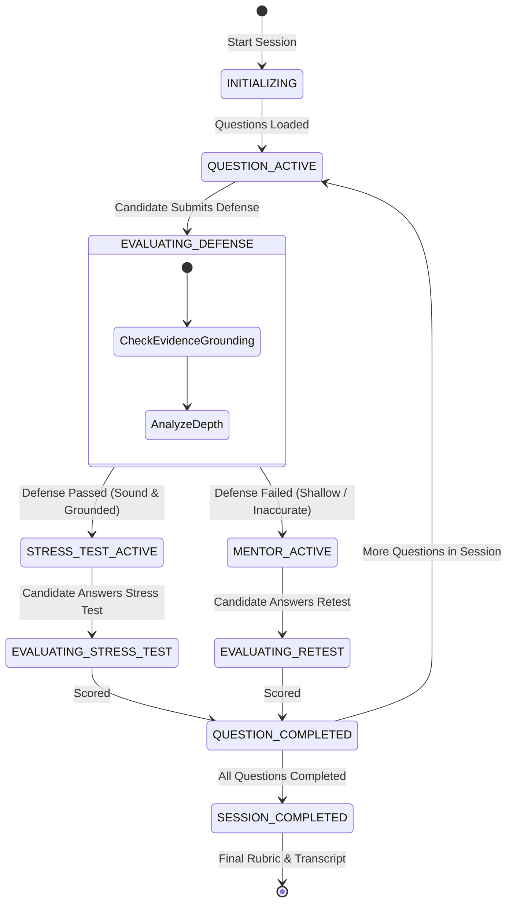

# 📄 Technical Specification: Step 1.14a — Defense Session: FSM State Machine, Answer Evaluation & REST API

> **Step ID**: `1.14a`  
> **Target Module**: `backend/app/schemas/defense.py`, `backend/app/ai/fsm.py`, `backend/app/ai/prompts.py`, `backend/app/ai/llm.py`, `backend/app/api/v1/defense.py`  
> **Git Feature Branch**: `feat/step-1-14a-defense-session-fsm`  
> **Status**: 📋 Draft / Ready for Implementation  
> **Created**: 2026-11-03

---

## 1. Executive Summary

Per **Gemini.md** (Sections 2, 4, 5, 6) and **implementation_plan.md** (Milestone 1.14):
RepoDefense authenticates candidate technical comprehension through an oral-style, evidence-grounded defense. The heart of the platform is the deterministic interview state machine:

$$\text{Evidence} \longrightarrow \text{Claim} \longrightarrow \text{Defense} \longrightarrow \text{Stress Test} \longrightarrow \text{Evaluation} \longrightarrow \text{Mentor} \longrightarrow \text{Re-test}$$

Milestone 1.14 is sub-sliced into two Goldilocks-sized tasks:
- **Step 1.14a (This Step)**: Backend Defense Session management, FSM State Machine (`backend/app/ai/fsm.py`), answer evaluation engine with stress-testing and mentor guidance via LiteLLM, and FastAPI endpoints.
- **Step 1.14b (Next Step)**: Next.js 15 interactive defense session UI with real-time turn exchange and code viewer synchronization.

In Step 1.14a:
1. Candidate starts a defense session against a repository snapshot via `POST /api/v1/projects/{project_id}/defense/start`.
2. The session initializes with 3–5 evidence-grounded questions.
3. Candidate submits their architectural defense for the active question via `POST /api/v1/defense/sessions/{session_id}/answer`.
4. The system evaluates the candidate's answer against the repository evidence:
   - **Passed Initial Defense**: Injects a production stress-test constraint (*"What happens when concurrent requests spike to 10k/sec?"*).
   - **Failed / Incomplete**: Shifts to **Mentor Phase**, providing constructive hints and asking a guided re-test variant.
5. Scores and feedback are calculated, advancing through all questions until `SESSION_COMPLETED` is reached with an aggregate defense score and rubric.

---

## 2. Dependencies & Prerequisites

- **Depends on**:
  - Milestone 1.10 (LiteLLM Client Wrapper & FreeLLMAPI Routing)
  - Milestone 1.11 (Architectural Evidence Items in `Evidence` model)
  - Milestone 1.12 (Vector Embeddings & Code Chunks in `pgvector`)
  - Milestone 1.13 (Evidence-Grounded Question Generation Engine)
- **Blocked by**: None.
- **Tech Stack Invariant**:
  - Pure Python state logic for FSM transitions (`app/ai/fsm.py`) — no autonomous agent loops.
  - LiteLLM with FreeLLMAPI (`http://127.0.0.1:31415/v1`) for stateless pure function evaluation.
  - Pydantic v2 schemas for all inputs, outputs, and intermediate states.
  - Zero arbitrary code execution — only code snippets and evidence references are passed to prompts.

---

## 3. 🛡️ Security, Grounding & Invariants Impact

- [x] **Zero Code Execution**: Repository code and candidate defenses are treated as untrusted strings; never executed or dynamically evaluated.
- [x] **Deterministic State Machine**: Interview state transitions are strictly controlled in Python code. The LLM only evaluates responses and generates stress test constraints; it never decides the control flow of the application.
- [x] **Prompt Injection Defense**: Candidate defense answers and repository evidence are sanitized and wrapped in rigid XML boundary tags (`<candidate_defense>`, `<evidence_bundle>`).
- [x] **Deterministic Evaluation Fallback**: If LLM gateway is offline or times out, the evaluation falls back to a deterministic heuristic evaluator, preventing session lockouts.
- [x] **Strict 300 LOC Invariant**: All modules are kept $\le 300$ lines of code through modular separation of schemas, state logic, evaluation prompts, and endpoints.

---

## 4. 🧠 Sequential Thinking & State Machine Architecture



### State Definitions
1. `INITIALIZING`: Session created with target project and snapshot. Questions generated or bound.
2. `QUESTION_ACTIVE`: Active question displayed to candidate; awaiting initial architectural defense.
3. `EVALUATING_DEFENSE`: Backend processing candidate defense via LiteLLM against evidence.
4. `STRESS_TEST_ACTIVE`: Candidate passed initial defense. LLM injected production bottleneck constraint.
5. `MENTOR_ACTIVE`: Candidate struggled on initial defense. System provided architectural hint and follow-up variant.
6. `EVALUATING_STRESS_TEST`: Evaluating candidate's response to production constraint.
7. `EVALUATING_RETEST`: Evaluating candidate's response after mentor guidance.
8. `QUESTION_COMPLETED`: Question scored, rubric updated.
9. `SESSION_COMPLETED`: Defense session ended, aggregate score and performance transcript finalized.

---

## 5. Data Contracts & Pydantic Schemas (`backend/app/schemas/defense.py`)

```python
from enum import Enum
from typing import List, Optional, Dict, Any
from pydantic import BaseModel, Field
from app.schemas.question import GroundedQuestion, EvidenceRef

class DefenseStage(str, Enum):
    INITIALIZING = "initializing"
    QUESTION_ACTIVE = "question_active"
    EVALUATING_DEFENSE = "evaluating_defense"
    STRESS_TEST_ACTIVE = "stress_test_active"
    MENTOR_ACTIVE = "mentor_active"
    QUESTION_COMPLETED = "question_completed"
    SESSION_COMPLETED = "session_completed"

class TurnRole(str, Enum):
    INTERVIEWER = "interviewer"
    CANDIDATE = "candidate"
    SYSTEM = "system"

class DefenseTurn(BaseModel):
    id: str
    role: TurnRole
    content: str
    stage: DefenseStage
    timestamp: str
    metadata: Dict[str, Any] = Field(default_factory=dict)

class DefenseQuestionProgress(BaseModel):
    question: GroundedQuestion
    status: DefenseStage = DefenseStage.QUESTION_ACTIVE
    initial_defense: Optional[str] = None
    defense_score: Optional[int] = None
    stress_test_prompt: Optional[str] = None
    stress_test_response: Optional[str] = None
    mentor_hint: Optional[str] = None
    retest_question: Optional[str] = None
    retest_response: Optional[str] = None
    final_score: Optional[int] = None
    feedback: Optional[str] = None

class DefenseSessionState(BaseModel):
    session_id: str
    project_id: str
    status: DefenseStage
    current_question_index: int = 0
    total_questions: int
    questions: List[DefenseQuestionProgress]
    turns: List[DefenseTurn]
    overall_score: Optional[float] = None
    created_at: str
    updated_at: str

class StartDefenseRequest(BaseModel):
    num_questions: int = Field(default=3, ge=1, le=5)
    custom_categories: Optional[List[str]] = None

class SubmitAnswerRequest(BaseModel):
    answer: str = Field(..., min_length=5, max_length=5000)

class EvaluationOutput(BaseModel):
    passed_initial_defense: bool
    depth_score: int = Field(..., ge=1, le=10)
    grounding_verified: bool
    feedback: str
    stress_test_prompt: Optional[str] = None
    mentor_hint: Optional[str] = None
    retest_question: Optional[str] = None
```

---

## 6. Implementation Sequence

1. **Schemas (`backend/app/schemas/defense.py`)**:
   - Author Pydantic models for session stages, turns, question progress, requests, and structured evaluation output.
   - Re-export in `backend/app/schemas/__init__.py`.

2. **Persona Prompts (`backend/app/ai/prompts.py`)**:
   - `DEFENSE_EVALUATION_SYSTEM_PROMPT`: Rigorous principal engineer persona grading defenses against codebase evidence.
   - Output structured evaluation JSON with `passed_initial_defense`, `depth_score`, `feedback`, and `stress_test_prompt` or `mentor_hint`.

3. **Evaluation & Fallback Logic (`backend/app/ai/llm.py` & `fallbacks.py`)**:
   - `evaluate_candidate_defense`: Invokes LiteLLM with structured output parsing and retry protection.
   - Deterministic evaluation fallback in `fallbacks.py` when offline.

4. **FSM State Machine Engine (`backend/app/ai/fsm.py`)**:
   - Pure state transition engine managing session progress, turn logging, state validation, scoring calculation, and session completion.
   - Hermetic in-memory session manager with thread-safe session tracking.

5. **FastAPI Endpoints (`backend/app/api/v1/defense.py`)**:
   - `POST /api/v1/projects/{project_id}/defense/start`
   - `POST /api/v1/defense/sessions/{session_id}/answer`
   - `GET /api/v1/defense/sessions/{session_id}`
   - Registered under `/api/v1` in `backend/app/main.py`.

6. **Unit & Integration Test Suite (`backend/tests/test_defense_session.py`)**:
   - Test FSM state transitions (valid moves, illegal moves, turn logging).
   - Test defense answer evaluation and stress test trigger.
   - Test mentor hint trigger on failed defense.
   - Test full multi-question session completion and aggregate scoring.
   - Test FastAPI REST endpoints.

---

## 7. Quality Gates & Acceptance Criteria

- [x] All 5 FSM stages (`QUESTION_ACTIVE` $\rightarrow$ `STRESS_TEST_ACTIVE` / `MENTOR_ACTIVE` $\rightarrow$ `QUESTION_COMPLETED` $\rightarrow$ `SESSION_COMPLETED`) function deterministically.
- [x] All files $\le 300$ LOC.
- [x] Full pytest test suite passing with 100% test hermeticism.
- [x] `ruff check` passes with 0 warnings/errors.
