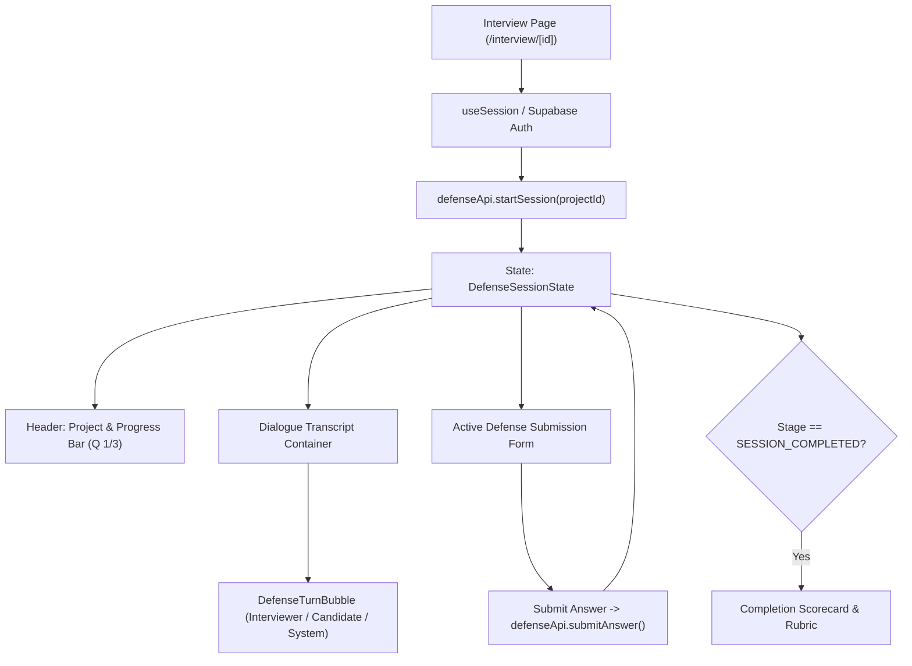

# 📄 Technical Specification: Step 1.14b — Next.js 15 Interactive Defense Session UI & Turn Exchange

> **Step ID**: `1.14b`  
> **Target Module**: `frontend/src/types/defense.ts`, `frontend/src/lib/defenseApi.ts`, `frontend/src/components/domain/DefenseTurnBubble.tsx`, `frontend/src/app/interview/[id]/page.tsx`  
> **Git Feature Branch**: `feat/step-1-14b-defense-session-ui`  
> **Status**: 📋 Draft / Ready for Implementation  
> **Created**: 2026-11-04  

---

## 1. Executive Summary

Per **Gemini.md** (Sections 2, 4, 5, 9) and **implementation_plan.md** (Milestone 1.14):
RepoDefense replaces generic LeetCode quizzes with an evidence-grounded, oral-style architectural defense of a candidate's actual repository. Following the backend FSM implementation in Step 1.14a, **Step 1.14b** builds the interactive frontend user experience in Next.js 15 App Router.

In this step:
1. When the user clicks **"Start Defense"** on a repository card (`/dashboard`), they navigate to `/interview/[id]`.
2. The page initializes the defense session via `POST /api/v1/projects/{project_id}/defense/start`, loading the first evidence-grounded question into the active turn interface.
3. The candidate reviews the question and cited evidence files, formulates their architectural defense, and submits it via `POST /api/v1/defense/sessions/{session_id}/answer`.
4. The UI dynamically responds to the FSM stage:
   - **Passed Defense $\rightarrow$ `STRESS_TEST_ACTIVE`**: Visual constraint alert introduces a production bottleneck scenario (*"What happens under 10k req/s?"*).
   - **Failed / Incomplete $\rightarrow$ `MENTOR_ACTIVE`**: Shifts to constructive mentor mode, highlighting architectural hints and guiding a follow-up re-test.
5. Turns continue until `SESSION_COMPLETED`, displaying the aggregate defense score out of 10.0 and a link back to the dashboard.

---

## 2. Dependencies & Prerequisites

- **Depends on**:
  - Step 1.14a (FastAPI Defense Endpoints, FSM Engine, Evaluation Prompts)
  - Milestone 1.3b (Supabase Auth Client & Bearer JWT Token in `frontend/src/lib/supabase.ts`)
  - Milestone 1.4b (Next.js Dashboard & `ProjectCard` linking to `/interview/[id]`)
- **Blocked by**: None.
- **Tech Stack Invariant**:
  - Next.js 15 (App Router) + TypeScript + Tailwind CSS + Lucide React.
  - Strict $\le 300$ LOC limit per file.
  - Zero arbitrary code execution — client acts purely as a renderer for dialogue and static evidence references.

---

## 3. 🛡️ Invariants & Security Impact

- [x] **Stateless JWT Authorization**: All client API requests include `Authorization: Bearer <token>` from the active Supabase session.
- [x] **Sanitized Render**: Candidate defenses and model responses are rendered securely as text without `dangerouslySetInnerHTML`.
- [x] **Input Bounds**: Client validates min 5 characters and max 5,000 characters before submission, with character counter feedback.
- [x] **Graceful Error Handling**: Network or backend errors display clear, non-blocking alert banners without resetting dialogue transcript.
- [x] **300 LOC Gate**: Component logic is cleanly divided between API service (`defenseApi.ts`), presentation bubbles (`DefenseTurnBubble.tsx`), and the page container (`page.tsx`).

---

## 4. Component Hierarchy & Flow



---

## 5. Data Contracts & TypeScript Interfaces (`frontend/src/types/defense.ts`)

```typescript
export type DefenseStage =
  | "initializing"
  | "question_active"
  | "evaluating_defense"
  | "stress_test_active"
  | "mentor_active"
  | "question_completed"
  | "session_completed";

export type TurnRole = "interviewer" | "candidate" | "system";

export interface DefenseTurn {
  id: string;
  role: TurnRole;
  content: string;
  stage: DefenseStage;
  timestamp: string;
  metadata?: Record<string, unknown>;
}

export interface GroundedQuestion {
  id: string;
  category: "architecture" | "scalability" | "reliability" | "security" | "tradeoffs";
  question_text: string;
  context_hint: string;
  cited_evidence_ids: string[];
  cited_files: string[];
}

export interface DefenseQuestionProgress {
  question: GroundedQuestion;
  status: DefenseStage;
  initial_defense?: string;
  defense_score?: number;
  stress_test_prompt?: string;
  stress_test_response?: string;
  mentor_hint?: string;
  retest_question?: string;
  retest_response?: string;
  final_score?: number;
  feedback?: string;
}

export interface DefenseSessionState {
  session_id: string;
  project_id: string;
  status: DefenseStage;
  current_question_index: number;
  total_questions: number;
  questions: DefenseQuestionProgress[];
  turns: DefenseTurn[];
  overall_score?: number;
  created_at: string;
  updated_at: string;
}
```

---

## 6. Implementation Sequence

1. **TypeScript Definitions (`frontend/src/types/defense.ts`)**:
   - Define `DefenseStage`, `TurnRole`, `DefenseTurn`, `GroundedQuestion`, `DefenseQuestionProgress`, `DefenseSessionState`.
2. **API Client (`frontend/src/lib/defenseApi.ts`)**:
   - `startDefenseSession(projectId: string, token: string, numQuestions?: number): Promise<DefenseSessionState>`
   - `submitDefenseAnswer(sessionId: string, answer: string, token: string): Promise<DefenseSessionState>`
   - `getDefenseSession(sessionId: string, token: string): Promise<DefenseSessionState>`
3. **Turn Bubble Component (`frontend/src/components/domain/DefenseTurnBubble.tsx`)**:
   - Visual distinction between Interviewer (cyan/emerald theme), Candidate (slate/zinc card), and System announcements.
   - Stage indicators for Stress-Test (amber warning badge) and Mentor Guidance (indigo learning badge).
   - Score badges (`Score: 8/10`) for completed evaluations.
4. **Interactive Page Container (`frontend/src/app/interview/[id]/page.tsx`)**:
   - Automatic session creation on mount.
   - Active question banner with cited repository files and category badge.
   - Multi-turn transcript scroll view with auto-scroll on new turn.
   - Answer submission form with textarea, character counter (5/5000), and loading indicator.
   - Session completion summary card with overall score.

---

## 7. Quality Gates & Acceptance Criteria

- [ ] Next.js 15 type check passes: `npx tsc --noEmit` with 0 errors.
- [ ] Next.js production build passes: `npm run build` with 0 errors.
- [ ] All new files strictly $\le 300$ LOC.
- [ ] End-to-end defense turn exchange verified against backend FastAPI server.
