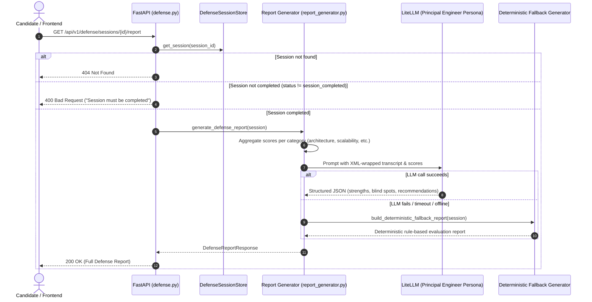

# 📄 Technical Specification: Step 1.16a — Backend Defense Report Schemas, LiteLLM Synthesis & REST API

> **Milestone ID**: `1.16a`  
> **Target Module**: `backend/app/schemas/report.py`, `backend/app/ai/prompts.py`, `backend/app/ai/report_generator.py`, `backend/app/api/v1/defense.py`, `backend/tests/test_defense_report.py`  
> **Git Feature Branch**: `feat/step-1-16a-defense-report-backend`  
> **Status**: 📋 Ready for Implementation  
> **Created**: 2026-11-04  

---

## 1. Executive Summary

Per **Gemini.md** (Sections 2, 4, 5, 9) and **implementation_plan.md** (Milestone 1.16):  
The ultimate output of RepoDefense is an objective, verifiable artifact proving whether a candidate truly understands their codebase architecture. Following an intensive defense session (Milestone 1.14), **Step 1.16a** implements the backend report aggregation and AI synthesis engine.

When a defense session is completed:
1. The engine aggregates mathematical scores across the 5 canonical architectural categories: `architecture`, `scalability`, `reliability`, `security`, and `tradeoffs`.
2. The Principal Engineer persona synthesizes qualitative findings using LiteLLM (with deterministic offline fallbacks):
   - **Summary Verdict**: Overall architectural defensibility rating (e.g. *Certified Principal Defense*, *Solid Architectural Defense*, *Remediation Required*).
   - **Key Strengths**: Specific architectural decisions where the candidate demonstrated deep technical maturity.
   - **Critical Blind Spots**: Architectural vulnerabilities uncovered during stress-testing (e.g., missing connection pooling, unindexed vector scans, unbounded caching).
   - **Actionable Recommendations**: Concrete engineering mitigations directly tied to the codebase.
3. The engine exposes `GET /api/v1/defense/sessions/{session_id}/report` with multi-tenant verification and session completion guards.

---

## 2. Dependencies & Prerequisites

- **Depends on**:
  - Milestone 1.14a (`backend/app/schemas/defense.py`, `backend/app/ai/fsm.py`, `backend/app/api/v1/defense.py`)
  - Milestone 1.14b (Interactive Defense Session UI)
  - Milestone 1.15 (Evidence Display & Grounding Inspector)
- **Blocked by**: None.
- **Tech Stack Invariant**:
  - FastAPI backend with async SQLAlchemy 2.0 and Pydantic v2.
  - LiteLLM with structured output parsing and offline fallback engine.
  - Strictly $\le 300$ LOC per file across all new and modified modules.

---

## 3. 🛡️ Invariants & Security Impact

- [x] **Zero Dynamic Code Execution**: Zero execution (`eval()`, `exec()`, or subshells); pure data aggregation and LLM prompt execution.
- [x] **Prompt Injection Defense**: All candidate answers are strictly sanitized and enclosed within `<candidate_defense>` and `<candidate_transcript>` XML delimiters.
- [x] **Multi-Tenant Isolation**: The report endpoint validates that the user owns the project associated with the session.
- [x] **Session State Integrity**: Incomplete sessions cannot generate reports (`HTTP 400 Bad Request`).
- [x] **300 LOC Invariant**: Report logic is cleanly decoupled into dedicated modules:
  - `schemas/report.py` ($\le 120$ LOC)
  - `ai/report_generator.py` ($\le 220$ LOC)
  - `api/v1/defense.py` (endpoint extension, $\le 210$ LOC)
  - `tests/test_defense_report.py` ($\le 250$ LOC)

---

## 3.5. 🩺 Specialized Domain Skill Directives

Per `.agents/skills/plan_step/SKILL.md` (v2.1):
The following specialized skills are assigned to Step 1.16a and will be audited during `/verify_step`:
1. **`eval_persona`**:
   - Audit `DEFENSE_REPORT_PROMPT` in `backend/app/ai/prompts.py` to ensure the Principal Engineer persona delivers rigorous, non-generic, code-grounded feedback with constructive remediation guidance.
   - Assert structured JSON output matches `DefenseReportResponse` Pydantic model.
2. **`security_auditor`**:
   - Enforce XML delimiter sanitization on candidate dialogue input in report prompt templates.
   - Audit tenant ownership and session completion checks on `GET /api/v1/defense/sessions/{session_id}/report`.

---

## 4. Architecture & Data Flow



---

## 5. Detailed Component Specifications

### 5.1 Data Contracts (`backend/app/schemas/report.py`)

```python
class CategoryScore(BaseModel):
    category: QuestionCategory
    score: float = Field(..., ge=0.0, le=10.0)
    questions_count: int = Field(..., ge=1)
    status: str  # "passed" | "needs_work" | "remediated"

class DefenseReportResponse(BaseModel):
    session_id: uuid.UUID
    project_id: uuid.UUID
    overall_score: float = Field(..., ge=0.0, le=10.0)
    verdict: str
    category_scores: list[CategoryScore]
    key_strengths: list[str]
    critical_blind_spots: list[str]
    actionable_recommendations: list[str]
    total_questions: int
    completed_at: str
```

### 5.2 Prompt Template (`backend/app/ai/prompts.py`)

- `DEFENSE_REPORT_PROMPT`: Instructs the Principal Engineer persona to assess candidate performance across the entire interview transcript, citing specific defense claims and stress-test answers.
- Strips XML delimiter attacks from candidate input before prompt assembly.

### 5.3 Report Generator (`backend/app/ai/report_generator.py`)

- Implements mathematical score aggregation: groups turns and questions by `QuestionCategory`, computing mean category scores.
- Dispatches async LiteLLM completion request with timeout and exponential retries.
- Implements `build_deterministic_fallback_report`: generates intelligent, deterministic reports based on turn scores and categories when LLM is unavailable.

### 5.4 REST API Endpoint (`backend/app/api/v1/defense.py`)

- Endpoint: `GET /api/v1/defense/sessions/{session_id}/report`
- Responses:
  - `200 OK`: `DefenseReportResponse`
  - `400 Bad Request`: When `session.status != "session_completed"`
  - `401 Unauthorized`: When missing or invalid Bearer token
  - `404 Not Found`: When session does not exist or user does not own the project

---

## 6. Verification & Acceptance Criteria

1. **Unit & Hermetic Tests (`backend/tests/test_defense_report.py`)**:
   - `test_report_schemas_and_serialization`: Validates Pydantic serialization and constraints.
   - `test_score_aggregation_logic`: Verifies mathematical category mean score computation.
   - `test_deterministic_fallback_report`: Verifies offline fallback report contains strengths, blind spots, and recommendations.
   - `test_report_endpoint_incomplete_session_rejected`: Asserts 400 when session is not completed.
   - `test_report_endpoint_unauthenticated_rejected`: Asserts 401 when no token provided.
   - `test_report_endpoint_success`: Validates full end-to-end report retrieval for completed sessions.
2. **Quality Gates**:
   - `ruff check backend/app backend/tests` &rarr; 0 errors.
   - `pytest backend/tests/test_defense_report.py` &rarr; 100% pass.
   - All files strictly $\le 300$ LOC.
