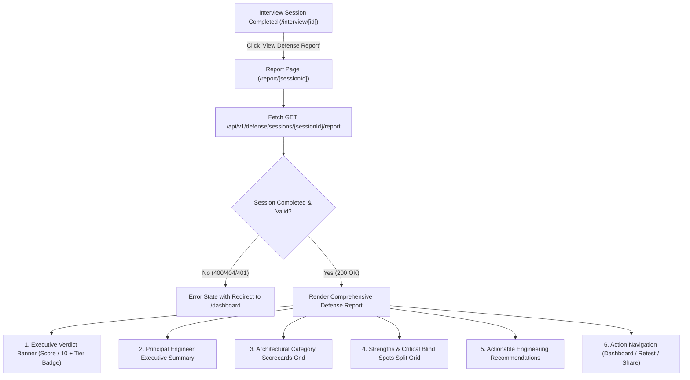

# 📄 Technical Specification: Step 1.16b — Next.js 15 Comprehensive Defense Report Page

> **Milestone ID**: `1.16b`  
> **Target Module**: `frontend/src/types/report.ts`, `frontend/src/lib/defenseApi.ts`, `frontend/src/components/domain/CategoryScorecard.tsx`, `frontend/src/app/report/[id]/page.tsx`, `frontend/src/app/interview/[id]/page.tsx`  
> **Git Feature Branch**: `feat/step-1-16b-defense-report-ui`  
> **Status**: 📋 Ready for Implementation  
> **Created**: 2026-11-05  

---

## 1. Executive Summary

Per **Gemini.md** (Sections 2, 4, 5, 9) and **implementation_plan.md** (Milestone 1.16):  
RepoDefense authenticates candidate codebase comprehension by conducting rigorous architectural stress tests and providing an objective, verifiable defense transcript and evaluation score. 

Following the implementation of the backend evaluation schemas and LiteLLM report synthesis API in **Step 1.16a**, **Step 1.16b** delivers the user-facing **Comprehensive Defense Report Page** in Next.js 15 App Router (`frontend/src/app/report/[id]/page.tsx`).

The report interface provides candidates and reviewers with an executive-grade architectural debrief:
1. **Executive Verdict & Overall Score**: Prominent visual scorecard featuring the overall score ($0.0 - 10.0$) and color-coded Principal Engineer defensibility verdict (*Certified Principal Defense*, *Solid Architectural Defense*, or *Architectural Remediation Required*).
2. **Executive Summary Callout**: Contextual narrative synthesized by the AI Principal Engineer persona summarizing the candidate's grasp of their system design.
3. **Architectural Category Scorecards**: Granular performance cards across the 5 core domains (`architecture`, `scalability`, `reliability`, `security`, `tradeoffs`) with progress bars, status badges (`passed`, `needs_work`, `remediated`), and specific domain feedback.
4. **Key Strengths vs Critical Blind Spots**: Two-column breakdown contrasting areas of high technical maturity against vulnerabilities exposed during stress-testing.
5. **Actionable Recommendations**: Concrete engineering mitigations and refactorings to address architectural gaps before live production or technical interviews.
6. **Seamless Session Navigation**: Integration with `interview/[id]/page.tsx` directing completed sessions to the dedicated report page.

---

## 2. Dependencies & Prerequisites

- **Depends on**:
  - Step 1.16a (`GET /api/v1/defense/sessions/{session_id}/report`, `backend/app/schemas/report.py`)
  - Milestone 1.14b (`frontend/src/app/interview/[id]/page.tsx`, `frontend/src/lib/defenseApi.ts`)
  - Milestone 1.3b (Supabase Auth Client & JWT token management)
- **Blocked by**: None.
- **Tech Stack Invariant**:
  - Next.js 15 (App Router) + TypeScript + Tailwind CSS + Lucide Icons.
  - Zero arbitrary code execution; pure static rendering with client-side reactive data fetching.
  - Strictly $\le 300$ LOC per file across all new and modified components.

---

## 3. 🛡️ Invariants & Security Impact

- [x] **Zero Code Execution**: Pure presentation layer; no code execution or script evaluation.
- [x] **Client-Side Sanitization & XSS Defense**: React JSX handles automatic string escaping for all LLM-synthesized narrative strings.
- [x] **Stateless JWT Authorization**: API requests to `/api/v1/defense/sessions/{id}/report` require valid Supabase JWT Bearer authentication.
- [x] **Multi-Tenant Isolation**: Backend enforces ownership verification; frontend gracefully handles 401 Unauthorized / 404 Not Found states with redirect to `/dashboard`.
- [x] **300 LOC Invariant**: Components are modularized cleanly:
  - `frontend/src/types/report.ts` ($\le 50$ LOC)
  - `frontend/src/lib/defenseApi.ts` ($\le 145$ LOC)
  - `frontend/src/components/domain/CategoryScorecard.tsx` ($\le 120$ LOC)
  - `frontend/src/app/report/[id]/page.tsx` ($\le 240$ LOC)
  - `frontend/src/app/interview/[id]/page.tsx` ($\le 270$ LOC)

---

## 3.5. 🩺 Specialized Domain Skill Directives

Per `.agents/skills/plan_step/SKILL.md` (v2.1):
The following specialized skills are assigned to Step 1.16b and will be audited during `/verify_step`:
1. **`eval_persona`**:
   - Verify that the report presentation strictly respects the tone calibration of the Principal Engineer persona (objective, authoritative, constructive).
   - Ensure the UI clearly reflects the 3 verdict tiers (*Certified Principal Defense* $\ge 7.5$, *Solid Architectural Defense* $\ge 5.0$, *Architectural Remediation Required* $< 5.0$) with appropriate chromatic hierarchy (emerald, blue, amber/rose).
2. **`code_reviewer`**:
   - Assert all new and modified frontend files adhere to the strict $\le 300$ LOC limit.
   - Enforce clean TypeScript strict typings (zero `any` types).
   - Validate Next.js 15 client-side data fetching hooks (`useParams`, `useCallback`, `useEffect`).

---

## 4. UI Architecture & Route Design



---

## 5. Data Contracts & Interfaces

### 5.1 TypeScript Contracts (`frontend/src/types/report.ts`)

```typescript
import type { QuestionCategory } from "./defense";

export type CategoryEvaluationStatus = "passed" | "needs_work" | "remediated";

export interface CategoryScore {
  category: QuestionCategory;
  score: number;
  questions_count: number;
  status: CategoryEvaluationStatus | string;
  summary: string;
}

export interface DefenseReportResponse {
  session_id: string;
  project_id: string;
  overall_score: number;
  verdict: string;
  summary: string;
  category_scores: CategoryScore[];
  key_strengths: string[];
  critical_blind_spots: string[];
  actionable_recommendations: string[];
  total_questions: number;
  completed_at: string;
}
```

### 5.2 API Client Extension (`frontend/src/lib/defenseApi.ts`)

```typescript
export async function getDefenseReport(
  sessionId: string,
  token: string
): Promise<DefenseReportResponse> {
  const response = await fetch(`${API_BASE}/api/v1/defense/sessions/${sessionId}/report`, {
    method: "GET",
    headers: {
      Authorization: `Bearer ${token}`,
    },
  });

  if (!response.ok) {
    const message = await parseApiError(response, "Failed to retrieve defense report");
    throw new Error(message);
  }

  return response.json();
}
```

---

## 6. Step-by-Step Implementation Sequence

1. **Step 1: TypeScript Data Contracts & API Client**
   - Create `frontend/src/types/report.ts` defining `CategoryScore` and `DefenseReportResponse`.
   - Update `frontend/src/lib/defenseApi.ts` to export `getDefenseReport`.
2. **Step 2: Modular Domain Component (`CategoryScorecard.tsx`)**
   - Create `frontend/src/components/domain/CategoryScorecard.tsx` displaying:
     - Category title & icon.
     - Progress bar with numerical score ($X.X / 10$).
     - Status tag (`passed`, `needs_work`, `remediated`) with distinct color themes.
     - Qualitative assessment summary.
3. **Step 3: Comprehensive Report Page (`frontend/src/app/report/[id]/page.tsx`)**
   - Implement dynamic route `/report/[id]` (where `[id]` is `sessionId`).
   - Add auth session check with Supabase client; redirect unauthenticated users to `/login`.
   - Fetch report via `getDefenseReport(sessionId, token)`.
   - Render executive verdict banner, overall score circle/badge, category scorecards grid, strengths/blind spots comparison, and actionable recommendations list.
   - Include back-to-dashboard navigation and retry triggers.
4. **Step 4: Interview UI Navigation Hookup (`interview/[id]/page.tsx`)**
   - Update the completion scorecard in `frontend/src/app/interview/[id]/page.tsx` with a primary button linking to `/report/${session.session_id}` ("View Comprehensive Defense Report").

---

## 7. Verification & Acceptance Criteria

### Automated Type & Build Checks
```bash
# In frontend/
npx tsc --noEmit
npm run build
```

### Acceptance Checklist
- [x] Dynamic report route `/report/[id]` compiles cleanly with Next.js 15 App Router.
- [x] Report loads session report from FastAPI backend with Supabase bearer token.
- [x] Overall score and verdict banner render correctly across all 3 tiers.
- [x] Category scorecards display progress bar, status badge, and domain summary.
- [x] Strengths and critical blind spots render in clear, contrasting visual cards.
- [x] Actionable recommendations are listed with concrete technical takeaways.
- [x] Defense interview completion card links directly to the generated report.
- [x] All touched files strictly conform to the $\le 300$ LOC limit.
