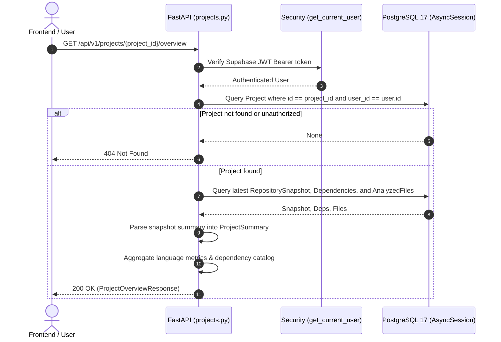

# 📄 Technical Specification: Step 1.17a — Backend Project Overview Aggregator & REST API

> **Milestone ID**: `1.17a`  
> **Target Module**: `backend/app/schemas/project.py`, `backend/app/api/v1/projects.py`, `backend/tests/test_project_overview.py`  
> **Git Feature Branch**: `feat/step-1-17a-project-overview-backend`  
> **Status**: 📋 Ready for Implementation  
> **Created**: 2026-11-05  

---

## 1. Executive Summary

Per **Gemini.md** (Sections 2, 4, 9) and **implementation_plan.md** (Milestone 1.17):  
Before a candidate enters a 45-minute architectural defense session, they need a comprehensive overview of how RepoDefense cataloged and analyzed their repository. 

While the ingestion pipeline (Milestones 1.5–1.12) extracts file trees, AST symbols, dependencies, contributors, and local embeddings into PostgreSQL 17, and synthesizes an AI project summary (Milestone 1.10), the backend previously only exposed high-level project metadata (`id`, `name`, `status`, `github_url`) and evidence rows.

**Step 1.17a** implements the backend aggregation layer and REST API endpoint `GET /api/v1/projects/{project_id}/overview`. It aggregates:
1. **Core Project Identity**: Project UUID, name, GitHub URL, default branch, and current analysis status.
2. **Latest Snapshot & AI Summary**: The most recent `RepositorySnapshot` commit SHA, analyzed timestamp, and parsed `ProjectSummary` (tagline, primary language, detected frameworks, architectural style, key components, and architectural narrative).
3. **Repository Metrics**: Scanned file count, total lines of code, language breakdown (language names with file counts and line distributions), total AST symbols, and total vector embeddings.
4. **Third-Party Dependencies**: Structured list of runtime and dev packages (`name`, `version`, `package_manager`, `is_dev`) extracted from manifests.
5. **Git Contributors**: Top contributors and commit attribution metrics.

---

## 2. Dependencies & Prerequisites

- **Depends on**:
  - Milestone 1.2a & 1.2b (SQLAlchemy core models: `Project`, `RepositorySnapshot`, `AnalyzedFile`, `Dependency`)
  - Milestone 1.6 (File Scanning & Language Detection)
  - Milestone 1.8 (Dependency Extraction)
  - Milestone 1.10 (Project Summary Schema: `app.schemas.summary.ProjectSummary`)
- **Blocked by**: None.
- **Tech Stack Invariant**:
  - FastAPI backend with async SQLAlchemy 2.0 and Pydantic v2.
  - Zero external code execution; pure relational aggregation and JSON parsing.
  - Strictly $\le 300$ LOC per file across all touched modules.

---

## 3. 🛡️ Invariants & Security Impact

- [x] **Zero Code Execution**: Strictly static database querying and JSON parsing; no subprocess execution.
- [x] **Multi-Tenant Isolation**: The endpoint verifies `Project.user_id == current_user.id` on every query, returning `HTTP 404 Not Found` if unauthorized or nonexistent.
- [x] **Safe JSON Deserialization**: `RepositorySnapshot.summary` is validated against Pydantic schema `ProjectSummary` with fallback defaults if pending or malformed.
- [x] **Parameterized Queries**: All queries execute via SQLAlchemy 2.0 parameterized expressions (`select()`).
- [x] **300 LOC Invariant**:
  - `backend/app/schemas/project.py`: currently 70 LOC $\rightarrow$ stays $\le 160$ LOC.
  - `backend/app/api/v1/projects.py`: currently 174 LOC $\rightarrow$ stays $\le 260$ LOC.
  - `backend/tests/test_project_overview.py`: $\le 200$ LOC.

---

## 3.5. 🩺 Specialized Domain Skill Directives

Per `.agents/skills/plan_step/SKILL.md` (v2.1):
The following specialized skills are assigned to Step 1.17a and will be audited during `/verify_step`:
1. **`security_auditor`**:
   - Assert strict multi-tenant isolation on `GET /api/v1/projects/{project_id}/overview`.
   - Prevent data leakage of snapshots or dependencies across user boundaries.
2. **`code_reviewer`**:
   - Assert async query efficiency (e.g. eager-loading or targeted selects avoiding N+1 queries).
   - Ensure all files strictly conform to the $\le 300$ LOC limit.
   - Enforce clean Pydantic v2 schemas with `model_config = ConfigDict(from_attributes=True)`.

---

## 4. Architecture & Data Flow



---

## 5. Data Contracts & Schemas (`backend/app/schemas/project.py`)

```python
from typing import Dict, List, Optional
from datetime import datetime
import uuid
from pydantic import BaseModel, ConfigDict, Field
from app.schemas.summary import ProjectSummary

class DependencyOverviewItem(BaseModel):
    name: str
    version: Optional[str] = None
    package_manager: str
    is_dev: bool = False

class LanguageMetric(BaseModel):
    language: str
    file_count: int
    total_lines: int

class RepositoryOverviewMetrics(BaseModel):
    total_files: int = 0
    total_lines: int = 0
    languages: List[LanguageMetric] = []
    dependency_count: int = 0
    evidence_count: int = 0

class ProjectOverviewResponse(BaseModel):
    project_id: uuid.UUID
    name: str
    github_url: str
    default_branch: str
    status: str
    created_at: datetime
    updated_at: datetime
    commit_hash: Optional[str] = None
    summary: Optional[ProjectSummary] = None
    metrics: RepositoryOverviewMetrics
    dependencies: List[DependencyOverviewItem] = []

    model_config = ConfigDict(from_attributes=True)
```

---

## 6. Step-by-Step Implementation Sequence

1. **Step 1: Pydantic Schemas (`backend/app/schemas/project.py`)**
   - Add `DependencyOverviewItem`, `LanguageMetric`, `RepositoryOverviewMetrics`, and `ProjectOverviewResponse`.
   - Ensure imports from `app.schemas.summary` are clean.
2. **Step 2: FastAPI Endpoint (`backend/app/api/v1/projects.py`)**
   - Implement `GET /api/v1/projects/{project_id}/overview`.
   - Verify user ownership (`Project.user_id == current_user.id`).
   - Query latest `RepositorySnapshot` for the project.
   - Query associated `Dependency` records.
   - Aggregate `AnalyzedFile` language distribution and line counts.
   - Parse `snapshot.summary` into `ProjectSummary` if present; return default metrics if still pending.
3. **Step 3: Hermetic Unit & Integration Tests (`backend/tests/test_project_overview.py`)**
   - Test 401 unauthenticated request rejection.
   - Test 404 for nonexistent or foreign user project.
   - Test 200 OK with pending project (no snapshot yet).
   - Test 200 OK with fully analyzed project (snapshot summary, dependencies, and file metrics).

---

## 7. Verification & Acceptance Criteria

### Automated Tests
```bash
python -m pytest backend/tests/test_project_overview.py -v
python -m ruff check backend/app backend/tests
```

### Acceptance Checklist
- [x] Endpoint `GET /api/v1/projects/{project_id}/overview` returns comprehensive overview data.
- [x] Tenant isolation verified (unauthorized access returns 404).
- [x] Handles both pending projects (empty snapshot) and completed snapshots gracefully.
- [x] Zero arbitrary code execution; pure static relational queries.
- [x] All touched files strictly conform to the $\le 300$ LOC limit.
