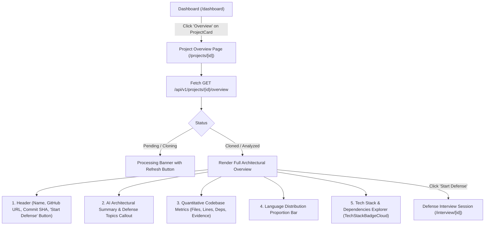

# 📄 Technical Specification: Step 1.17b — Next.js 15 Project Overview Page & Tech Stack Visualizer

> **Milestone ID**: `1.17b`  
> **Target Module**: `frontend/src/types/project.ts`, `frontend/src/lib/projectApi.ts`, `frontend/src/components/domain/TechStackBadgeCloud.tsx`, `frontend/src/app/projects/[id]/page.tsx`, `frontend/src/components/domain/ProjectCard.tsx`  
> **Git Feature Branch**: `feat/step-1-17b-project-overview-ui`  
> **Status**: 📋 Ready for Implementation  
> **Created**: 2026-11-05  

---

## 1. Executive Summary

Per **Gemini.md** (Sections 2, 4, 9, 10) and **implementation_plan.md** (Milestone 1.17):  
Before entering an intense, 45-minute architectural defense session, developers need a polished, transparent view of what RepoDefense extracted from their repository. 

Following the backend overview API implementation in **Step 1.17a**, **Step 1.17b** builds the user-facing **Project Overview Page** in Next.js 15 App Router (`frontend/src/app/projects/[id]/page.tsx`).

The Project Overview page provides developers with:
1. **Repository Identity & Ingestion Status**: Real-time status indicator, branch name, commit hash, and GitHub link.
2. **AI Architectural Summary & Narrative**: Deep-dive narrative grounded in code evidence, system tagline, architectural style (e.g. Modular Monolith, Microservices), key components, and anticipated stress-test defense topics.
3. **Quantitative Codebase Metrics**: Overview cards displaying total scanned files, total lines of code, dependency count, and load-bearing evidence items.
4. **Language Distribution Bar**: Visual proportion bar showing the percentage of lines of code across detected programming languages.
5. **Tech Stack & Dependencies Explorer (`TechStackBadgeCloud`)**: Interactive badge cloud of detected frameworks and cataloged third-party libraries (distinguishing runtime vs dev dependencies).
6. **Prominent "Start Defense" CTA**: Direct launchpad to initiate the defense interview session (`/interview/[id]`).

---

## 2. Dependencies & Prerequisites

- **Depends on**:
  - Step 1.17a (`GET /api/v1/projects/{project_id}/overview`, `backend/app/schemas/project.py`)
  - Milestone 1.4b (`frontend/src/app/dashboard/page.tsx`, `frontend/src/components/domain/ProjectCard.tsx`)
  - Milestone 1.3b (Supabase Auth Client & JWT token management)
- **Blocked by**: None.
- **Tech Stack Invariant**:
  - Next.js 15 App Router + React 19 + TypeScript 5 + Tailwind CSS + Lucide Icons.
  - Zero arbitrary code execution; pure presentation of sanitized backend analysis records.
  - Strictly $\le 300$ LOC per file across all new and modified components.

---

## 3. 🛡️ Invariants & Security Impact

- [x] **Zero Code Execution**: Pure presentation of static analysis facts; no scripts or terminal commands executed on candidate code.
- [x] **Client-Side XSS Protection**: React JSX automatically escapes all summary strings, library names, and descriptions.
- [x] **Stateless JWT Authorization**: API calls require valid Supabase JWT Bearer token; redirects unauthenticated users to `/login`.
- [x] **Multi-Tenant Protection**: Backend enforces user project ownership; 404/401 errors are caught and render a clean fallback with navigation to `/dashboard`.
- [x] **300 LOC Invariant**:
  - `frontend/src/types/project.ts`: $\le 60$ LOC
  - `frontend/src/lib/projectApi.ts`: $\le 60$ LOC
  - `frontend/src/components/domain/TechStackBadgeCloud.tsx`: $\le 120$ LOC
  - `frontend/src/app/projects/[id]/page.tsx`: $\le 260$ LOC
  - `frontend/src/components/domain/ProjectCard.tsx`: $\le 140$ LOC

---

## 3.5. 🩺 Specialized Domain Skill Directives

Per `.agents/skills/plan_step/SKILL.md` (v2.1):
The following specialized skills are assigned to Step 1.17b and will be audited during `/verify_step`:
1. **`eval_persona`**:
   - Ensure the AI project summary presentation (architectural style, key components, defense topics) clearly communicates the Principal Engineer perspective and sets expectations for repository stress testing.
2. **`code_reviewer`**:
   - Assert all files strictly adhere to the $\le 300$ LOC limit.
   - Enforce clean TypeScript strict typings (zero `any`).
   - Validate Next.js 15 client-side lifecycle and error handling.

---

## 4. UI Architecture & Navigation Flow



---

## 5. Data Contracts & Interfaces (`frontend/src/types/project.ts`)

```typescript
export interface DependencyOverviewItem {
  name: string;
  version?: string | null;
  source_file: string;
  is_dev: boolean;
}

export interface LanguageMetric {
  language: string;
  file_count: number;
  total_lines: number;
}

export interface RepositoryOverviewMetrics {
  total_files: number;
  total_lines: number;
  languages: LanguageMetric[];
  dependency_count: number;
  evidence_count: number;
}

export interface ProjectSummary {
  title: string;
  tagline: string;
  primary_language: string;
  detected_frameworks: string[];
  architectural_style: string;
  key_components: string[];
  potential_defense_topics: string[];
  narrative: string;
}

export interface ProjectOverviewResponse {
  project_id: string;
  name: string;
  github_url: string;
  default_branch: string;
  status: string;
  created_at: string;
  updated_at: string;
  commit_hash?: string | null;
  summary?: ProjectSummary | null;
  metrics: RepositoryOverviewMetrics;
  dependencies: DependencyOverviewItem[];
}
```

---

## 6. Step-by-Step Implementation Sequence

1. **Step 1: TypeScript Interfaces (`frontend/src/types/project.ts`)**
   - Add `DependencyOverviewItem`, `LanguageMetric`, `RepositoryOverviewMetrics`, `ProjectSummary`, and `ProjectOverviewResponse`.
2. **Step 2: API Client (`frontend/src/lib/projectApi.ts`)**
   - Implement `getProjectOverview(projectId: string, token: string): Promise<ProjectOverviewResponse>`.
3. **Step 3: Tech Stack Badge Cloud (`frontend/src/components/domain/TechStackBadgeCloud.tsx`)**
   - Build modular badge cloud component displaying detected frameworks, architectural style, and searchable dependency tags with dev/runtime indicators.
4. **Step 4: Project Overview Page (`frontend/src/app/projects/[id]/page.tsx`)**
   - Implement dynamic route `/projects/[id]` with client-side state.
   - Header with back to Dashboard, commit SHA, and primary "Start Defense" button.
   - Metric scorecard grid (total files, total lines, dependencies, evidence count).
   - Language distribution colored bar.
   - AI architectural narrative and potential defense topics card.
   - Dependencies & Tech Stack Explorer.
5. **Step 5: ProjectCard Navigation Hookup (`frontend/src/components/domain/ProjectCard.tsx`)**
   - Add "Overview" button linking to `/projects/${project.id}` next to "Start Defense".

---

## 7. Verification & Acceptance Criteria

### Automated Type & Build Checks
```bash
cd frontend && npx tsc --noEmit && npm run build
```

### Acceptance Checklist
- [x] Dynamic project overview route `/projects/[id]` compiles cleanly with Next.js 15 App Router.
- [x] Consumes `GET /api/v1/projects/{project_id}/overview` with Supabase JWT bearer token.
- [x] Displays AI summary narrative, architectural style, and defense stress-test topics.
- [x] Renders language distribution bar and quantitative metric cards.
- [x] Renders dependencies list with runtime vs dev categorization.
- [x] Prominent "Start Defense" CTA links seamlessly to `/interview/[id]`.
- [x] All modified and created files strictly conform to the $\le 300$ LOC limit.
