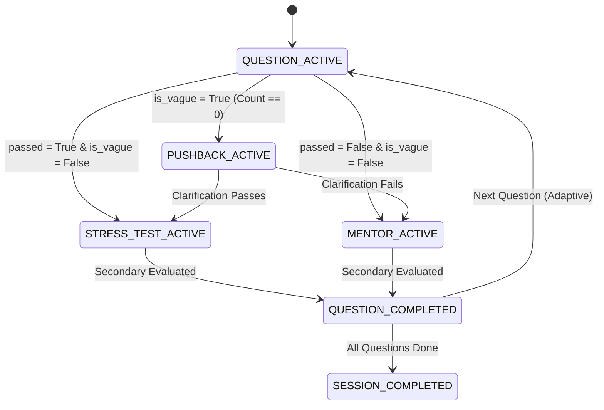

# 📄 Technical Specification: AI Pushback Logic & Multi-Turn Clarification Engine

> **Step ID**: `Step 2.5`  
> **Target Module**: `backend/app/ai/...` & `frontend/src/...`  
> **Git Feature Branch**: `feat/step-2-5-ai-pushback-logic`  
> **Status**: 📋 Draft / Ready for Implementation  
> **Created**: 2026-11-06  

---

## 1. Executive Summary

Step 2.5 delivers **Milestone 2.5: AI Pushback Logic** under Phase 2 (Differentiation). In the baseline defense interview FSM (Milestones 1.14 & 2.4), a candidate's answer branched immediately into either a stress test (if $\text{score} \ge 6$) or mentor remediation (if $\text{score} < 6$).

However, in authentic Principal Engineer interviews, vague, evasive, or generic textbook responses are neither immediately rewarded nor spoon-fed with hints. Instead, the interviewer **pushes back**, directly challenging the candidate to ground their claims in specific codebase mechanisms (e.g. *"That's standard theory, but looking at `services/cache.py`, how exactly do you prevent thundering herd on cache misses?"*).

This milestone equips RepoDefense with:
1. **Pushback State Transition (`PUSHBACK_ACTIVE`)**: Discrete FSM dialogue state triggered when an initial defense is vague or superficial (`is_vague=True`).
2. **Pushback Prompting & Evaluation**: Updates the Principal Engineer evaluation prompt to detect generic answers and synthesize pointed, evidence-anchored pushback questions.
3. **Multi-Turn Resolution**: Enables the candidate to clarify their implementation before final scoring and branch progression (transitioning to stress test if clarified, or mentor remediation if still inadequate).
4. **Visual Pushback Dialogue Indicator**: Distinctive styling in Next.js 15 UI (`DefenseTurnBubble.tsx`) presenting the "Principal Engineer Pushback" badge in rose/amber alert styling.

---

## 2. Dependencies & Prerequisites

- **Depends on**:
  - `Milestone 2.4`: Adaptive Questioning State Machine (`fsm.py`, `adaptive.py`, `defense.py`).
  - Next.js 15 App Router & React components (`DefenseTurnBubble.tsx`).
- **Blocked by**: None.
- **Tech Stack Invariants**:
  - FastAPI (Python 3.12+) + Next.js 15 App Router.
  - Zero code execution; static analysis evidence grounding only.
  - Strict compliance with `Gemini.md` architecture and file length limits ($\le 300$ LOC per file).

---

## 3. 🛡️ Security, Grounding & Invariants Impact

- [x] **Zero Code Execution**: Dialogue turns and evaluations remain strictly static text exchanges; no arbitrary code execution.
- [x] **Evidence-Anchored Pushback**: Pushback prompts must reference actual repository file paths and AST symbols from question context.
- [x] **Prompt Injection Defense**: All candidate clarification inputs are sanitized through existing XML delimiter isolation (`<candidate_defense>`).

---

## 4. 🧭 Specialized Skills Directive

| Specialized Skill | Scope of Impact & Mandate | Verification Requirement |
| :--- | :--- | :--- |
| **[`eval_persona`](file:///d:/RepoDefense/.agents/skills/eval_persona/SKILL.md)** | Audits Principal Engineer persona tone during pushback (demanding, analytical, pressing for implementation evidence without revealing answers). | Validates that pushback prompts press for code specifics without giving away the solution. |
| **[`doctor`](file:///d:/RepoDefense/.agents/skills/doctor/SKILL.md)** | Pre-flight and post-implementation health checks across Python pytest, Ruff linting, TypeScript typecheck, and Next.js build. | Asserts 100% test pass rate with zero lint or typing errors. |

---

## 5. 🧠 Sequential Thinking & Architecture Strategy

### 5.1 FSM State Progression with Pushback

### 5.2 Component Modularity & LOC Guardrails
- `backend/app/schemas/defense.py`: Add `PUSHBACK_ACTIVE`, `is_vague`, `pushback_prompt`, `pushback_response`, `pushback_count` (~235 LOC).
- `backend/app/ai/prompts.py`: Update `DEFENSE_EVALUATION_SYSTEM_PROMPT` with vague answer detection guidelines (~275 LOC).
- `backend/app/ai/fallbacks.py`: Support `is_vague` and `pushback_prompt` in fallback evaluation (~230 LOC).
- `backend/app/ai/fsm.py`: Handle `PUSHBACK_ACTIVE` transition and multi-turn resolution (~295 LOC).
- `frontend/src/types/defense.ts`: Add `pushback_active` to `DefenseStage` (~90 LOC).
- `frontend/src/components/domain/DefenseTurnBubble.tsx`: Style pushback turn bubble (~140 LOC).
- `backend/tests/test_pushback.py`: 6 hermetic tests covering pushback triggering, clarification passing, and clarification failing (~230 LOC).

---

## 6. Quality Gate & Acceptance Criteria

1. **Backend Tests**: `python -m pytest backend/tests/test_pushback.py -v` passes 100%.
2. **Regression Check**: `test_adaptive_questioning.py` and `test_defense_session.py` continue passing 100%.
3. **Ruff Linter**: `python -m ruff check backend/app backend/tests` returns 0 errors.
4. **TypeScript & Next.js**: `npm --prefix frontend run typecheck` and `npm --prefix frontend run build` return 0 errors.
5. **LOC Audit**: Every file strictly complies with $\le 300$ LOC.
