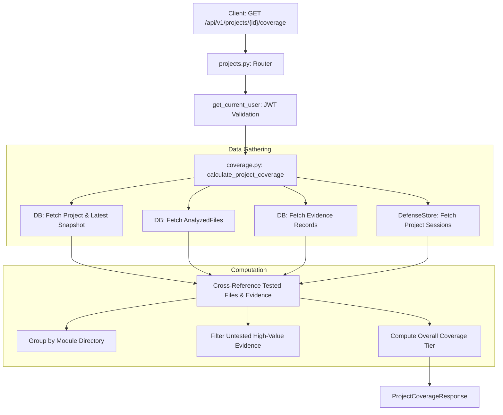

# 📄 Technical Specification: Backend Coverage Tracking & Module Heatmap API

> **Step ID**: `Step 2.6a`  
> **Target Module**: `backend/app/schemas/coverage.py`, `backend/app/services/coverage.py`, `backend/app/api/v1/projects.py`  
> **Git Feature Branch**: `feat/step-2-6a-backend-coverage-tracking`  
> **Status**: 📋 In Progress / Ready for Verification  
> **Created**: 2026-11-06  

---

## 1. Executive Summary

Step 2.6a implements the backend engine for **Milestone 2.6: Repository Coverage Tracking** under Phase 2 (Differentiation). 

In authentic technical evaluations, interviewers and candidates need visibility into which parts of a repository have been defended and which remain untested blind spots. Without coverage tracking, an interview session might repeatedly test the same authentication middleware while completely ignoring high-risk payment processors, database transaction pipelines, or background workers.

This milestone equips RepoDefense with:
1. **Coverage Data Contracts (`backend/app/schemas/coverage.py`)**:
   - `FileCoverageItem`: file path, language, line count, tested flag, test count, associated evidence count, average defense score.
   - `ModuleCoverageItem`: module/directory name, file counts, coverage percentage, status (`tested`, `partial`, `untested`).
   - `BlindSpotItem`: high-priority untested files containing architectural evidence (database, auth, queues, endpoints) requiring defense.
   - `ProjectCoverageResponse`: aggregate metrics, coverage tier (*Needs More Defense*, *Substantial Coverage*, *Principal Verified*), module heatmap items, and blind spots.
2. **Session Store Project Lookup (`fsm.py`)**:
   - `get_by_project(project_id: str)` method in `DefenseSessionStore` to retrieve all historical and active sessions for a repository.
3. **Coverage Computation Engine (`backend/app/services/coverage.py`)**:
   - Aggregates latest `RepositorySnapshot`, `AnalyzedFile`, and `Evidence` database records for a project.
   - Cross-references cited files (`question.cited_files`) and evidence (`question.cited_evidence_ids`) across completed and active questions.
   - Groups files into hierarchical module directories (e.g. `backend/app/services`, `frontend/src/components`) for heatmap visualization.
   - Identifies high-priority untested blind spots.
4. **REST API Endpoint (`GET /api/v1/projects/{project_id}/coverage`)**:
   - Protected endpoint requiring Supabase JWT bearer token authentication.
   - Enforces strict multi-tenant project ownership validation.
5. **Hermetic Test Suite (`backend/tests/test_coverage.py`)**:
   - Validates coverage calculation with zero sessions (0% coverage, blind spots highlighted).
   - Validates coverage with active and completed defense sessions.
   - Asserts multi-tenant access control (`403 Forbidden` / `404 Not Found`).

---

## 2. Dependencies & Prerequisites

- **Depends on**:
  - `Milestone 1.2b`: `AnalyzedFile` and `Evidence` SQLAlchemy models.
  - `Milestone 1.14a` & `2.5`: `DefenseSessionState`, `DefenseQuestionProgress`, and `fsm.py`.
- **Blocked by**: None.
- **Tech Stack Invariants**:
  - FastAPI (Python 3.12+) + SQLAlchemy 2.0 Async + Pydantic v2.
  - Zero arbitrary code execution; static metadata and session turn cross-referencing only.
  - Strict compliance with `Gemini.md` architecture and file length limits ($\le 300$ LOC per file).

---

## 3. 🛡️ Security, Grounding & Invariants Impact

- [x] **Zero Code Execution**: Pure database queries and in-memory set intersections; no user code execution.
- [x] **Multi-Tenant Isolation**: Queries strictly assert `Project.user_id == current_user.id`.
- [x] **Deterministic Fact Grounding**: File paths, evidence IDs, and line counts correspond 1:1 with cataloged database records.

---

## 4. 🧭 Specialized Skills Directive

| Specialized Skill | Scope of Impact & Mandate | Verification Requirement |
| :--- | :--- | :--- |
| **[`doctor`](file:///d:/RepoDefense/.agents/skills/doctor/SKILL.md)** | Pre-flight and post-implementation health checks across Python pytest and Ruff linting. | 100% test pass rate with zero lint errors. |
| **[`security_auditor`](file:///d:/RepoDefense/.agents/skills/security_auditor/SKILL.md)** | Multi-tenant authorization and path traversal check. | Asserts non-owners cannot view coverage data for other projects. |

---

## 5. 🧠 Architecture Strategy & Data Flow

---

## 6. Quality Gate & Acceptance Criteria

1. **Backend Tests**: `python -m pytest backend/tests/test_coverage.py -v` passes 100%.
2. **Regression Check**: `test_pushback.py`, `test_adaptive_questioning.py`, and `test_defense_session.py` continue passing 100%.
3. **Ruff Linter**: `python -m ruff check backend/app backend/tests` returns 0 errors.
4. **TypeScript & Next.js**: `npm --prefix frontend run typecheck` and `npm --prefix frontend run build` return 0 errors.
5. **LOC Audit**: Every modified and created file strictly complies with $\le 300$ LOC.
