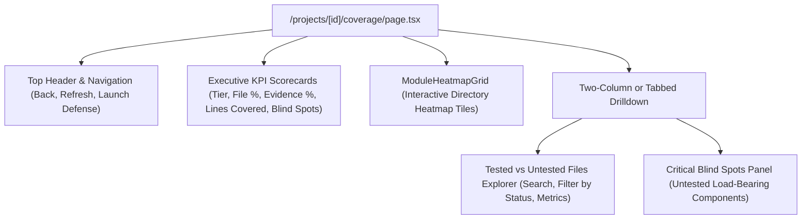

# 📄 Technical Specification: Next.js 15 Repository Coverage Heatmap & Tested vs Untested Visualizer

> **Step ID**: `Step 2.6b`  
> **Target Module**: `frontend/src/...`  
> **Git Feature Branch**: `feat/step-2-6b-repository-coverage-heatmap`  
> **Status**: 📋 Draft / Ready for Implementation  
> **Created**: 2026-11-06  

---

## 1. Executive Summary

Step 2.6b completes **Milestone 2.6 (Repository Coverage Tracking)** under Phase 2 (Differentiation). In Step 2.6a, the backend coverage tracking engine and REST API (`GET /api/v1/projects/{project_id}/coverage`) were successfully deployed and verified, cross-referencing completed/active defense sessions, cataloged source files, and architectural evidence records.

This milestone delivers the Next.js 15 App Router frontend visualizer to provide candidates and reviewers with an interactive, high-fidelity view of repository defense coverage. The interface provides:
1. **Executive Coverage Scorecards**: High-level KPIs displaying the overall coverage tier (*Needs More Defense*, *Substantial Coverage*, *Principal Verified*), file coverage percentage, architectural evidence coverage percentage, total lines covered, and untested blind spots count.
2. **Interactive Module Heatmap Grid**: Visual directory-level tiles (e.g. `backend/app/services`, `frontend/src/components`) color-coded by defense density (`tested`, `partial`, `untested`) with real-time directory drilldown filtering.
3. **Tested vs Untested Files Explorer**: Searchable and filterable data table/list showing per-file defense status, language, physical LOC, test counts, average defense score (1.0–10.0), and highest difficulty tier reached.
4. **Untested Blind Spot Inspector**: Ranked list of critical untested architectural components (e.g. database transactions, auth middlewares, message brokers) highlighting file paths, line ranges, and priority badges (`critical`, `high`, `medium`) with direct CTAs to initiate focused defenses.
5. **Project Overview Integration**: Quick-action navigation pill in `/projects/[id]` linking directly to the coverage visualizer.

---

## 2. Dependencies & Prerequisites

- **Depends on**:
  - `Step 2.6a`: Backend Coverage Tracking & Module Heatmap API (`GET /api/v1/projects/{project_id}/coverage`).
  - `Milestone 1.4b` & `Step 2.3`: Next.js 15 App Router setup, Supabase Auth integration, and existing domain components.
  - Lucide React icon set (`Shield`, `ShieldAlert`, `ShieldCheck`, `Layers`, `Folder`, `FileCode`, `Flame`, `CheckCircle2`, `XCircle`, `AlertTriangle`).
- **Blocked by**: None.
- **Tech Stack Invariants**:
  - Strictly Next.js 15 (App Router) + TypeScript + Tailwind CSS + shadcn/ui.
  - Zero arbitrary code execution; all source file paths and evidence descriptions are safely escaped static strings.
  - Strict compliance with `Gemini.md` architecture and file length limits ($\le 300$ LOC per file).

---

## 3. 🛡️ Security, Grounding & Invariants Impact

- [x] **Zero Code Execution**: All file paths, lines, and evidence snippets are rendered as pure React text nodes with zero client-side evaluation or dangerous DOM injections.
- [x] **Safe Token Handling**: All API requests pass the Supabase JWT bearer token via `Authorization: Bearer <token>` headers without exposing secrets.
- [x] **Deterministic Fact Grounding**: Every coverage percentage, module grouping, and blind spot maps 1:1 to the backend's deterministic `calculate_project_coverage` output.
- [x] **Multi-Tenant Scoping**: All frontend requests are scoped strictly to the authenticated user's project ID (`/projects/[id]/coverage`).

---

## 4. 🧭 Specialized Skills Directive

| Specialized Skill | Scope of Impact & Mandate | Verification Requirement |
| :--- | :--- | :--- |
| **[`doctor`](file:///d:/RepoDefense/.agents/skills/doctor/SKILL.md)** | Pre-flight and post-implementation health checks across Next.js 15 App Router build (`npm run build`) and TypeScript typecheck (`npx tsc --noEmit`). | Validates zero TypeScript errors and successful production build across all routes including `/projects/[id]/coverage`. |
| **[`eval_persona`](file:///d:/RepoDefense/.agents/skills/eval_persona/SKILL.md)** | Verifies presentation of Principal Engineer coverage tiers and blind spot architectural priorities. | Asserts that blind spots prioritize load-bearing components (auth, DB, queues) and provide actionable context for technical defense. |

---

## 5. 🧠 Sequential Thinking Strategy & UI Layout



1. **State Management & Interactivity**:
   - `selectedModule`: When a user clicks a module tile in `ModuleHeatmapGrid` (e.g. `backend/app/services`), `selectedModule` is set or toggled, automatically filtering the Files Explorer to show only files starting with that prefix.
   - `statusFilter`: Dropdown or pill filter (`all`, `tested`, `untested`) allowing candidates to isolate gaps.
   - `searchQuery`: Real-time substring filter on file path or language.
2. **Visual Hierarchy & Color Coding**:
   - `Tested (100% or is_tested)`: Emerald (`bg-emerald-500/10 text-emerald-400 border-emerald-500/20`)
   - `Partial (1-99%)`: Sky/Blue or Amber (`bg-sky-500/10 text-sky-400 border-sky-500/20`)
   - `Untested (0% / Blind Spot)`: Rose or Amber (`bg-rose-500/10 text-rose-400 border-rose-500/20`)
   - `Coverage Tier`:
     - *Principal Verified*: Emerald badge with `ShieldCheck`
     - *Substantial Coverage*: Sky badge with `Shield`
     - *Needs More Defense*: Amber/Rose badge with `ShieldAlert`

---

## 6. Data Contracts & Interfaces

### 6.1 TypeScript Interfaces (`frontend/src/types/coverage.ts`)

```typescript
export type CoverageStatus = "tested" | "partial" | "untested";

export type CoverageTier = "Needs More Defense" | "Substantial Coverage" | "Principal Verified";

export interface FileCoverageItem {
  file_path: string;
  language: string;
  total_lines: number;
  is_tested: boolean;
  test_count: number;
  associated_evidence_count: number;
  tested_evidence_count: number;
  average_score?: number | null;
  highest_difficulty?: string | null;
}

export interface ModuleCoverageItem {
  module_path: string;
  total_files: number;
  tested_files: number;
  coverage_percentage: number;
  status: CoverageStatus;
}

export interface BlindSpotItem {
  file_path: string;
  evidence_id: string;
  evidence_type: string;
  title: string;
  description: string;
  start_line: number;
  end_line: number;
  priority: "critical" | "high" | "medium" | string;
}

export interface ProjectCoverageResponse {
  project_id: string;
  project_name: string;
  total_files: number;
  tested_files_count: number;
  untested_files_count: number;
  file_coverage_percentage: number;
  total_evidence_items: number;
  tested_evidence_count: number;
  evidence_coverage_percentage: number;
  total_lines_covered: number;
  overall_coverage_tier: CoverageTier;
  modules: ModuleCoverageItem[];
  files: FileCoverageItem[];
  blind_spots: BlindSpotItem[];
}
```

### 6.2 API Client (`frontend/src/lib/coverageApi.ts`)

```typescript
import type { ProjectCoverageResponse } from "@/types/coverage";

export async function getProjectCoverage(
  projectId: string,
  token: string
): Promise<ProjectCoverageResponse>;
```

---

## 7. Step-by-Step Implementation Sequence

1. **Step A: TypeScript Types & API Client**
   - [ ] Create `frontend/src/types/coverage.ts` defining all response interfaces matching `backend/app/schemas/coverage.py`.
   - [ ] Create `frontend/src/lib/coverageApi.ts` implementing `getProjectCoverage` with error handling and bearer authorization.
2. **Step B: Domain Components**
   - [ ] Create `frontend/src/components/domain/ModuleHeatmapGrid.tsx` for directory-level coverage density tiles with click-to-filter drilldown.
   - [ ] Create `frontend/src/components/domain/BlindSpotList.tsx` for displaying high-risk untested architectural evidence with priority badges.
3. **Step C: Main Coverage Visualizer Route**
   - [ ] Create `frontend/src/app/projects/[id]/coverage/page.tsx` integrating KPI scorecards, interactive heatmap grid, file search/filter table, and blind spot panel.
4. **Step D: Navigation Linking**
   - [ ] Update `frontend/src/app/projects/[id]/page.tsx` to add "Coverage Heatmap" action button.
5. **Step E: Verification & Quality Gate**
   - [ ] Run `npx tsc --noEmit` to verify type safety.
   - [ ] Run Next.js build verification to confirm static compilation and routing.

---

## 8. Quality Gate & Acceptance Criteria

1. **Type Safety & Build**: `npx tsc --noEmit` and `npm run build` pass with zero errors.
2. **Modular File Limits**: All created and modified files remain strictly $\le 300$ LOC.
3. **Interactive Visualizer**:
   - Displays real-time coverage tier, file coverage percentage, and evidence coverage percentage.
   - Module tiles accurately show `tested_files / total_files` and percentage.
   - Clicking a module tile filters the files list.
   - Blind spots list shows file paths, line ranges, and priority badges.
4. **Clean Navigation**: Direct link from project overview page to `/projects/[id]/coverage`.
