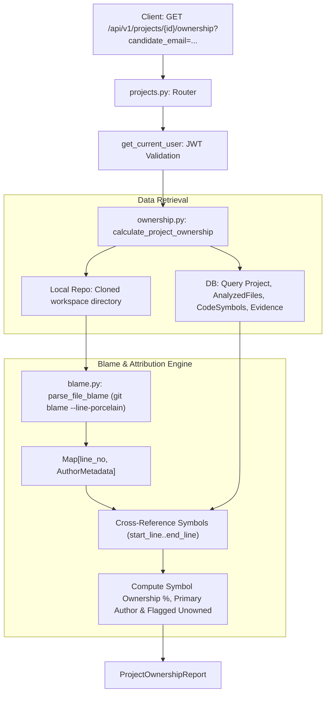

# 📄 Technical Specification: Backend Ownership Analysis Engine, Git Blame Parser & REST API

> **Step ID**: `Step 2.7a`  
> **Target Module**: `backend/app/schemas/ownership.py`, `backend/app/analyzers/blame.py`, `backend/app/services/ownership.py`, `backend/app/api/v1/projects.py`  
> **Git Feature Branch**: `feat/step-2-7a-backend-ownership-engine`  
> **Status**: 📋 Draft / Ready for Implementation  
> **Created**: 2026-11-06  

---

## 1. Executive Summary

Step 2.7a implements the backend engine for **Milestone 2.7: Ownership Analysis Engine** under Phase 2 (Differentiation).

In modern technical hiring, candidates frequently submit collaborative projects, team capstones, open-source forks, or boilerplate starters. A critical blind spot in current interview processes is determining **who actually wrote the complex, load-bearing parts of the code**. If a candidate claims to understand an asynchronous database connection pool or a custom cryptographic authentication pipeline, but `git blame` reveals that 100% of those lines were authored by another teammate or upstream library author, the interview platform must identify this discrepancy.

This milestone equips RepoDefense with:
1. **Ownership Data Contracts (`backend/app/schemas/ownership.py`)**:
   - `SymbolOwnership`: Per-symbol attribution (symbol name, symbol type, file path, line span, primary author, candidate ownership status `primary | collaborator | minor | unowned`, and author percentage breakdown).
   - `FileOwnershipSummary`: Per-file metrics (total physical lines, primary contributor, candidate lines authored, and candidate attribution %).
   - `ProjectOwnershipReport`: Aggregate repository report (candidate author email, total symbols cataloged, candidate-authored symbols count, candidate overall line ownership %, flagged unowned load-bearing symbols, and contributor breakdown).
2. **Deterministic Git Blame Parser (`backend/app/analyzers/blame.py`)**:
   - Safe asynchronous execution of `git blame --line-porcelain` using `asyncio.create_subprocess_exec` with zero shell injection risk.
   - Maps each physical line of code in a file to its commit SHA, author name, author email, and timestamp.
   - Bounded execution timeouts with graceful fallback for untracked or non-git files.
3. **Ownership Cross-Referencing Service (`backend/app/services/ownership.py`)**:
   - Cross-references extracted `CodeSymbol` records (`start_line`..`end_line`) and architectural `Evidence` records against line-by-line blame attributions.
   - Flags critical load-bearing symbols where candidate attribution is `unowned` (0%) or `minor` (<20%) to prime the AI Principal Engineer persona for targeted questioning.
4. **REST API Endpoint (`GET /api/v1/projects/{project_id}/ownership`)**:
   - Parameterized endpoint with optional `candidate_email` filter (defaults to authenticated user's email).
   - Protected by Supabase JWT bearer token authentication and multi-tenant project ownership validation.
5. **Hermetic Test Suite (`backend/tests/test_ownership.py`)**:
   - Validates line-porcelain blame parsing on committed files.
   - Validates symbol ownership calculation and candidate attribution tier classification.
   - Asserts multi-tenant access control (`403 Forbidden` / `404 Not Found`).

---

## 2. Dependencies & Prerequisites

- **Depends on**:
  - `Milestone 1.2b`: `AnalyzedFile`, `CodeSymbol`, and `Evidence` database models.
  - `Milestone 1.9`: `backend/app/analyzers/git.py` (Git commit metadata and contributor extraction).
- **Blocked by**: None.
- **Tech Stack Invariants**:
  - Strictly FastAPI (Python 3.12+) + SQLAlchemy 2.0 Async + Pydantic v2 + structlog.
  - Strictly zero arbitrary code execution; static analysis of repository git history and database metadata only.
  - Strict compliance with `Gemini.md` architecture and file length limits ($\le 300$ LOC per file).

---

## 3. 🛡️ Security, Grounding & Invariants Impact

- [x] **Zero Code Execution**: Strictly runs read-only `git blame --line-porcelain`. Never invokes arbitrary user code, hooks, or compilation.
- [x] **Subprocess Security**: Subprocesses are spawned using `asyncio.create_subprocess_exec` with explicit argument arrays, preventing shell injection.
- [x] **Path Traversal Defense**: All target file paths are validated using `Path.is_relative_to(repo_root)` before executing git operations.
- [x] **Multi-Tenant Protection**: Validates that `Project.user_id == current_user.id` on all API queries.
- [x] **Deterministic Fact Grounding**: Line ownership attribution is deterministically calculated from `git blame` stdout without AI hallucinations.

---

## 4. 🧭 Specialized Skills Directive

| Specialized Skill | Scope of Impact & Mandate | Verification Requirement |
| :--- | :--- | :--- |
| **[`security_auditor`](file:///d:/RepoDefense/.agents/skills/security_auditor/SKILL.md)** | Subprocess execution safety and path traversal containment. | Asserts that `git blame` subprocesses use argument arrays without `shell=True` and validate paths within the cloned repo directory. |
| **[`ast_inspector`](file:///d:/RepoDefense/.agents/skills/ast_inspector/SKILL.md)** | Line span mapping between Tree-sitter `CodeSymbol` coordinates and git blame lines. | Asserts that 1-indexed line spans (`start_line`..`end_line`) match physical blame line numbering without off-by-one errors. |
| **[`doctor`](file:///d:/RepoDefense/.agents/skills/doctor/SKILL.md)** | Pre-flight and post-implementation health checks across Python pytest and Ruff linting. | 100% test pass rate with zero lint errors. |

---

## 5. 🧠 Sequential Thinking Strategy & Data Flow



1. **Blame Porcelain Token State Machine**:
   - `git blame --line-porcelain` provides full header blocks per line:
     - `author <name>`
     - `author-mail <<email>>`
     - `author-time <timestamp>`
     - Followed by `\t<code_line>`
   - Parser maps each physical line number to an `AuthorLineInfo(author_name, author_email, commit_hash)`.
2. **Attribution Categorization**:
   - `candidate_pct = (candidate_lines / total_symbol_lines) * 100`
   - Categorization:
     - `candidate_pct >= 80.0`: `OwnershipStatus.PRIMARY`
     - `20.0 <= candidate_pct < 80.0`: `OwnershipStatus.COLLABORATOR`
     - `0.0 < candidate_pct < 20.0`: `OwnershipStatus.MINOR`
     - `candidate_pct == 0.0`: `OwnershipStatus.UNOWNED`
3. **Flagged Symbols for Interview Preparation**:
   - Symbols associated with critical architectural `Evidence` (e.g. database transactions, auth tokens, background queues) where `OwnershipStatus == UNOWNED` or `MINOR` are highlighted as `flagged_symbols`.

---

## 6. Data Contracts & Interfaces

### 6.1 Pydantic v2 Models (`backend/app/schemas/ownership.py`)

```python
from enum import Enum
from typing import Dict, List, Optional
from pydantic import BaseModel, Field


class OwnershipStatus(str, Enum):
    PRIMARY = "primary"
    COLLABORATOR = "collaborator"
    MINOR = "minor"
    UNOWNED = "unowned"


class AuthorShare(BaseModel):
    name: str = Field(..., description="Author display name.")
    email: str = Field(..., description="Author email address.")
    lines_authored: int = Field(default=0, ge=0)
    percentage: float = Field(default=0.0, ge=0.0, le=100.0)


class SymbolOwnership(BaseModel):
    symbol_id: str
    symbol_name: str
    symbol_type: str
    file_path: str
    start_line: int
    end_line: int
    total_lines: int
    primary_author: str
    candidate_ownership_percentage: float
    candidate_status: OwnershipStatus
    authors: List[AuthorShare] = Field(default_factory=list)
    is_architectural_evidence: bool = Field(default=False)
    evidence_type: Optional[str] = None


class FileOwnershipSummary(BaseModel):
    file_path: str
    total_lines: int
    primary_author: str
    candidate_percentage: float
    candidate_lines: int
    authors: List[AuthorShare] = Field(default_factory=list)


class ProjectOwnershipReport(BaseModel):
    project_id: str
    project_name: str
    candidate_email: str
    total_symbols_analyzed: int
    candidate_authored_symbols: int
    candidate_overall_ownership_percentage: float
    flagged_unowned_symbols: List[SymbolOwnership] = Field(default_factory=list)
    symbols: List[SymbolOwnership] = Field(default_factory=list)
    files: List[FileOwnershipSummary] = Field(default_factory=list)
    top_contributors: List[AuthorShare] = Field(default_factory=list)
```

---

## 7. Step-by-Step Implementation Sequence

1. **Step A: Schemas & Data Contracts**
   - [ ] Create `backend/app/schemas/ownership.py` defining `OwnershipStatus`, `AuthorShare`, `SymbolOwnership`, `FileOwnershipSummary`, and `ProjectOwnershipReport`.
   - [ ] Re-export schemas in `backend/app/schemas/__init__.py`.
2. **Step B: Deterministic Git Blame Analyzer**
   - [ ] Create `backend/app/analyzers/blame.py` implementing `parse_file_blame` and `extract_symbol_ownership` with subprocess timeout and path traversal protection.
3. **Step C: Ownership Aggregation Service**
   - [ ] Create `backend/app/services/ownership.py` querying database snapshots, analyzed files, symbols, and evidence to calculate comprehensive ownership metrics.
4. **Step D: REST API Route**
   - [ ] Add `GET /api/v1/projects/{project_id}/ownership` in `backend/app/api/v1/projects.py`.
5. **Step E: Automated Tests & Verification**
   - [ ] Create `backend/tests/test_ownership.py` with mock git repository and symbol attribution tests.
   - [ ] Run `ruff check` and `pytest backend/tests/test_ownership.py -v`.

---

## 8. Quality Gate & Acceptance Criteria

1. **Unit & Integration Tests**: `pytest backend/tests/test_ownership.py -v` passes 100%.
2. **LOC Limit**: All files strictly $\le 300$ lines.
3. **Security**: Zero dynamic code execution; subprocesses pass explicit argument arrays; path traversal prevented.
4. **Clean Types & Linting**: `ruff check backend/app backend/tests` passes with 0 errors.
