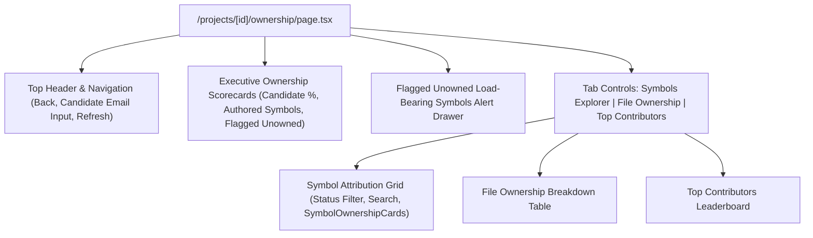

# 📄 Technical Specification: Next.js 15 Repository Ownership Visualizer & Symbol Attribution Inspector

> **Step ID**: `Step 2.7b`  
> **Target Module**: `frontend/src/...`  
> **Git Feature Branch**: `feat/step-2-7b-repository-ownership-ui`  
> **Status**: 📋 Draft / Ready for Implementation  
> **Created**: 2026-11-06  

---

## 1. Executive Summary

Step 2.7b completes **Milestone 2.7 (Ownership Analysis Engine)** under Phase 2 (Differentiation). In Step 2.7a, the backend ownership analysis engine and REST API (`GET /api/v1/projects/{project_id}/ownership`) were built and verified, running deterministic `git blame --line-porcelain` to attribute line ownership, calculate candidate shares on AST code symbols, and flag unowned load-bearing components.

This milestone delivers the interactive Next.js 15 App Router visualizer (`/projects/[id]/ownership`) to give candidates and reviewers full transparency into codebase authorship:
1. **Executive Ownership Scorecards**: High-level KPIs displaying candidate overall line ownership %, candidate-authored symbols ratio, count of flagged unowned load-bearing components, and top contributor display.
2. **Flagged Unowned Load-Bearing Components Alert**: Prominent alert cards highlighting critical architectural code (e.g. JWT auth, connection pools, message queues) where the candidate authored 0% or <20% of the lines, providing context on what the Principal Engineer persona will probe during interviews.
3. **Symbol Attribution Cards (`SymbolOwnershipCard.tsx`)**: Visual cards for functions, methods, and classes displaying status badges (`primary`, `collaborator`, `minor`, `unowned`), physical line spans, and multi-color author share distribution meters.
4. **File-Level Ownership & Contributor Distribution Tables**: Interactive drilldown tables showing per-file candidate attribution and overall repository contributor rankings.
5. **Dynamic Candidate Email Switcher**: Real-time email query parameter override allowing users to test attribution against different git author emails.
6. **Navigation Integration**: Quick-action "Ownership" pill in the project overview header.

---

## 2. Dependencies & Prerequisites

- **Depends on**:
  - `Step 2.7a`: Backend Ownership Analysis Engine & REST API (`GET /api/v1/projects/{project_id}/ownership`).
  - Next.js 15 App Router, Supabase Auth, Tailwind CSS, Lucide React icons (`UserCheck`, `Users`, `UserX`, `ShieldAlert`, `FileCode`, `Code2`, `GitCommit`, `Search`).
- **Blocked by**: None.
- **Tech Stack Invariants**:
  - Strictly Next.js 15 (App Router) + TypeScript + Tailwind CSS.
  - Strictly zero arbitrary code execution; static metadata visualizer only.
  - Strict compliance with `Gemini.md` architecture and file length limits ($\le 300$ LOC per file).

---

## 3. 🛡️ Security, Grounding & Invariants Impact

- [x] **Zero Code Execution**: All author names, emails, and file paths are rendered safely through React escaped text nodes without `dangerouslySetInnerHTML`.
- [x] **Safe Token Handling**: All API requests pass the Supabase JWT bearer token via `Authorization: Bearer <token>` headers without exposing secrets.
- [x] **Deterministic Grounding**: Every symbol attribution percentage and contributor line count maps 1:1 to the backend's deterministic `calculate_project_ownership` response.
- [x] **Multi-Tenant Protection**: Scoped strictly to the authenticated user's project ID (`/projects/[id]/ownership`).

---

## 4. 🧭 Specialized Skills Directive

| Specialized Skill | Scope of Impact & Mandate | Verification Requirement |
| :--- | :--- | :--- |
| **[`doctor`](file:///d:/RepoDefense/.agents/skills/doctor/SKILL.md)** | Pre-flight and post-implementation health checks across Next.js 15 App Router build (`npm run build`) and TypeScript typecheck (`npx tsc --noEmit`). | Validates zero TypeScript errors and successful production build across all routes including `/projects/[id]/ownership`. |
| **[`eval_persona`](file:///d:/RepoDefense/.agents/skills/eval_persona/SKILL.md)** | Verifies presentation of ownership status tiers (`primary`, `collaborator`, `minor`, `unowned`) and flagged load-bearing architectural components. | Asserts that flagged unowned symbols prominently display architectural evidence types to explain why the AI persona will probe them. |

---

## 5. 🧠 Sequential Thinking Strategy & UI Architecture



1. **Authorship Status Color Coding**:
   - `PRIMARY (>=80%)`: Emerald badge (`bg-emerald-500/10 text-emerald-400 border-emerald-500/30`)
   - `COLLABORATOR (20-79%)`: Sky badge (`bg-sky-500/10 text-sky-400 border-sky-500/30`)
   - `MINOR (1-19%)`: Amber badge (`bg-amber-500/10 text-amber-400 border-amber-500/30`)
   - `UNOWNED (0%)`: Rose badge (`bg-rose-500/10 text-rose-400 border-rose-500/30`)
2. **Interactive Filters**:
   - Filter by candidate attribution status (`all`, `primary`, `collaborator`, `minor`, `unowned`).
   - Filter by symbol type (`all`, `function`, `class`, `method`).
   - Search query matching symbol name, file path, or author name.

---

## 6. Data Contracts & Interfaces

### 6.1 TypeScript Interfaces (`frontend/src/types/ownership.ts`)

```typescript
export type OwnershipStatus = "primary" | "collaborator" | "minor" | "unowned";

export interface AuthorShare {
  name: str;
  email: str;
  lines_authored: number;
  percentage: number;
}

export interface SymbolOwnership {
  symbol_id: string;
  symbol_name: string;
  symbol_type: string;
  file_path: string;
  start_line: number;
  end_line: number;
  total_lines: number;
  primary_author: string;
  candidate_ownership_percentage: number;
  candidate_status: OwnershipStatus;
  authors: AuthorShare[];
  is_architectural_evidence: boolean;
  evidence_type?: string | null;
}

export interface FileOwnershipSummary {
  file_path: string;
  total_lines: number;
  primary_author: string;
  candidate_percentage: number;
  candidate_lines: number;
  authors: AuthorShare[];
}

export interface ProjectOwnershipReport {
  project_id: string;
  project_name: string;
  candidate_email: string;
  total_symbols_analyzed: number;
  candidate_authored_symbols: number;
  candidate_overall_ownership_percentage: number;
  flagged_unowned_symbols: SymbolOwnership[];
  symbols: SymbolOwnership[];
  files: FileOwnershipSummary[];
  top_contributors: AuthorShare[];
}
```

### 6.2 API Client (`frontend/src/lib/ownershipApi.ts`)

```typescript
export async function getProjectOwnership(
  projectId: string,
  token: string,
  candidateEmail?: string
): Promise<ProjectOwnershipReport>;
```

---

## 7. Step-by-Step Implementation Sequence

1. **Step A: TypeScript Types & API Client**
   - [ ] Create `frontend/src/types/ownership.ts` matching backend Pydantic models.
   - [ ] Create `frontend/src/lib/ownershipApi.ts` implementing `getProjectOwnership` with candidate email query parameter support.
2. **Step B: Domain Components**
   - [ ] Create `frontend/src/components/domain/OwnershipScorecard.tsx` for executive KPIs.
   - [ ] Create `frontend/src/components/domain/SymbolOwnershipCard.tsx` for symbol attribution cards with line percentage meters.
3. **Step C: Main Ownership Visualizer Route**
   - [ ] Create `frontend/src/app/projects/[id]/ownership/page.tsx` integrating scorecards, flagged components alert, symbol grid, file table, and contributor leaderboard.
4. **Step D: Navigation Integration**
   - [ ] Update `frontend/src/app/projects/[id]/page.tsx` to add "Ownership" action button.
5. **Step E: Verification & Quality Gate**
   - [ ] Run `npx tsc --noEmit` and `npm run build` in frontend.

---

## 8. Quality Gate & Acceptance Criteria

1. **TypeScript & Build**: `npx tsc --noEmit` and `npm run build` pass with zero errors.
2. **LOC Limits**: All created and modified files strictly $\le 300$ lines.
3. **Visual Transparency**:
   - Correctly renders Candidate Overall Ownership %, Authored Symbols, and Flagged Unowned Symbols.
   - Displays color-coded author share bars for symbols.
   - Clicking tabs switches smoothly between Symbols, Files, and Contributors.
4. **Clean Navigation**: Direct link from project overview to `/projects/[id]/ownership`.
