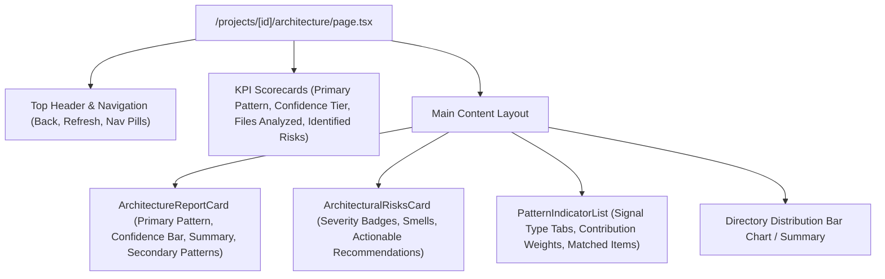

# 📄 Technical Specification: Next.js 15 Architecture Pattern Visualizer & Health Card

> **Step ID**: `Step 2.8b`  
> **Target Module**: `frontend/src/...`  
> **Git Feature Branch**: `feat/step-2-8b-architecture-visualizer`  
> **Status**: 📋 Draft / Ready for Implementation  
> **Created**: 2026-11-07  

---

## 1. Executive Summary

Step 2.8b completes **Milestone 2.8 (Architecture Audit & Detection)** under Phase 2 (Differentiation). In Step 2.8a, the backend architecture pattern detection engine and REST API (`GET /api/v1/projects/{project_id}/architecture`) were built and verified, classifying repository topologies (Modular Monolith, MVC, Clean Architecture, Layered, Event-Driven, Microservices, Serverless/JAMstack, Unstructured) via deterministic directory weights, dependency clusters, and supporting architectural evidence.

This milestone delivers the interactive Next.js 15 App Router visualizer (`/projects/[id]/architecture`) to give candidates and reviewers full transparency into codebase structural health:
1. **Executive Architecture KPI Scorecards**: High-level metrics displaying Primary Architecture pattern, confidence score & tier, total files analyzed, and count of detected architectural risks.
2. **Architecture Report Card (`ArchitectureReportCard.tsx`)**: Hero component rendering primary pattern classification, confidence progress bar, architectural topology summary, and secondary pattern radar/comparisons.
3. **Pattern Indicator Inspector (`PatternIndicatorList.tsx`)**: Detailed breakdown of deterministic signals (directory matches, dependency packages, supporting evidence) with contribution weights and matched token tags.
4. **Architectural Health & Risks Card (`ArchitecturalRisksCard.tsx`)**: Highlighting detected architectural smells (e.g. `FAT_ROUTER_MISSING_SERVICE`, `MISSING_LAYER_SEPARATION`, `UNISOLATED_BACKGROUND_TASKS`) with severity badges and actionable defense recommendations.
5. **Directory Summary Topology Visualizer**: Graphical bar distribution of source files across repository directory tiers (`frontend/`, `backend/`, `api/`, `services/`, `controllers/`, etc.).
6. **Project Navigation Integration**: Quick-action "Architecture" pill in `/projects/[id]/page.tsx` header alongside Claims, Coverage, and Ownership.

---

## 2. Dependencies & Prerequisites

- **Depends on**:
  - `Step 2.8a`: Backend Architecture Pattern Detection Engine & REST API (`GET /api/v1/projects/{project_id}/architecture`).
  - Next.js 15 App Router, Supabase Auth, Tailwind CSS, Lucide React icons (`Network`, `Layers`, `ShieldAlert`, `CheckCircle2`, `AlertTriangle`, `FolderTree`, `Package`, `FileCode`, `ArrowLeft`, `RefreshCw`, `ExternalLink`).
- **Blocked by**: None.
- **Tech Stack Invariants**:
  - Strictly Next.js 15 (App Router) + TypeScript + Tailwind CSS.
  - Strictly zero arbitrary code execution; static metadata visualizer only.
  - Strict compliance with `Gemini.md` architecture and file length limits ($\le 300$ LOC per file).

---

## 3. 🛡️ Security, Grounding & Invariants Impact

- [x] **Zero Code Execution**: All directory names, package identifiers, and risk titles are rendered safely through standard React JSX string interpolation without `dangerouslySetInnerHTML`.
- [x] **Safe Token Handling**: API requests pass the Supabase JWT bearer token via `Authorization: Bearer <token>` headers without leaking secrets or cookies.
- [x] **Deterministic Grounding**: Every pattern confidence score, indicator weight, and matched directory token maps 1:1 to the backend's deterministic `ArchitectureReportResponse`.
- [x] **Multi-Tenant Protection**: Scoped strictly to the authenticated user's project ID (`/projects/[id]/architecture`).

---

## 4. 🧭 Specialized Skills Directive

| Specialized Skill | Scope of Impact & Mandate | Verification Requirement |
| :--- | :--- | :--- |
| **[`doctor`](file:///d:/RepoDefense/.agents/skills/doctor/SKILL.md)** | Pre-flight and post-implementation health checks across Next.js 15 App Router build (`npm run build`) and TypeScript typecheck (`npx tsc --noEmit`). | Validates zero TypeScript errors and successful production build across all routes including `/projects/[id]/architecture`. |
| **[`security_auditor`](file:///d:/RepoDefense/.agents/skills/security_auditor/SKILL.md)** | Verifies safe rendering of user-provided paths and prevents XSS or client-side DOM injection. | Asserts that all path and directory strings are strictly escaped by React virtual DOM. |
| **[`code_reviewer`](file:///d:/RepoDefense/.agents/skills/code_reviewer/SKILL.md)** | Audits strict $\le 300$ LOC limit per file, dark-mode consistency, and modular component hierarchy. | Confirms no file exceeds 300 lines of code and all UI states (loading, empty, error, active) are handled cleanly. |

---

## 5. 🧠 Sequential Thinking Strategy & UI Architecture



### 5.1 Design & Visual Treatment
1. **Confidence Tier Color Coding**:
   - `HIGH (>= 75%)`: Emerald (`bg-emerald-500/10 text-emerald-400 border-emerald-500/30`)
   - `MODERATE (45 - 74%)`: Amber (`bg-amber-500/10 text-amber-400 border-amber-500/30`)
   - `LOW (< 45%)`: Slate (`bg-slate-500/10 text-slate-400 border-slate-500/30`)
2. **Risk Severity Badges**:
   - `CRITICAL`: Rose badge (`bg-rose-500/10 text-rose-400 border-rose-500/30`)
   - `HIGH`: Orange badge (`bg-orange-500/10 text-orange-400 border-orange-500/30`)
   - `MEDIUM`: Amber badge (`bg-amber-500/10 text-amber-400 border-amber-500/30`)
   - `LOW`: Sky badge (`bg-sky-500/10 text-sky-400 border-sky-500/30`)
3. **Indicator Type Badges**:
   - `directory`: Folder icon, indigo styling (`bg-indigo-500/10 text-indigo-400 border-indigo-500/20`)
   - `dependency`: Package icon, cyan styling (`bg-cyan-500/10 text-cyan-400 border-cyan-500/20`)
   - `evidence`: Shield icon, emerald styling (`bg-emerald-500/10 text-emerald-400 border-emerald-500/20`)

---

## 6. Data Contracts & Interfaces

### 6.1 TypeScript Interfaces (`frontend/src/types/architecture.ts`)

```typescript
export type ArchitecturePatternType =
  | "modular_monolith"
  | "mvc"
  | "clean_architecture"
  | "layered_architecture"
  | "event_driven"
  | "microservices"
  | "serverless_jamstack"
  | "unstructured";

export type PatternConfidenceTier = "high" | "moderate" | "low";

export interface PatternIndicator {
  indicator_type: "directory" | "dependency" | "evidence" | string;
  description: string;
  weight: number;
  matched_items: string[];
}

export interface DetectedPattern {
  pattern_type: ArchitecturePatternType;
  pattern_name: string;
  confidence_score: number;
  tier: PatternConfidenceTier;
  summary: string;
  indicators: PatternIndicator[];
}

export interface ArchitecturalRisk {
  risk_id: string;
  severity: "critical" | "high" | "medium" | "low";
  title: string;
  description: string;
  recommendation: string;
}

export interface ArchitectureReportResponse {
  project_id: string;
  project_name: string;
  primary_pattern: DetectedPattern;
  secondary_patterns: DetectedPattern[];
  all_patterns: DetectedPattern[];
  architectural_risks: ArchitecturalRisk[];
  directory_summary: Record<string, number>;
  total_files_analyzed: number;
}
```

### 6.2 API Client (`frontend/src/lib/architectureApi.ts`)

```typescript
export async function getProjectArchitecture(
  projectId: string,
  token: string
): Promise<ArchitectureReportResponse>;
```

---

## 7. Target Implementation Files & Sizing

| File Path | Purpose | Estimated LOC |
| :--- | :--- | :--- |
| `frontend/src/types/architecture.ts` | Shared TypeScript data contracts | ~45 LOC |
| `frontend/src/lib/architectureApi.ts` | Authenticated API client fetching `GET /api/v1/projects/{id}/architecture` | ~50 LOC |
| `frontend/src/components/domain/ArchitectureReportCard.tsx` | Hero pattern card with confidence meters & secondary patterns | ~150 LOC |
| `frontend/src/components/domain/PatternIndicatorList.tsx` | Indicator signal breakdown with weights and matched badges | ~120 LOC |
| `frontend/src/components/domain/ArchitecturalRisksCard.tsx` | Health checklist, smell warnings, and actionable recommendations | ~120 LOC |
| `frontend/src/app/projects/[id]/architecture/page.tsx` | Next.js 15 App Router full architecture report page | ~210 LOC |
| `frontend/src/app/projects/[id]/page.tsx` | Navigation link to Architecture report page | ~10 LOC (diff) |

Total estimated additions: ~700 LOC across 6 modular files (all strictly $\le 300$ LOC each).

---

## 8. Verification Strategy & Acceptance Criteria

1. **Static Typecheck**:
   - `cd frontend && npx tsc --noEmit` must return 0 errors.
2. **Next.js Production Build**:
   - `cd frontend && npm run build` must succeed, compiling `/projects/[id]/architecture` statically and dynamically.
3. **Manual / Functional Verification**:
   - Visiting `/projects/[id]/architecture` renders:
     - Primary pattern badge with confidence percentage.
     - Secondary detected patterns with confidence indicators.
     - Indicators list grouped by type with tags.
     - Architectural risks with severity colors.
     - Directory distribution breakdown.
     - Back navigation to project overview.
