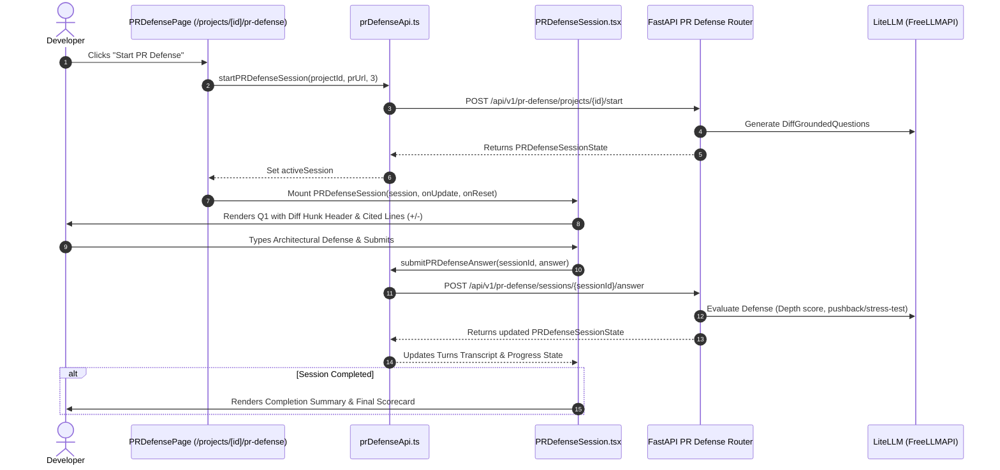

# Technical Specification: Step 3.2b — Next.js 15 PR Defense Session UI & Diff-Grounded Interview Flow

## 1. Metadata
- **Step ID**: `3.2b`
- **Feature Slug**: `step-3-2b-pr-defense-ui`
- **Git Branch**: `feat/step-3-2b-pr-defense-ui`
- **Parent Milestone**: `Milestone 3.2: PR Defense Session`
- **Target Files**:
  - `frontend/src/types/prDefense.ts` (TypeScript contracts matching backend Pydantic models)
  - `frontend/src/lib/prDefenseApi.ts` (API client for PR defense endpoints)
  - `frontend/src/components/domain/PRDefenseSession.tsx` (Interactive diff-anchored interview session component)
  - `frontend/src/app/projects/[id]/pr-defense/page.tsx` (PR defense page wiring and session lifecycle)
- **Status**: Ready for Implementation

---

## 2. Executive Summary & Objective

In **Step 3.2a**, we developed the backend foundation for PR-scoped defense sessions:
- Pydantic v2 schemas (`DiffGroundedQuestion`, `PRDefenseSessionState`, `StartPRDefenseRequest`).
- LiteLLM diff-grounded question generator with XML delimiter protection and deterministic fallback.
- FastAPI REST endpoints:
  - `POST /api/v1/pr-defense/projects/{project_id}/start`
  - `GET /api/v1/pr-defense/sessions/{session_id}`
  - `POST /api/v1/pr-defense/sessions/{session_id}/answer`

In **Step 3.2b**, we deliver the interactive user interface in Next.js 15 App Router that allows developers to launch a defense session against their Pull Request, engage in multi-turn pushback and stress-test dialogues with the AI Principal Engineer, view cited diff hunks and changed code lines, and view their final evaluation rubric.

---

## 3. Architecture & Data Flow



---

## 4. Component Design & Interfaces

### 4.1 TypeScript Data Contracts (`frontend/src/types/prDefense.ts`)
Must maintain parity with backend `backend/app/schemas/pr_defense.py`:
- `DiffGroundedQuestion`:
  - `id: string`
  - `category: QuestionCategory`
  - `question_text: string`
  - `context_hint: string`
  - `diff_file_path: string`
  - `diff_hunk_header: string`
  - `change_type: "addition" | "deletion" | "modification"`
  - `cited_lines: string[]`
  - `cited_files: string[]`
- `PRDefenseSessionState`:
  - Extends or matches `DefenseSessionState`
  - `pr_number: number`
  - `pr_title: string`
  - `pr_html_url: string`
  - `pr_author: string`
  - `pr_analysis_summary: string`
  - `diff_questions: DiffGroundedQuestion[]`
  - `turns: DefenseTurn[]`
  - `current_question_index: number`
  - `total_questions: number`
  - `status: DefenseStage`
- `StartPRDefenseRequest`:
  - `pr_url: string`
  - `num_questions: number`

### 4.2 API Client (`frontend/src/lib/prDefenseApi.ts`)
Provides typed HTTP requests against `/api/v1/pr-defense`:
```typescript
export async function startPRDefenseSession(
  projectId: string,
  prUrl: string,
  numQuestions: number = 3,
  token?: string
): Promise<PRDefenseSessionState>;

export async function getPRDefenseSession(
  sessionId: string,
  token?: string
): Promise<PRDefenseSessionState>;

export async function submitPRDefenseAnswer(
  sessionId: string,
  answer: string,
  token?: string
): Promise<PRDefenseSessionState>;
```

### 4.3 PR Defense Interactive Component (`frontend/src/components/domain/PRDefenseSession.tsx`)
- **Question Anchor Header**:
  - Displays file path (`diff_file_path`) with file icon.
  - Displays hunk coordinate pill (`diff_hunk_header`).
  - Change type badge (`addition`, `deletion`, `modification`).
- **Cited Diff Preview Box**:
  - Renders `cited_lines` with syntax styling:
    - Lines starting with `+` colored in `text-emerald-400 bg-emerald-950/20`.
    - Lines starting with `-` colored in `text-rose-400 bg-rose-950/20`.
    - Other lines colored in `text-zinc-400`.
- **Dialogue Transcript**:
  - Displays turns from the AI Principal Engineer and Candidate.
  - Highlights pushback turns (rose theme), stress-test turns (amber theme), and mentor turns (indigo theme).
- **Answer Input Form**:
  - Textarea with auto-expanding capability, char counter ($\ge 5$ chars required).
  - Submit button with spinner during evaluation.
  - Shortcut: Enter submits (unless Shift is pressed).
- **Completion Card**:
  - Summarizes final score and questions completed.
  - Actions to return to diff view or restart.

### 4.4 PR Defense Page Integration (`frontend/src/app/projects/[id]/pr-defense/page.tsx`)
- Adds `activeSession: PRDefenseSessionState | null` state.
- Adds "Start PR Defense" trigger handler that calls `startPRDefenseSession` with project ID and analyzed PR URL.
- Displays loading state while the LLM generates questions.
- Renders `PRDefenseSession` when a session is active, with a toggle to switch back and inspect the full PR diff.

---

## 5. Security & Invariant Checklist
- [x] **Zero Code Execution**: Pure static analysis and diff-based questions; no evaluation or running of repository code.
- [x] **LOC Budget**: All target files must strictly not exceed 300 LOC.
- [x] **Auth Guard**: Supabase JWT Bearer token passed to API endpoints with automatic session redirection on expiration.
- [x] **Input Validation**: Minimum answer length $\ge 5$ characters; maximum bounds checked.

---

## 6. Verification & Quality Gates
- **Type Checking**: `npx tsc --noEmit` returns 0 errors.
- **Next.js Production Build**: `npm run build` succeeds cleanly.
- **Backend Regression Suite**: `python -m pytest backend/tests/test_pr_defense.py` passes 15/15 tests.
- **LOC Verification**: Each file verified with line count $\le 300$.

---

## 7. Mandatory Stop Gate
After specification authoring, the agent halts immediately and awaits the developer's approval before modifying any code.
