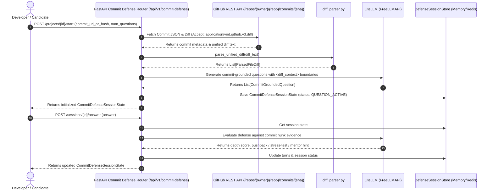

# Technical Specification: Step 3.3a — Commit Defense Session Schemas, Commit Diff Parser & REST API

## 1. Metadata
- **Step ID**: `3.3a`
- **Feature Slug**: `step-3-3a-commit-defense-backend`
- **Git Branch**: `feat/step-3-3a-commit-defense-backend`
- **Parent Milestone**: `Milestone 3.3: Commit Defense`
- **Target Files**:
  - `backend/app/schemas/commit_defense.py` (Pydantic v2 contracts for commit diff defense)
  - `backend/app/api/v1/commit_defense.py` (Commit fetcher, question synthesis, and REST session router)
  - `backend/app/main.py` (Mount router under `/api/v1/commit-defense`)
  - `backend/tests/test_commit_defense.py` (Hermetic unit and endpoint tests using `_drive_coro`)
- **Status**: Ready for Implementation

---

## 2. Executive Summary & Objective

In **Milestone 3.1 & 3.2**, we introduced Pull Request ingestion and defense sessions, enabling candidates to defend their PRs against an AI Principal Engineer. 

In **Milestone 3.3**, we expand RepoDefense to support **Commit Defense** — interrogating candidates strictly on the architectural intent, tradeoffs, and failure modes of changes introduced in a single Git commit hash or GitHub commit URL.

In **Step 3.3a**, we build the complete backend engine:
1. Pydantic v2 data models for commit metadata, diff analysis, commit-grounded questions, and session states.
2. GitHub Commit REST client fetching commit metadata JSON and unified diff text with rate-limit and error resilience.
3. Commit diff analysis and question generator anchored to changed hunks with `<diff_context>` prompt-injection defense.
4. FastAPI REST endpoints for starting sessions, retrieving session state, evaluating answers (with pushback, stress-test, mentor hints, and scoring), and previewing commit diffs.
5. 100% hermetic unit and endpoint tests with zero network or socket dependencies.

---

## 3. Architecture & Data Flow

---

## 4. Component Design & Interfaces

### 4.1 Pydantic v2 Data Models (`backend/app/schemas/commit_defense.py`)
- `CommitMetadata`:
  - `commit_hash: str` (7 to 40 hex chars)
  - `author_name: str`
  - `author_email: Optional[str]`
  - `committed_at: str` (ISO 8601)
  - `message: str`
  - `html_url: str`
  - `total_additions: int`
  - `total_deletions: int`
  - `total_files: int`
- `CommitAnalysisResponse`:
  - `metadata: CommitMetadata`
  - `files: List[ParsedFileDiff]`
  - `total_files_changed: int`
  - `total_additions: int`
  - `total_deletions: int`
  - `summary_narrative: str`
- `CommitGroundedQuestion`:
  - Inherits `DiffGroundedQuestion` (anchored to `diff_file_path`, `diff_hunk_header`, `change_type`, `cited_lines`)
  - `commit_hash: str`
- `CommitDefenseSessionState`:
  - Inherits `DefenseSessionState`
  - `commit_hash: str`
  - `commit_message: str`
  - `commit_author: str`
  - `commit_html_url: str`
  - `commit_analysis_summary: str`
  - `diff_questions: List[CommitGroundedQuestion]`
- `StartCommitDefenseRequest`:
  - `commit_url_or_hash: str` (min_length=7, max_length=500)
  - `num_questions: int = 3` (ge=1, le=5)

### 4.2 GitHub Commit Fetcher & Parser (`backend/app/api/v1/commit_defense.py`)
- Regex validation for GitHub commit URLs:
  `^https?://github\.com/([a-zA-Z0-9_.-]+)/([a-zA-Z0-9_.-]+)/commit/([a-fA-F0-9]{7,40})(?:/.*)?$`
- Also accepts raw 7-40 hex SHA if project's `github_url` provides `owner/repo` context.
- Function `fetch_github_commit_data(owner, repo, sha, client)`:
  - Fetches commit metadata JSON from `https://api.github.com/repos/{owner}/{repo}/commits/{sha}`
  - Fetches unified diff from `https://api.github.com/repos/{owner}/{repo}/commits/{sha}` with `Accept: application/vnd.github.v3.diff`
  - Handles 404 (Commit not found), 429 (Rate limit), 502 (Bad gateway) with user-friendly errors.

### 4.3 REST API Endpoints
- `POST /api/v1/commit-defense/projects/{project_id}/start`: Initiates a commit defense session.
- `GET /api/v1/commit-defense/sessions/{session_id}`: Retrieves current session state.
- `POST /api/v1/commit-defense/sessions/{session_id}/answer`: Submits candidate response and transitions state (`QUESTION_ACTIVE` $\rightarrow$ `PUSHBACK_ACTIVE` / `STRESS_TEST_ACTIVE` / `MENTOR_ACTIVE` $\rightarrow$ `QUESTION_COMPLETED` $\rightarrow$ `SESSION_COMPLETED`).
- `POST /api/v1/commit-defense/projects/{project_id}/analyze`: Analyzes commit changes without starting a session.

---

## 5. Security & Invariant Checklist
- [x] **Zero Code Execution**: Pure static unified diff parsing; no repo code execution.
- [x] **LOC Budget**: All target files must strictly remain $\le 300$ LOC.
- [x] **Prompt Injection Defense**: Wrap commit diff context in `<diff_context>` XML tags and sanitize prompt tokens.
- [x] **Path Traversal & Secrets**: Verify file paths and redact credentials with `scan_for_secrets`.
- [x] **Tenancy Isolation**: Assert `project.user_id == current_user.id` on all project-scoped routes.

---

## 6. Verification & Quality Gates
- **Pytest Suite**: $\ge 12$ unit and endpoint tests in `backend/tests/test_commit_defense.py` using `_drive_coro`.
- **Ruff Lint**: `python -m ruff check backend/app backend/tests` passes with 0 errors.
- **Frontend Parity Check**: `npx tsc --noEmit` passes with 0 errors.
- **300 LOC Gate**: Each file strictly $\le 300$ LOC.

---

## 7. Mandatory Stop Gate
After `/plan_step` completes specification authoring, the agent immediately stops and prompts the developer for approval before writing code.
