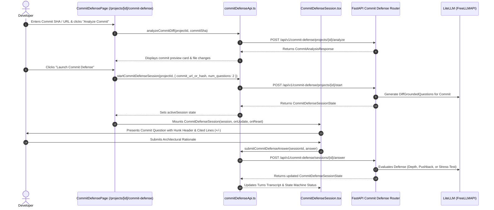

# Technical Specification: Step 3.3b — Next.js 15 Commit Defense UI & Commit History Integration

## 1. Metadata
- **Step ID**: `3.3b`
- **Feature Slug**: `step-3-3b-commit-defense-ui`
- **Git Branch**: `feat/step-3-3b-commit-defense-ui`
- **Parent Milestone**: `Milestone 3.3: Commit Defense`
- **Target Files**:
  - `frontend/src/types/commitDefense.ts` (TypeScript contracts matching backend commit defense schemas)
  - `frontend/src/lib/commitDefenseApi.ts` (API client for commit defense endpoints)
  - `frontend/src/components/domain/CommitDefenseSession.tsx` (Interactive commit-anchored defense session component)
  - `frontend/src/app/projects/[id]/commit-defense/page.tsx` (Commit defense visualizer, SHA analyzer, and interview lifecycle)
  - `frontend/src/components/domain/ProjectNavHeader.tsx` (Nav tab addition for Commit Defense)
- **Status**: Ready for Implementation

---

## 2. Executive Summary & Objective

In **Step 3.3a**, we authored the backend infrastructure for commit-scoped defense interviews:
- Pydantic v2 schemas (`CommitMetadata`, `CommitGroundedQuestion`, `CommitDefenseSessionState`, `StartCommitDefenseRequest`, `CommitAnalysisResponse`).
- Analyzer `commit_fetcher.py` with URL/SHA parsing, GitHub REST API commit data and unified diff retrieval, and session synthesis.
- FastAPI REST endpoints mounted at `/api/v1/commit-defense`:
  - `POST /projects/{id}/start`
  - `GET /sessions/{id}`
  - `POST /sessions/{id}/answer`
  - `POST /projects/{id}/analyze`

In **Step 3.3b**, we deliver the complete interactive frontend in Next.js 15 App Router that empowers developers to:
1. Provide a Git Commit SHA or GitHub Commit URL (or browse repository commits).
2. Preview the commit diff summary (author, timestamp, stats, changed files, additions/deletions).
3. Launch an AI-driven, multi-turn architectural defense interview anchored in the commit diff.
4. Interact with the Principal Engineer persona across pushback, production stress-tests, and mentor feedback.
5. Review their performance score and graduation metrics upon session completion.

---

## 3. Architecture & Data Flow

---

## 4. Component Design & Interfaces

### 4.1 TypeScript Data Contracts (`frontend/src/types/commitDefense.ts`)
Must maintain strict 1:1 parity with `backend/app/schemas/commit_defense.py`:
- `CommitMetadata`:
  - `commit_hash: string`
  - `author_name: string`
  - `committed_at: string`
  - `message: string`
  - `html_url: string`
  - `total_additions: number`
  - `total_deletions: number`
  - `total_files: number`
- `CommitGroundedQuestion`:
  - `id: string`
  - `category: QuestionCategory`
  - `question_text: string`
  - `context_hint: string`
  - `cited_evidence_ids: string[]`
  - `cited_files: string[]`
  - `diff_file_path: string`
  - `diff_hunk_header: string`
  - `change_type: "addition" | "deletion" | "modification"`
  - `cited_lines: string[]`
  - `commit_hash: string`
- `CommitDefenseSessionState`:
  - `session_id: string`
  - `project_id: string`
  - `status: DefenseStage`
  - `current_question_index: number`
  - `current_difficulty: DifficultyLevel`
  - `total_questions: number`
  - `score: number | null`
  - `commit_hash: string`
  - `commit_message: string`
  - `commit_author: string`
  - `commit_html_url: string`
  - `commit_analysis_summary: string`
  - `diff_questions: CommitGroundedQuestion[]`
  - `questions: DefenseQuestionProgress[]`
  - `turns: DefenseTurn[]`
  - `created_at: string`
  - `updated_at: string`
- `StartCommitDefenseRequest`:
  - `commit_url_or_hash: string`
  - `num_questions?: number`
- `CommitAnalysisResponse`:
  - `commit: CommitMetadata`
  - `files: ParsedFileDiff[]`
  - `total_files_changed: number`
  - `total_additions: number`
  - `total_deletions: number`
  - `summary_narrative: string`

### 4.2 API Client (`frontend/src/lib/commitDefenseApi.ts`)
Exports async client functions communicating with `/api/v1/commit-defense`:
- `startCommitDefenseSession(projectId: string, payload: StartCommitDefenseRequest): Promise<CommitDefenseSessionState>`
- `getCommitDefenseSession(sessionId: string): Promise<CommitDefenseSessionState>`
- `submitCommitDefenseAnswer(sessionId: string, answer: string): Promise<CommitDefenseSessionState>`
- `analyzeCommitDiff(projectId: string, commitUrlOrHash: string): Promise<CommitAnalysisResponse>`

Includes standard Supabase JWT Bearer token injection and defensive error parsing.

### 4.3 Domain UI Component (`frontend/src/components/domain/CommitDefenseSession.tsx`)
Interactive component managing an in-flight commit defense session:
- **Header**: Commit SHA badge (mono font, copy button), message summary, author, GitHub link.
- **Diff Question Anchor Card**:
  - Category pill (Architecture, Security, Reliability, etc.).
  - File path with file icon.
  - Hunk header (`@@ -1,5 +1,7 @@`).
  - Collapsible quoted diff lines with emerald `+` and rose `-` syntax highlighting.
- **Dialogue Transcript**:
  - Interviewer questions & pushback alerts.
  - Candidate submitted answers.
  - Production stress-test constraints.
  - Mentor pedagogical guidance.
- **Answer Submission Box**:
  - Textarea with character counter and Ctrl+Enter keyboard submission.
  - Dynamic button states (`Submitting...`, `Submit Defense`).
- **Completion Card**:
  - Defense score meter, handled questions recap, and "Start New Commit Defense" action.

### 4.4 App Page (`frontend/src/app/projects/[id]/commit-defense/page.tsx`)
Full App Router page:
- Integrates `ProjectNavHeader` with active tab `commit-defense`.
- Stage 1: Commit input (7-40 hex SHA or GitHub URL), "Analyze Diff" action, preview of files and changes.
- Stage 2: In-progress defense interview session via `CommitDefenseSession`.

### 4.5 Navigation Header (`frontend/src/components/domain/ProjectNavHeader.tsx`)
- Adds `commit-defense` to `ProjectNavTab`.
- Adds `Commit Defense` tab with `GitCommit` icon and `/commit-defense` suffix.

---

## 5. Security & Verification Invariants

1. **Zero Code Execution**: Strictly render static AST and diff text. Never evaluate user strings.
2. **Context Boundary Isolation**: Code citations are rendered via pre-formatted markdown code blocks.
3. **Multi-Tenant Authorization**: Bearer token passed on every request; handles 401/404 cleanly.
4. **Strict $\le 300$ LOC Invariant**: Every touched file must stay strictly under 300 LOC.
5. **Quality Gates**:
   - `npx tsc --noEmit` $\to$ 0 errors.
   - `npm run build` $\to$ 0 errors.
   - Backend regression test suite passes.

---

## 6. Specialized Domain Skill Directives

- **security_auditor**: Verify that diff lines and commit messages do not use `dangerouslySetInnerHTML`. Ensure all HTML is safely escaped by React. Validate that git commit hashes and URLs conform to safe regular expressions.
- **eval_persona**: Ensure that the UI displays role-based avatars and labels reflecting the Principal Engineer persona (`Interviewer`, `Production Stress-Test`, `Technical Pushback`, `Mentor Guidance`).
