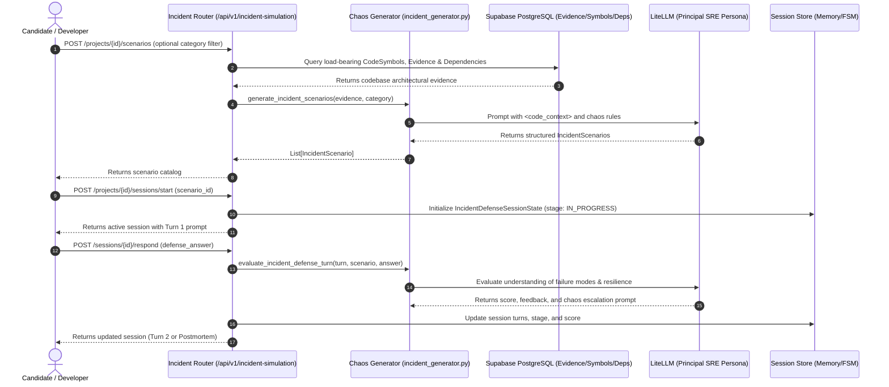

# Technical Specification: Step 3.4a — Backend Incident Simulation Engine, Chaos Scenario Generator & REST API

## 1. Metadata
- **Step ID**: `3.4a`
- **Feature Slug**: `step-3-4a-incident-simulation-engine`
- **Git Branch**: `feat/step-3-4a-incident-simulation-engine`
- **Parent Milestone**: `Milestone 3.4: Incident / Failure Simulation Engine`
- **Target Files**:
  - `backend/app/schemas/incident.py` (Pydantic v2 contracts for incident scenarios, chaos targets, turns, and session state)
  - `backend/app/ai/incident_generator.py` (Chaos scenario generator, escalation prompt logic, and SRE evaluation engine)
  - `backend/app/api/v1/incident_simulation.py` (FastAPI REST router for scenario cataloging, session start, and multi-turn defense)
  - `backend/app/main.py` (Register router under `/api/v1/incident-simulation`)
  - `backend/tests/test_incident_simulation.py` (Hermetic pytest test suite covering scenario synthesis, fallback heuristics, and API endpoints)
- **Status**: Ready for Implementation

---

## 2. Executive Summary & Objective

In **Milestones 3.1 through 3.3**, RepoDefense introduced diff-grounded defenses for Pull Requests and individual Git Commits.

In **Milestone 3.4**, we implement the **Incident / Failure Simulation Engine**. Rather than simply asking "Why did you write this code?", the system acts as a Principal Site Reliability Engineer (SRE) and Chaos Architect. It identifies load-bearing components (database sessions, external APIs, queue workers, caches, or route handlers) and injects realistic, catastrophic production failure scenarios (e.g. database connection pool starvation, third-party timeout cascades, Redis eviction thunder, or deadlocks). The candidate must explain how their code behaves under fire and defend their system resilience.

In **Step 3.4a**, we build the complete backend engine:
1. **Pydantic v2 Data Models**: `FailureCategory`, `IncidentSeverity`, `ChaosTarget`, `IncidentScenario`, `IncidentDefenseTurn`, `IncidentDefenseSessionState`, and request/response models.
2. **Chaos Scenario Generator (`app/ai/incident_generator.py`)**: Gathers project AST symbols and dependency evidence, generates hyper-contextual failure scenarios using LiteLLM (with strict XML boundary defenses), and includes deterministic heuristic fallbacks when LLM routing is unavailable.
3. **Multi-Turn Incident Defense Evaluation**: Progresses candidates through a 3-stage Incident Life Cycle:
   - **Turn 1 (Initial Defense)**: "The incident is firing. How does your current code behave?"
   - **Turn 2 (Chaos Escalation / Stress Test)**: "Your mitigation had an unintended consequence or traffic doubled. What breaks next?"
   - **Turn 3 (Mitigation & Postmortem)**: "How do you permanently prevent this failure in code and infrastructure?"
4. **FastAPI REST Router (`app/api/v1/incident_simulation.py`)**: Endpoints for generating scenarios, starting sessions, submitting candidate answers, and fetching session state.
5. **Hermetic Test Suite (`backend/tests/test_incident_simulation.py`)**: Comprehensive tests validating schema parsing, deterministic fallbacks, mock LLM generation, and authenticated REST endpoints.

---

## 3. Architecture & Data Flow



---

## 4. Failure Categories & Chaos Topology

| Category | Description & Common Trigger | Target Code Anchors |
| :--- | :--- | :--- |
| `DATABASE_OUTAGE` | Connection pool saturation, deadlock, unindexed query lock cascade. | Database sessions, ORM models, migration hooks. |
| `DEPENDENCY_TIMEOUT` | External HTTP API (payment, OAuth, LLM) latency spike or 504 gateway timeout. | HTTP clients, third-party SDK calls, webhooks. |
| `CACHE_FAILURE` | Redis eviction storm, cache avalanche, cache stampede on key expiration. | Cache keys, Redis client, session stores. |
| `MESSAGE_BROKER_PARTITION` | Queue worker crash, backlog accumulation, poison pill task. | Background tasks, ARQ workers, task queues. |
| `RESOURCE_EXHAUSTION` | Out-of-memory (OOM) on large payload processing, disk saturation. | File uploaders, batch parsers, streaming endpoints. |
| `CONCURRENCY_RACE` | Lost updates, race condition on inventory/counter, double-submit. | State mutations, non-atomic increments, unprotected flags. |

---

## 5. Data Contracts & Pydantic Schemas (`backend/app/schemas/incident.py`)

```python
class FailureCategory(str, Enum):
    DATABASE_OUTAGE = "DATABASE_OUTAGE"
    DEPENDENCY_TIMEOUT = "DEPENDENCY_TIMEOUT"
    CACHE_FAILURE = "CACHE_FAILURE"
    MESSAGE_BROKER_PARTITION = "MESSAGE_BROKER_PARTITION"
    RESOURCE_EXHAUSTION = "RESOURCE_EXHAUSTION"
    CONCURRENCY_RACE = "CONCURRENCY_RACE"

class IncidentSeverity(str, Enum):
    P0_CRITICAL = "P0_CRITICAL"
    P1_HIGH = "P1_HIGH"
    P2_MEDIUM = "P2_MEDIUM"

class ChaosTarget(BaseModel):
    file_path: str
    symbol_name: Optional[str] = None
    line_start: Optional[int] = None
    line_end: Optional[int] = None
    component_type: str = Field(..., description="db, endpoint, worker, service, cache")

class IncidentScenario(BaseModel):
    id: str = Field(default_factory=lambda: str(uuid.uuid4()))
    title: str
    category: FailureCategory
    severity: IncidentSeverity
    hypothetical_trigger: str
    symptoms: List[str]
    grounded_target: ChaosTarget
    incident_question: str
    evaluation_criteria: List[str]

class IncidentDefenseTurn(BaseModel):
    turn_index: int
    prompt: str
    candidate_answer: Optional[str] = None
    score: Optional[float] = None
    feedback: Optional[str] = None
    escalation_injected: Optional[str] = None

class IncidentDefenseSessionState(BaseModel):
    id: uuid.UUID
    project_id: uuid.UUID
    scenario: IncidentScenario
    turns: List[IncidentDefenseTurn]
    current_turn_index: int
    max_turns: int = 3
    stage: str = "TRIAGE" # TRIAGE -> ESCALATED -> MITIGATED -> POSTMORTEM
    overall_score: Optional[float] = None
    postmortem_summary: Optional[str] = None
```

---

## 6. Specialized Domain Skill Directives

### `eval_persona` Directives:
1. **Persona Calibration**: System prompt must instruct LiteLLM to adopt a **Principal Site Reliability Engineer (SRE) / Chaos Architect** persona. Rigorous, realistic, grounded in distributed systems failure modes.
2. **Evidence Grounding**: The chaos scenario MUST cite actual symbols or files discovered in the user's project (`CodeSymbol`, `AnalyzedFile`, `Dependency`).
3. **XML Boundary Sanitization**: All file paths and code snippets must be wrapped in `<code_context>` and `<target_symbol>` XML tags to prevent prompt injection.
4. **Deterministic Heuristic Fallback**: If LLM API call fails or times out, the generator must cleanly fall back to high-grade pre-calibrated architectural heuristics without crashing.

### `security_auditor` Directives:
1. **Zero Arbitrary Execution**: Simulation only. No executing system chaos commands or network sockets.
2. **Tenancy Isolation**: Verify `Project.user_id == current_user.id` before inspecting project evidence or launching sessions.

---

## 7. Verification & Acceptance Criteria

1. **Ruff Linting**: Clean execution with 0 warnings or errors across all created files.
2. **File Size Invariant**: Every file strictly $\le 300$ LOC.
3. **Hermetic Test Suite**: Unit and API tests passing in `backend/tests/test_incident_simulation.py`:
   - Validates `FailureCategory` and `IncidentScenario` serialization.
   - Tests deterministic heuristic generation across all categories.
   - Tests scenario generation REST endpoint.
   - Tests full 3-turn interactive incident defense session (`start` -> `respond` turn 1 -> `respond` turn 2 -> `respond` turn 3 postmortem).
4. **Non-destructive**: Existing defense routes (`/defense`, `/pr-defense`, `/commit-defense`) remain 100% untouched and passing.
