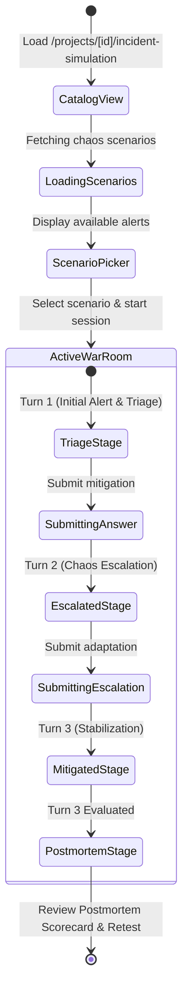

# Technical Specification: Step 3.4b — Next.js 15 Incident Simulation War Room UI & Scenario Defense Flow

> **Step ID**: `3.4b`  
> **Parent Milestone**: `Milestone 3.4: Incident / Failure Simulation Engine`  
> **Target Module**: `frontend/src/`  
> **Git Feature Branch**: `feat/step-3-4b-incident-simulation-war-room`  
> **Status**: 📋 Draft / Ready for Implementation  
> **Created**: 2026-11-10  

---

## 1. Executive Summary

In **Step 3.4a**, we established the backend **Incident Simulation & Chaos Engineering Engine** (`backend/app/schemas/incident.py`, `backend/app/ai/incident_generator.py`, `backend/app/api/v1/incident_simulation.py`), enabling dynamic generation of realistic production outages grounded in codebase AST evidence, 3-stage failure escalations (`TRIAGE` → `ESCALATED` → `MITIGATED` → `POSTMORTEM`), and automated SRE evaluation.

In **Step 3.4b**, we construct the user-facing frontend experience: the **Next.js 15 Incident Simulation War Room UI & Scenario Defense Flow**. This provides candidates with an intense, realistic SRE war room dashboard where simulated P0/P1 alerts fire against their specific repository components. Candidates inspect symptoms and code targets, formulate mitigations against cascading failures, progress through multi-turn chaos challenges, and receive a comprehensive incident postmortem resilience scorecard.

---

## 2. Dependencies & Prerequisites

- **Depends on**:
  - `backend/app/api/v1/incident_simulation.py` (Endpoints: `/projects/{id}/scenarios`, `/projects/{id}/sessions/start`, `/sessions/{id}`, `/sessions/{id}/respond`)
  - `frontend/src/lib/supabase.ts` (Authentication session token retrieval)
  - `frontend/src/components/domain/ProjectNavHeader.tsx` (Unified project navigation)
- **Blocked by**: None (Step 3.4a is complete and verified).
- **Tech Stack Invariant**: Next.js 15 App Router, React 19, TypeScript strict mode, Tailwind CSS, Lucide React icons. Strictly zero external non-whitelisted libraries.

---

## 3. 🛡️ Security, Grounding & Invariants Impact

- [x] **Zero Arbitrary Code Execution**: Pure UI simulation and static display; no terminal emulation or container execution.
- [x] **Secure Authentication & Multi-Tenancy**: All API requests pass the Supabase JWT Bearer token; unauthorized users cannot inspect or launch simulations for private projects.
- [x] **Code Evidence Grounding**: The UI prominently highlights the `ChaosTarget` (file path, symbol name, line numbers) anchoring the incident to genuine code.
- [x] **Sanitized User Inputs**: Candidate defense submissions are sanitized, validated against empty strings/whitespace, and bound to length limits (10 to 5,000 characters).

---

## 4. 🧠 Sequential Thinking Strategy & UI State Machine

The Incident War Room operates as an interactive state machine on the frontend:



### Key UI Invariants:
1. **War Room Atmosphere**: Dark-mode industrial SRE theme (rose/amber alerts, pulsing sirens, terminal-like code references, telemetry meters).
2. **Telemetry & Symptoms Panel**: Renders real-time telemetry symptoms (`symptoms: string[]`) and code anchor (`file_path`, `symbol_name`, `line_start`-`line_end`).
3. **Turn Progression Dialogue**: Displays conversational history between the Principal SRE and candidate with color-coded feedback badges and numerical depth scores (0-100).
4. **Postmortem Summary**: When `stage === "POSTMORTEM"`, renders a high-impact incident postmortem card featuring the overall resilience grade and architectural recommendations.

---

## 5. Data Contracts & Interfaces

### 5.1 TypeScript Contracts (`frontend/src/types/incident.ts`)

```typescript
export type FailureCategory =
  | "DATABASE_OUTAGE"
  | "DEPENDENCY_TIMEOUT"
  | "CACHE_FAILURE"
  | "MESSAGE_BROKER_PARTITION"
  | "RESOURCE_EXHAUSTION"
  | "CONCURRENCY_RACE";

export type IncidentSeverity = "P0_CRITICAL" | "P1_HIGH" | "P2_MEDIUM";

export type IncidentStage = "TRIAGE" | "ESCALATED" | "MITIGATED" | "POSTMORTEM";

export interface ChaosTarget {
  file_path: string;
  symbol_name?: string | null;
  line_start?: number | null;
  line_end?: number | null;
  component_type: string;
}

export interface IncidentScenario {
  id: string;
  title: string;
  category: FailureCategory;
  severity: IncidentSeverity;
  hypothetical_trigger: string;
  symptoms: string[];
  grounded_target: ChaosTarget;
  incident_question: string;
  evaluation_criteria: string[];
}

export interface IncidentDefenseTurn {
  turn_index: number;
  prompt: string;
  candidate_answer?: string | null;
  score?: number | null;
  feedback?: string | null;
  escalation_injected?: string | null;
}

export interface IncidentDefenseSessionState {
  id: string;
  project_id: string;
  scenario: IncidentScenario;
  turns: IncidentDefenseTurn[];
  current_turn_index: number;
  max_turns: number;
  stage: IncidentStage;
  overall_score?: number | null;
  postmortem_summary?: string | null;
}

export interface GenerateScenariosRequest {
  category?: FailureCategory;
  limit?: number;
}

export interface ScenarioListResponse {
  project_id: string;
  total_scenarios: number;
  scenarios: IncidentScenario[];
}

export interface StartIncidentDefenseRequest {
  scenario_id?: string;
  category?: FailureCategory;
}

export interface SubmitIncidentAnswerRequest {
  answer: string;
}
```

### 5.2 API Client (`frontend/src/lib/incidentApi.ts`)

- `fetchProjectScenarios(projectId: string, category?: FailureCategory): Promise<ScenarioListResponse>`
- `startIncidentSession(projectId: string, scenarioId?: string, category?: FailureCategory): Promise<IncidentDefenseSessionState>`
- `getIncidentSession(sessionId: string): Promise<IncidentDefenseSessionState>`
- `respondToIncidentTurn(sessionId: string, answer: string): Promise<IncidentDefenseSessionState>`

---

## 6. Step-by-Step Implementation Sequence

### Phase A: Types & API Client
1. Create `frontend/src/types/incident.ts` with strict TypeScript typings matching backend schemas.
2. Create `frontend/src/lib/incidentApi.ts` consuming `/api/v1/incident-simulation` with Supabase JWT bearer authorization and standard error handling.

### Phase B: Domain Components & Navigation
3. Update `frontend/src/components/domain/ProjectNavHeader.tsx`:
   - Add `"incident-simulation"` to `ProjectNavTab`.
   - Add War Room tab entry (`label: "Incident War Room"`, `hrefSuffix: "/incident-simulation"`, `Icon: Flame` or `AlertTriangle`, `accentColor: "text-rose-400"`).
4. Create `frontend/src/components/domain/IncidentWarRoom.tsx`:
   - **Scenario Catalog Selector**: Displays simulated failure scenario cards with severity badges (P0 Critical in red, P1 High in amber), failure category tags, code targets, and "Launch Incident Defense" CTA.
   - **Active Incident War Room**:
     - Status header with pulsing alert beacon, stage indicator (`TRIAGE` / `ESCALATED` / `MITIGATED`), and severity badge.
     - Telemetry & symptoms panel with code anchor inspector.
     - Multi-turn dialogue transcript displaying SRE challenges, candidate answers, depth scores, and cascading chaos escalations.
     - Answer submission textarea with minimum character validation and response loading spinner.
   - **Postmortem Showcase**:
     - Final resilience grade circle / badge.
     - Architectural summary narrative and key takeaways.
     - "Simulate New Incident" restart button.

### Phase C: App Router Page & Verification
5. Create `frontend/src/app/projects/[id]/incident-simulation/page.tsx`:
   - Server/Client page loading project details and embedding `ProjectNavHeader` and `IncidentWarRoom`.
6. Run Next.js production build (`npm run build`) and type check (`tsc --noEmit`) to verify zero regressions.

---

## 7. Specialized Domain Skill Directives

### `eval_persona` Directives:
1. **War Room Persona Atmosphere**: Visual design must convey high-stakes incident response (Principal SRE / Incident Commander). Clear distinctions between triage prompts, chaos escalations, and postmortem analysis.
2. **Evidence Visibility**: The code target (`file_path`, `symbol_name`, line ranges) must remain prominently visible during answer drafting so candidates can ground their defense directly in code.

### `security_auditor` Directives:
1. **Client-Side Authorization**: Ensure API calls attach valid bearer headers; handle 401/403 states gracefully with redirection or clear auth warning.
2. **Safe Text Rendering**: All user and LLM feedback strings rendered cleanly via React JSX escaping without `dangerouslySetInnerHTML`.

---

## 8. Verification & Acceptance Criteria

### Automated Build & Typecheck
```bash
cd frontend && npm run build
```

### Acceptance Checklist
- [ ] `frontend/src/types/incident.ts` accurately represents all incident schemas and stages.
- [ ] `frontend/src/lib/incidentApi.ts` successfully communicates with backend `/api/v1/incident-simulation` endpoints.
- [ ] `ProjectNavHeader` includes the `"Incident War Room"` tab with active tab highlighting.
- [ ] `IncidentWarRoom.tsx` handles scenario listing, session launch, turn progression, and postmortem rendering.
- [ ] `/projects/[id]/incident-simulation` loads cleanly and integrates with project breadcrumbs.
- [ ] Max file length $\le 300$ lines per file.
- [ ] Zero TypeScript errors and clean Next.js build.
