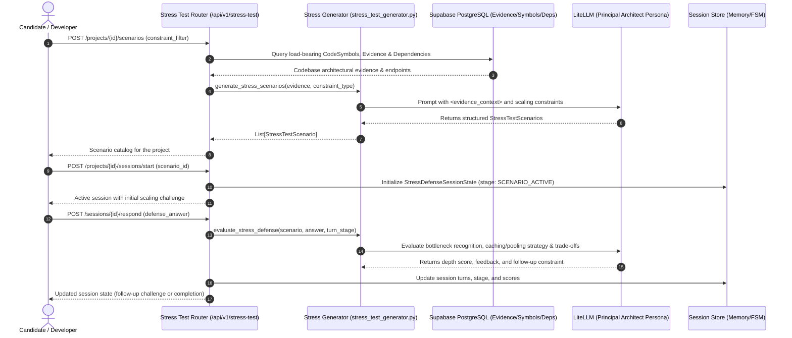

# Technical Specification: Step 3.5a — Backend Stress Test Engine, Scaling Scenario Generator & REST API

## 1. Metadata
- **Step ID**: `3.5a`
- **Feature Slug**: `step-3-5a-stress-test-what-if-backend`
- **Git Branch**: `feat/step-3-5a-stress-test-what-if-backend`
- **Parent Milestone**: `Milestone 3.5: Stress Test / What-If Mode`
- **Target Files**:
  - `backend/app/schemas/stress_test.py` (Pydantic v2 data models for scaling constraints, scenarios, defense turns, and session states)
  - `backend/app/ai/stress_test_generator.py` (Scaling scenario generator, constraint escalation prompts, and Principal Architect evaluation engine)
  - `backend/app/api/v1/stress_test.py` (FastAPI REST router for scenario cataloging, session start, turn defense, and state retrieval)
  - `backend/app/main.py` (Register router under `/api/v1/stress-test`)
  - `backend/tests/test_stress_test.py` (Hermetic pytest test suite covering schema validation, deterministic fallbacks, mock LLM generation, and authenticated REST endpoints)
- **Status**: Ready for Implementation

---

## 2. Executive Summary & Objective

In **Milestone 3.4**, RepoDefense introduced the Incident / Failure Simulation War Room, putting candidates through simulated production outages.

In **Milestone 3.5**, we introduce the **Stress Test / What-If Mode**. Unlike standard interview questions that evaluate whether a component works under nominal conditions, Stress Test Mode interrogates system limits under extreme production scaling constraints:
1. **Concurrency Spikes**: What happens to connection pools, request queues, and thread starvation when traffic surges to 10k–50k req/sec?
2. **Data Volume Growth (100x)**: What queries degrade from $O(1)$ to $O(N)$ when table sizes jump from 10k rows to 10 million rows?
3. **Resource & Memory Clamping**: What happens when containers are constrained to 256MB RAM or aggressive CPU throttling?
4. **Third-Party & Network Latency**: How does the system degrade when downstream dependencies experience 1,500ms latency jitter?

In **Step 3.5a**, we engineer the complete backend foundation:
- **Pydantic Schemas (`backend/app/schemas/stress_test.py`)**: Data contracts for constraint types, magnitudes, targets, scenarios, turns, and session state.
- **Stress Test Generator & Evaluator (`backend/app/ai/stress_test_generator.py`)**: Grounded scenario synthesizer inspecting codebase evidence, pairing components with realistic bottlenecks, and evaluating candidate mitigation strategies using LiteLLM with deterministic offline fallback heuristics.
- **FastAPI Router (`backend/app/api/v1/stress_test.py`)**: Multi-tenant REST endpoints supporting scenario catalog generation, session initiation, and turn-based defense submissions.
- **Hermetic Pytest Suite (`backend/tests/test_stress_test.py`)**: Hermetic unit and integration tests asserting schema invariants, scoring rubrics, offline fallback reliability, and HTTP status codes.

---

## 3. Architecture & Data Flow



---

## 4. Constraint Categories & Scaling Scenarios

| Constraint Type | Description | Target Code Anchors |
| :--- | :--- | :--- |
| `CONCURRENCY_SPIKE` | Sudden burst to 10k–50k concurrent requests/sec. | FastAPI endpoints, ASGI middleware, HTTP client session pools. |
| `DATA_VOLUME_100X` | Table growth to 10M+ rows with unindexed foreign keys or full table scans. | SQLAlchemy models, query filters, migration indexes. |
| `MEMORY_PRESSURE` | Strict container memory clamping (256MB RAM) during bulk operations. | File uploaders, batch ingestion, array aggregations. |
| `NETWORK_LATENCY_JITTER` | 1,500ms p99 latency spike on third-party auth, payment, or external APIs. | Supabase client, LiteLLM client, external HTTP callers. |
| `DB_CONNECTION_STARVATION` | Max pool size reached, thread blocking, exhaustion of available Postgres connections. | `AsyncSessionLocal`, connection pool parameters, transaction bounds. |

---

## 5. Data Contracts & Pydantic Schemas (`backend/app/schemas/stress_test.py`)

```python
class StressConstraintType(str, Enum):
    CONCURRENCY_SPIKE = "CONCURRENCY_SPIKE"
    DATA_VOLUME_100X = "DATA_VOLUME_100X"
    MEMORY_PRESSURE = "MEMORY_PRESSURE"
    NETWORK_LATENCY_JITTER = "NETWORK_LATENCY_JITTER"
    DB_CONNECTION_STARVATION = "DB_CONNECTION_STARVATION"

class StressSeverity(str, Enum):
    MODERATE = "MODERATE"
    SEVERE = "SEVERE"
    EXTREME = "EXTREME"

class StressSessionStage(str, Enum):
    SCENARIO_ACTIVE = "SCENARIO_ACTIVE"
    FOLLOW_UP_CONSTRAINED = "FOLLOW_UP_CONSTRAINED"
    COMPLETED = "COMPLETED"

class StressTarget(BaseModel):
    symbol_name: str
    file_path: str
    line_range: str
    component_type: str

class StressTestScenario(BaseModel):
    id: str
    title: str
    constraint_type: StressConstraintType
    severity: StressSeverity
    target: StressTarget
    context_description: str
    hypothetical_prompt: str
    expected_tradeoffs: List[str]

class StressDefenseTurn(BaseModel):
    id: str
    role: str  # interviewer, candidate, system
    content: str
    stage: StressSessionStage
    timestamp: str
    metadata: Dict[str, Any]

class StressDefenseSessionState(BaseModel):
    session_id: str
    project_id: str
    scenario: StressTestScenario
    stage: StressSessionStage
    current_turn_index: int
    turns: List[StressDefenseTurn]
    overall_score: Optional[float]
    bottleneck_identified: Optional[bool]
    feedback: Optional[str]

class GenerateStressScenariosRequest(BaseModel):
    constraint_type: Optional[StressConstraintType] = None
    max_scenarios: int = 4

class StartStressDefenseRequest(BaseModel):
    scenario_id: str

class SubmitStressAnswerRequest(BaseModel):
    answer: str
```

---

## 6. Implementation Sequence

### Phase 1: Pydantic Data Contracts (`backend/app/schemas/stress_test.py`)
- Define enums: `StressConstraintType`, `StressSeverity`, `StressSessionStage`.
- Define models: `StressTarget`, `StressTestScenario`, `StressDefenseTurn`, `StressDefenseSessionState`.
- Define request/response payloads with validation bounds.
- Maintain $\le 300$ LOC limit.

### Phase 2: AI Stress Scenario Generator & Evaluator (`backend/app/ai/stress_test_generator.py`)
- Define `generate_stress_scenarios` with LiteLLM integration and `<evidence_context>` prompt structure.
- Define `build_deterministic_stress_scenarios` fallback for offline/hermetic test execution.
- Define `evaluate_stress_defense_turn` with Principal Architect persona scoring (1–10 depth, bottleneck identified, mitigation strategy, trade-off awareness).
- Define `build_deterministic_stress_evaluation` fallback for offline grading.
- Maintain $\le 300$ LOC limit.

### Phase 3: FastAPI REST Router (`backend/app/api/v1/stress_test.py`) & Main Mount
- Implement `POST /projects/{id}/scenarios`: Query evidence, extract load-bearing targets, synthesize scenarios.
- Implement `POST /projects/{id}/sessions/start`: Start defense session, store in `defense_store`.
- Implement `GET /sessions/{session_id}`: Retrieve active session state and transcript.
- Implement `POST /sessions/{session_id}/respond`: Evaluate candidate defense, inject follow-up constraint if stage is 1, complete session if stage is 2.
- Mount router in `backend/app/main.py`.
- Maintain $\le 300$ LOC limit across router and main.

### Phase 4: Hermetic Pytest Suite (`backend/tests/test_stress_test.py`)
- Author hermetic unit tests for schema parsing and JSON serialization.
- Test deterministic scenario generator and evaluation fallbacks.
- Test mocked LiteLLM generator responses.
- Test FastAPI endpoint security (401 unauthenticated, 404 project not found, 422 input validation).
- Verify 100% test pass with zero database connection leaks.

---

## 7. Specialized Domain Skill Directives

### 🩺 `eval_persona` Mandate
- **Tone Calibration**: The interviewer must adopt a **Principal Infrastructure Architect** persona. Demands precise technical mechanisms (e.g. "Explain your connection pooling max_overflow configuration or cache key TTL strategy rather than saying 'I will scale horizontally'").
- **XML Boundary Isolation**: Context snippets must be enclosed in `<evidence_context>...</evidence_context>` tags to prevent prompt injection from repository files.
- **Deterministic Offline Hermeticity**: When `settings.FREELLMAPI_API_KEY` is empty, fallback routines must return structurally identical Pydantic objects.
- **Structured Schema Conformance**: LiteLLM calls must enforce strict JSON responses conforming to `StressTestScenario` and `StressEvaluationOutput`.

---

## 8. Verification & Acceptance Criteria
- **Backend Tests**: `python -m pytest backend/tests/test_stress_test.py -v` passes 100%.
- **Regression Tests**: All 266+ existing backend tests pass.
- **Lint Check**: `python -m ruff check backend/app backend/tests` returns zero errors.
- **Strict LOC Limit**: All 5 touched files strictly $\le 300$ LOC.
- **Security Check**: 100% static analysis, zero arbitrary code execution, multi-tenant user authentication enforced via `get_current_user`.
