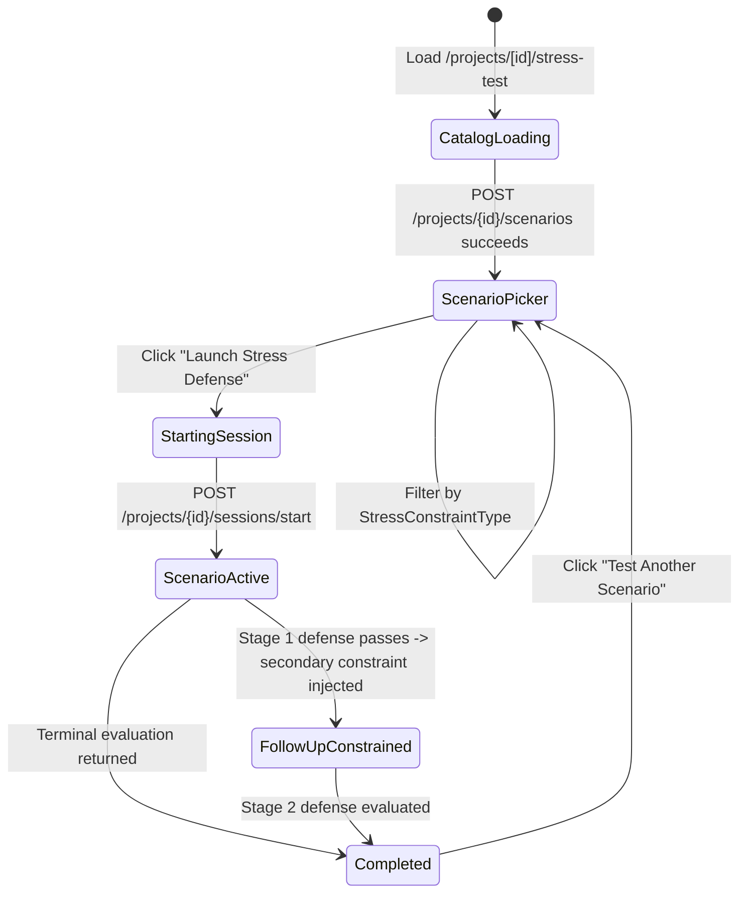

# 📄 Technical Specification: Next.js 15 Stress Test / What-If Mode UI & Interactive Scaling Defense Flow

> **Step ID**: `3.5b`  
> **Parent Milestone**: `Milestone 3.5: Stress Test / What-If Mode`  
> **Target Module**: `frontend/src/`  
> **Git Feature Branch**: `feat/step-3-5b-stress-test-what-if-ui`  
> **Status**: 📋 Draft / Ready for Implementation  
> **Created**: 2026-11-12

---

## 1. Executive Summary

In **Step 3.5a**, the backend Stress Test & What-If Mode engine (`backend/app/schemas/stress_test.py`, `backend/app/ai/stress_test_generator.py`, `backend/app/api/v1/stress_test.py`) was built and verified, providing grounded scaling constraint scenarios (`CONCURRENCY_SPIKE`, `DATA_VOLUME_100X`, `MEMORY_PRESSURE`, `NETWORK_LATENCY_JITTER`, `DB_CONNECTION_STARVATION`) and a multi-turn constraint-escalation evaluation loop (`SCENARIO_ACTIVE` → `FOLLOW_UP_CONSTRAINED` → `COMPLETED`).

In **Step 3.5b**, we build the complete **Next.js 15 Stress Test / What-If Mode UI & Interactive Scaling Defense Flow**. Candidates can filter and inspect repository-grounded scaling scenarios, launch an interactive defense session anchored to specific codebase symbols (`StressTarget`), respond to initial and escalated what-if constraints under a Principal Infrastructure Architect persona, and review their final scaling depth score (`1.0–10.0`), bottleneck detection status, and architectural feedback.

---

## 2. Dependencies & Prerequisites

- **Depends on**:
  - `backend/app/api/v1/stress_test.py` (Mounted at `/api/v1/stress-test`: `POST /projects/{id}/scenarios`, `POST /projects/{id}/sessions/start`, `GET /sessions/{id}`, `POST /sessions/{id}/respond`)
  - `backend/app/schemas/stress_test.py` (Canonical Pydantic v2 request/response contracts)
  - `frontend/src/lib/supabase.ts` (Supabase Auth JWT session retrieval)
  - `frontend/src/lib/projectApi.ts` (`getProjectOverview` for project header context)
  - `frontend/src/components/domain/ProjectNavHeader.tsx` (Unified multi-tab project navigation)
- **Blocked by**: None (Step 3.5a is complete and passing 7/7 tests).
- **Tech Stack Invariant**: Strictly Next.js 15 (App Router), React 19, TypeScript strict mode, Tailwind CSS, and `lucide-react` icons — matching `Gemini.md` with zero new external packages.

---

## 3. 🛡️ Security, Grounding & Invariants Impact

- [x] **Zero Code Execution**: Strictly static architectural simulation and text UI; zero terminal emulation, `eval()`, or user code execution.
- [x] **Multi-Tenant Authentication**: Every API call resolves the current Supabase session access token and attaches `Authorization: Bearer <token>`; unauthenticated visits redirect cleanly to `/login`.
- [x] **Safe Output Rendering**: All LLM-generated scenario prompts, architectural evaluations, feedback notes, and file paths are rendered strictly via React JSX text nodes with zero `dangerouslySetInnerHTML`.
- [x] **Input Bounds Enforcement**: Answer input enforces `minLength = 5` and `maxLength = 5000` (trimmed validation), matching `SubmitStressAnswerRequest` in `backend/app/schemas/stress_test.py`.
- [x] **Codebase Evidence Grounding**: The active session inspector anchors every challenge to `scenario.target` (`file_path`, `symbol_name`, `line_range`, `component_type`) and `cited_evidence_ids` so candidates defend real repository components.

---

## 4. 🧠 Sequential Thinking & UI Flow

Sequential Thinking MCP complexity triggers (AST traversal, chunk boundary splitting, backend FSM authoring, untrusted repo sanitization) are **not triggered** by this pure Next.js 15 frontend milestone, as the deterministic state machine resides in `backend/app/api/v1/stress_test.py`.

### Frontend Interactive State Flow



---

## 5. Data Contracts & Interfaces

### 5.1 TypeScript Contracts (`frontend/src/types/stressTest.ts`)

Must maintain exact 1:1 parity with `backend/app/schemas/stress_test.py`:

```typescript
export type StressConstraintType =
  | "CONCURRENCY_SPIKE"
  | "DATA_VOLUME_100X"
  | "MEMORY_PRESSURE"
  | "NETWORK_LATENCY_JITTER"
  | "DB_CONNECTION_STARVATION";

export type StressSeverity = "MODERATE" | "SEVERE" | "EXTREME";

export type StressSessionStage =
  | "SCENARIO_ACTIVE"
  | "FOLLOW_UP_CONSTRAINED"
  | "COMPLETED";

export interface StressTarget {
  symbol_name: string;
  file_path: string;
  line_range: string;
  component_type: string;
}

export interface StressTestScenario {
  id: string;
  title: string;
  constraint_type: StressConstraintType;
  severity: StressSeverity;
  target: StressTarget;
  context_description: string;
  hypothetical_prompt: string;
  expected_tradeoffs: string[];
  cited_evidence_ids: string[];
}

export interface StressDefenseTurn {
  id: string;
  role: "interviewer" | "candidate" | "system" | string;
  content: string;
  stage: StressSessionStage;
  timestamp: string;
  metadata: Record<string, unknown>;
}

export interface StressEvaluationOutput {
  depth_score: number;
  bottleneck_identified: boolean;
  scaling_strategy_sound: boolean;
  tradeoffs_acknowledged: boolean;
  feedback: string;
  follow_up_constraint?: string | null;
  is_terminal: boolean;
}

export interface StressDefenseSessionState {
  session_id: string;
  project_id: string;
  scenario: StressTestScenario;
  stage: StressSessionStage;
  current_turn_index: number;
  turns: StressDefenseTurn[];
  overall_score?: number | null;
  bottleneck_identified?: boolean | null;
  feedback?: string | null;
  created_at: string;
  updated_at: string;
}

export interface GenerateStressScenariosRequest {
  constraint_type?: StressConstraintType | null;
  max_scenarios?: number;
}

export interface StressScenarioListResponse {
  project_id: string;
  total_scenarios: number;
  scenarios: StressTestScenario[];
}

export interface StartStressDefenseRequest {
  scenario_id: string;
}

export interface SubmitStressAnswerRequest {
  answer: string;
}
```

### 5.2 API Client (`frontend/src/lib/stressTestApi.ts`)

Consumes `/api/v1/stress-test` with `Authorization: Bearer ${token}` and standard FastAPI `detail` error extraction:

- `fetchStressScenarios(projectId: string, token: string, constraintType?: StressConstraintType, maxScenarios?: number): Promise<StressScenarioListResponse>`
- `startStressSession(projectId: string, scenarioId: string, token: string): Promise<StressDefenseSessionState>`
- `getStressSession(sessionId: string, token: string): Promise<StressDefenseSessionState>`
- `submitStressAnswer(sessionId: string, answer: string, token: string): Promise<StressDefenseSessionState>`

### 5.3 UI Components & App Route

1. **`frontend/src/components/domain/ProjectNavHeader.tsx`** (`[MODIFY]`):
   - Extend `ProjectNavTab` union with `"stress-test"`.
   - Append tab `{ id: "stress-test", label: "Stress Test", hrefSuffix: "/stress-test", Icon: Gauge, accentColor: "text-amber-400" }`.
2. **`frontend/src/components/domain/StressTurnTranscript.tsx`** (`[NEW]`, $\le 160$ LOC):
   - Exports `CONSTRAINT_LABELS`, `StressSeverityBadge`, and `StressTurnTranscript`.
   - Renders each `StressDefenseTurn` cleanly: `interviewer` (`SCENARIO_ACTIVE` initial scaling prompt and `FOLLOW_UP_CONSTRAINED` secondary constraint escalation with `depth_score`), `candidate` defense bubble, and `system` postmortem notice (`overall_score`, `scaling_sound`, `tradeoffs_acknowledged`), plus evaluation loading indicator.
3. **`frontend/src/components/domain/StressTestSession.tsx`** (`[NEW]`, $\le 275$ LOC):
   - Props: `{ session: StressDefenseSessionState; onSessionUpdate: (updated: StressDefenseSessionState) => void; onExitSession: () => void }`.
   - **Session Header**: Back button (`Exit Stress Test`, `aria-label="Exit Stress Test"`), scenario `title`, `StressSeverityBadge`, `StressConstraintType` chip, and current `StressSessionStage` badge (`SCENARIO_ACTIVE` / `FOLLOW_UP_CONSTRAINED` / `COMPLETED`).
   - **Code Anchor & Tradeoffs Inspector**: Displays `target.file_path`, `target.symbol_name`, `target.line_range`, `target.component_type`, `context_description`, and a collapsible `"Reveal Tradeoff Checkpoints"` toggle (collapsed by default during active turns; automatically visible after completion).
   - **Dialogue Transcript**: Delegates turn rendering to `<StressTurnTranscript />` with smooth auto-scroll.
   - **Completion Card (`stage === "COMPLETED"`)**: Displays `overall_score` (`/10`), `bottleneck_identified` badge, summary `feedback`, and `"Test Another Scenario"` button (`onExitSession`).
   - **Defense Answer Form (`stage !== "COMPLETED"`)**: Accessible `<textarea>` (`aria-label="Scaling defense and bottleneck mitigation response"`), character counter (`5`–`5000`), `Ctrl+Enter` / `Cmd+Enter` submit shortcut, inline `role="alert"` error banner, and loading state (`Evaluating...`).
4. **`frontend/src/app/projects/[id]/stress-test/page.tsx`** (`[NEW]`, $\le 290$ LOC):
   - Loads project metadata via `getProjectOverview` and checks Supabase auth session (redirecting to `/login` if missing).
   - Renders `ProjectNavHeader` with `activeTab="stress-test"`.
   - When no active session: displays Stress Test header banner with constraint filter `<select aria-label="Filter stress scenarios by constraint type">`, loading state, error alert with retry, empty state with filter reset, and responsive scenario picker grid showing severity, constraint category, `context_description`, grounded `StressTarget` (`file_path`, `symbol_name`, `line_range`), and `"Launch Stress Defense"` CTA.
   - Uses a monotonic request counter (`latestRequestRef`) to prevent stale async filter race conditions.
   - When a session starts: switches into `<StressTestSession />`.

---

## 6. Step-by-Step Implementation Sequence

1. **Phase A: TypeScript Contracts & REST Client**
   - [ ] Create `frontend/src/types/stressTest.ts` ($\le 95$ LOC) matching `backend/app/schemas/stress_test.py`.
   - [ ] Create `frontend/src/lib/stressTestApi.ts` ($\le 150$ LOC) with Bearer token headers and FastAPI error parsing.
2. **Phase B: Navigation & Domain Component**
   - [ ] Update `frontend/src/components/domain/ProjectNavHeader.tsx` (+4 lines) to register the `"stress-test"` tab.
   - [ ] Create `frontend/src/components/domain/StressTestSession.tsx` ($\le 275$ LOC) for interactive scaling defense, secondary constraint escalation, and post-test scorecard.
3. **Phase C: App Router Page & Build Verification**
   - [ ] Create `frontend/src/app/projects/[id]/stress-test/page.tsx` ($\le 260$ LOC) integrating `ProjectNavHeader`, constraint filtering, scenario catalog cards, and `StressTestSession`.
   - [ ] Run `cd frontend && npm run typecheck && npm run lint && npm run build` to verify zero TypeScript, ESLint, or Next.js build issues.

---

## 7. 🩺 Specialized Skills Directive

- **Domain Skill Matrix Status**: `None` on backend domain modules (`app/security/`, `app/analyzers/`, `app/models/`, `app/ai/` are untouched by this pure Next.js 15 frontend milestone).
- **Enforced Quality & Security Guardrails (Verified in `/verify_step`)**:
  - **`security_auditor` UI Checks**: Zero `dangerouslySetInnerHTML`, zero code execution, strict Supabase JWT `Authorization: Bearer` header injection on all `/api/v1/stress-test` requests, and client-side answer length clamping (`5..5000`).
  - **`eval_persona` UX Checks**: Clear Principal Infrastructure Architect persona framing across initial scenario prompts, escalated `FOLLOW_UP_CONSTRAINED` turns, and grounded `StressTarget` citation visibility (`file_path`, `symbol_name`, `line_range`).
  - **`code_reviewer` Standards**: Strict $\le 300$ LOC cap per file, clean TypeScript interfaces with zero `any`, stale async request guard on scenario filtering, and accessible `aria-label` / `role="alert"` attributes.

---

## 8. Verification & Acceptance Criteria

### Automated Typecheck, Lint & Production Build
```bash
cd frontend && npm run typecheck && npm run lint && npm run build
```

### Acceptance Checklist
- [ ] `frontend/src/types/stressTest.ts` matches all `backend/app/schemas/stress_test.py` contracts cleanly.
- [ ] `frontend/src/lib/stressTestApi.ts` integrates with all `/api/v1/stress-test` endpoints using Supabase JWT Bearer auth.
- [ ] `ProjectNavHeader.tsx` includes the `"Stress Test"` tab with active highlight and `/stress-test` route.
- [ ] `StressTestSession.tsx` handles active scaling defense turns, secondary constraint escalation (`FOLLOW_UP_CONSTRAINED`), and `COMPLETED` scorecard rendering.
- [ ] `/projects/[id]/stress-test` renders the scenario catalog, constraint filter, grounded code target metadata, and active session flow cleanly.
- [ ] Every created or modified file is strictly $\le 300$ LOC.
- [ ] `npm run typecheck`, `npm run lint`, and `npm run build` pass with zero errors.
