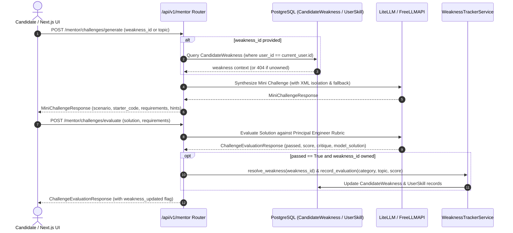

# Feature Specification: Step 4.3a — Mentor Mode Mini Challenges Backend Engine & Schema

> **Milestone:** 4.3 (Mentor Mode — Mini Challenges)  
> **Step:** 4.3a (Backend Schemas, AI Challenge Synthesizer, Evaluation Engine & REST API)  
> **Status:** In Progress  
> **Branch:** `feat/step-4-3a-mentor-mini-challenges-backend`  

---

## 1. Context & Objectives

In Milestone 4.2, RepoDefense introduced Mentor Mode teaching content and code remediation, providing pedagogical explanations of architectural anti-patterns with before-and-after code diffs.
Milestone 4.3 closes the learning loop by providing **Mini Challenges**: targeted, project- or topic-specific architectural problem statements where the candidate is asked to fix a flawed snippet or design a production-grade solution.

When the candidate submits their solution, the Principal Engineer AI persona evaluates it against rigorous architectural criteria. If the candidate passes, the system updates their tracked skills and resolves the candidate weakness record in the database via `WeaknessTrackerService`.

### Core Requirements:
1. **Pydantic v2 Contracts** (`backend/app/schemas/challenge.py`):
   - `MiniChallengeDifficulty` enum: `FOUNDATIONAL`, `INTERMEDIATE`, `ADVANCED`.
   - `MiniChallengeResponse`: `challenge_id`, `category`, `topic`, `difficulty`, `title`, `scenario`, `starter_code`, `language`, `requirements`, `hints`, `generated_at`.
   - `GenerateChallengeRequest`: `weakness_id`, `topic`, `category`, `difficulty`, `language`, `code_context`, LLM overrides.
   - `SubmitChallengeSolutionRequest`: `challenge_id`, `weakness_id`, `category`, `topic`, `scenario`, `requirements`, `candidate_solution`, `language`, LLM overrides.
   - `ChallengeEvaluationResponse`: `evaluation_id`, `challenge_id`, `passed`, `score`, `strengths`, `missing_elements`, `critique`, `model_solution`, `weakness_updated`, `evaluated_at`.
2. **AI Prompts & Generator** (`backend/app/ai/challenge_generator.py` & `backend/app/ai/challenge_prompts.py`):
   - XML context boundary delimiters (`<weakness_context>`, `<topic_context>`, `<code_context>`, `<candidate_solution>`, `<requirements>`) to prevent prompt injection.
   - Robust JSON extraction from LiteLLM completions.
   - High-fidelity deterministic offline fallbacks covering key architectural topics (connection pooling, concurrency lost updates, cache stampedes, rate limiting, domain decoupling) when LLM credentials are unavailable.
   - Zero arbitrary code execution: all user code is evaluated purely via static reasoning and static analysis.
3. **FastAPI REST Endpoints** (`backend/app/api/v1/mentor.py`):
   - `POST /api/v1/mentor/challenges/generate`: Generates an architectural challenge for a topic or recorded weakness.
   - `GET /api/v1/mentor/challenges/weakness/{weakness_id}`: Generates a challenge directly grounded in the recorded candidate weakness.
   - `POST /api/v1/mentor/challenges/evaluate`: Evaluates candidate's proposed solution, returning structured critique and model solution. If `weakness_id` is supplied and owned by `current_user`, updates the candidate's skill and resolves the weakness if passed.
4. **Multi-Tenant Security & Invariants**:
   - Strict IDOR isolation: if `weakness_id` is supplied, asserts `weakness.user_id == current_user.id`. Returns HTTP 404 for unowned records.
   - Strict $\le 300$ LOC limit per file.

---

## 2. Architecture & Data Flow

---

## 3. Security Checklist & Invariants
- [x] **Zero Code Execution**: Solutions and starter snippets are handled 100% as static text. No `eval()`, `exec()`, or container runs.
- [x] **IDOR Prevention**: `weakness.user_id == current_user.id` strictly enforced on all weakness-backed endpoints.
- [x] **Prompt Injection Defense**: User input wrapped in strict XML tags (`<candidate_solution>`, `<requirements>`).
- [x] **300 LOC Invariant**: All modules designed to remain safely below 300 LOC.
- [x] **Offline Fallbacks**: Fully deterministic offline fallbacks when LiteLLM is unconfigured.
