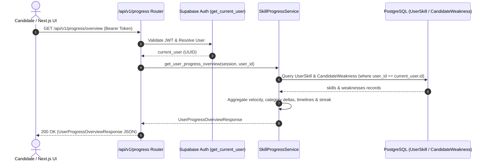

# Feature Specification: Step 4.4a — Skill Progress & Improvement Telemetry Backend

> **Milestone:** 4.4 (Progress Dashboard)  
> **Step:** 4.4a (Backend Progress Schemas, Improvement Telemetry Service & REST API)  
> **Status:** In Progress  
> **Branch:** `feat/skill-progress-telemetry-backend`  

---

## 1. Context & Objectives

In Milestones 4.1, 4.2, and 4.3, RepoDefense established the candidate skill proficiency and weakness tracking models (`UserSkill`, `CandidateWeakness`), pedagogical remediation content generation, and interactive mini-challenges with automatic gap resolution.

Milestone 4.4 introduces the **Progress Dashboard**, enabling candidates to track their architectural mastery trajectory, weakness resolution velocity, and skill growth over time.

Step 4.4a delivers the backend data aggregation and telemetry engine:
1. **Pydantic v2 Contracts** (`backend/app/schemas/progress.py`):
   - `ProficiencyTrendPoint`: Historical evaluation timeline tracking date, average proficiency, total evaluations, and passed evaluations.
   - `WeaknessVelocityMetric`: Total identified vs. resolved weaknesses, resolution percentage, breakdown across severity tiers (`critical`, `major`, `minor`), and average resolution turnaround hours.
   - `CategoryProgressDelta`: Per-category proficiency level, total evaluations, pass rate, weakness backlog count, resolved count, and status badge (`mastered`, `proficient`, `improving`, `needs_focus`).
   - `TopicMasteryItem`: Per-topic metrics including proficiency score, total evaluations, pass rate %, and last evaluation timestamp.
   - `UserProgressOverviewResponse`: Comprehensive progress summary aggregating overall proficiency, pass rate, active skills count, mastered skills count, learning streak days, weakness velocity, category deltas, recent timeline, and top improved vs. needs-focus topics.
2. **Telemetry Service** (`backend/app/services/skill_progress.py`):
   - Derives metrics from existing `UserSkill` and `CandidateWeakness` records.
   - Computes chronological score trajectories and learning streak days.
   - Computes weakness resolution velocity and time-to-resolve deltas.
   - Categorizes topics into top-performing vs. focus areas.
   - Multi-tenant query isolation strictly scoped to `user_id`.
3. **FastAPI REST Endpoints** (`backend/app/api/v1/progress.py`):
   - `GET /api/v1/progress/overview`: Returns full `UserProgressOverviewResponse` for authenticated user.
   - `GET /api/v1/progress/timeline`: Returns chronological proficiency and activity timeline points with optional `days` window filter (e.g. 7, 30, 90).
   - `GET /api/v1/progress/categories`: Returns category-level mastery and resolution deltas.
4. **Router Mounting**:
   - Mounted at `/api/v1/progress` in `backend/app/main.py`.

---

## 2. Architecture & Data Flow

---

## 3. Specialized Skills Directive

- **Security & Multi-Tenancy**:
  - All queries MUST filter explicitly by `user_id == current_user.id` to prevent cross-tenant telemetry exposure.
  - No untrusted user inputs executed; zero arbitrary code execution.
- **Data Integrity & Robustness**:
  - Non-finite numbers (NaN, Inf) forbidden in responses; all averages protected with zero-division fallbacks.
  - Strict $\le 300$ LOC limit per file.

---

## 4. Verification & Test Plan

1. **Unit & Integration Tests** (`backend/tests/test_skill_progress.py`):
   - Test empty state (user with 0 skills and 0 weaknesses) returns valid neutral response with zero counts.
   - Test user with mixed skills, passed/failed evaluations, and resolved/unresolved weaknesses computes accurate velocity, pass rates, and category deltas.
   - Test timeline bucketing and filtering.
   - Test multi-tenant isolation (user A cannot view user B's progress).
   - Test API endpoints return 200 with compliant Pydantic schemas.
2. **Quality Gates**:
   - `python -m ruff check backend/app backend/tests` clean.
   - `pytest backend/tests/test_skill_progress.py` 100% passing.
   - All touched files $\le 300$ LOC.
