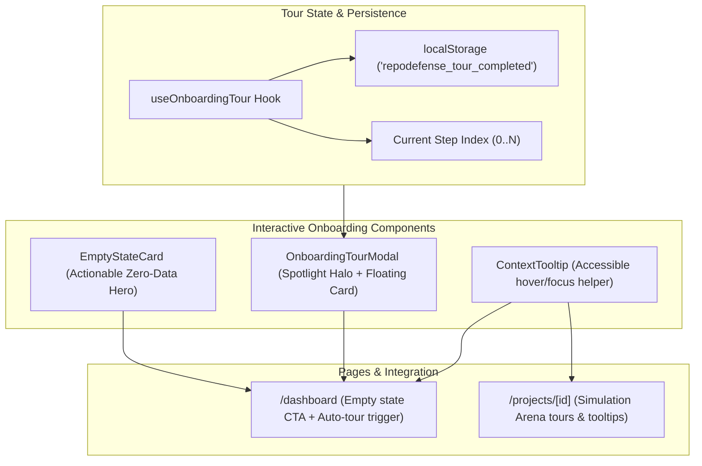

# Specification: Milestone 5.3 — Enhanced Onboarding (Tours, Tooltips & Empty States)

> **Milestone:** 5.3 — Enhanced Onboarding  
> **Status:** Draft / Active  
> **Target:** Frontend (`frontend/src/`)  
> **Dependencies:** Milestone 1.4 (Dashboard & Ingestion), Milestone 3.8 (Simulation Arena), Milestone 5.2 (GitHub App)

---

## 1. Problem Statement
First-time candidates arriving at RepoDefense often face unfamiliar conceptual paradigms (evidence grounding, architectural stress testing, chaotic incident simulation, AST symbol boundaries, and principal engineer persona defense). Without structured onboarding:
1. First-time users on an empty dashboard need clear, actionable guidance on how repository ingestion works (both public GitHub URLs and private GitHub App installations).
2. Deep architectural simulation features (Incident War Room, Scaling Stress Test, Architecture Topology Defense) can be intimidating without contextual tooltips explaining what each mode assesses.
3. Complex multi-step flows benefit from an interactive, lightweight spotlight walkthrough (Onboarding Tour) that highlights core elements, explains the 7-stage core loop, and persists completion status to prevent repetitive annoyance.

---

## 2. Architecture & Components

### Component Breakdown
1. **`types/onboarding.ts`**:
   - `TourStep`: `id`, `targetSelector`, `title`, `description`, `placement` (`top` | `bottom` | `left` | `right` | `center`), `badge` (optional).
   - `TourConfig`: `tourId`, `steps`, `onComplete?`, `onSkip?`.
   - `TourState`: `isActive`, `currentStepIndex`, `isCompleted`.

2. **`hooks/useOnboardingTour.ts`**:
   - Manages active step index, SSR-safe localStorage check (`repodefense_tour_${tourId}_completed`), next/previous step advancement, keyboard listeners (`Escape` to skip, `ArrowRight` / `Enter` for next, `ArrowLeft` for back), element bounding rect tracking with window resize/scroll listeners.

3. **`components/domain/OnboardingTourModal.tsx`**:
   - Spotlight backdrop (dimmed overlay with target element cutout or target halo ring).
   - Floating glassmorphism card positioned relative to the target element.
   - Step indicator (`Step 1 of 4`), "Skip", "Back", and "Next" / "Finish" controls.
   - Accessible ARIA dialog attributes (`role="dialog"`, `aria-modal="true"`, focus trap).

4. **`components/ui/ContextTooltip.tsx`**:
   - Lightweight, accessible tooltip wrapper.
   - Shows floating label on hover or keyboard focus (`tabIndex={0}` or wrapping button).
   - Smooth animation, high-contrast dark theme, arrow notch.

5. **`components/domain/EmptyState.tsx`**:
   - Clean, modern zero-data visual card.
   - Accepts icon (Lucide), title, description, primary CTA button, secondary guide button ("Take Feature Tour").

6. **Page Integrations**:
   - `/dashboard`: Enhanced empty state when user has 0 projects, with "Take a Tour" and "Add Repository" actions.
   - Contextual tooltips on project cards and simulation launchers.

---

## 3. Security & Quality Invariants
- **Zero Arbitrary Code Execution**: Pure UI and React hook state logic.
- **Strict LOC Limit**: All `.ts` and `.tsx` files $\le 300$ LOC.
- **SSR Safety**: `localStorage` and `window` references guarded inside `useEffect` or client-side checks (`typeof window !== 'undefined'`).
- **Responsive & Non-Blocking**: Graceful fallback to centered placement if target element is not found in DOM or viewport is small (mobile).
- **Type Safety**: TypeScript strict mode, 0 `any`, full test coverage.
