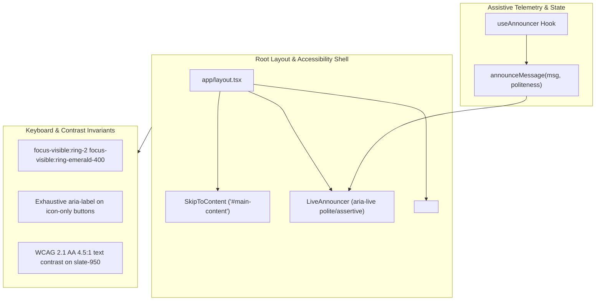

# Specification: Milestone 5.4 — Accessibility (WCAG 2.1 AA Compliance)

> **Milestone:** 5.4 — Accessibility  
> **Status:** Draft / Active  
> **Target:** Frontend (`frontend/src/`)  
> **Dependencies:** Milestone 1.1 (Frontend Scaffold), Milestone 1.4 (Dashboard & Ingestion), Milestone 5.3 (Enhanced Onboarding)

---

## 1. Problem Statement
RepoDefense is a high-stakes, interactive technical assessment tool featuring complex interfaces: real-time LLM oral defense chat, Tree-sitter AST symbol graphs, Mermaid architecture topologies, and simulation arenas. To ensure an inclusive, professional experience compliant with WCAG 2.1 AA standards:
1. Keyboard-only and screen reader users need a bypass mechanism to skip repetitive global headers directly to primary interactive workspaces ("Skip to Content").
2. Dynamic asynchronous UI changes (such as new AI evaluation turns, score updates, background cloning states, and error alerts) must be announced to assistive technologies via accessible ARIA live regions without interrupting the user.
3. Interactive controls (icon buttons, tab switchers, dialog triggers) must provide unambiguous `aria-label`, `aria-describedby`, and `focus-visible` focus indicators with high-contrast outlines against dark backdrops.

---

## 2. Architecture & Components

### Component Breakdown
1. **`types/accessibility.ts`**:
   - `PolitenessSetting`: `"polite"` | `"assertive"` | `"off"`.
   - `Announcement`: `id`, `message`, `politeness`, `timestamp`.
2. **`lib/accessibility.ts`**:
   - Event bus / listener for dispatching announcements across isolated React components.
   - Contrast calculation utility verifying minimum 4.5:1 luminance ratio for text.
3. **`hooks/useAnnouncer.ts`**:
   - React hook exposing `announce(message, politeness)` for declarative screen reader alerts.
4. **`components/ui/SkipToContent.tsx`**:
   - Hidden skip link that translates into view when focused via `Tab`, jumping focus to `#main-content`.
5. **`components/ui/LiveAnnouncer.tsx`**:
   - Visually hidden (`sr-only`) live region component rendering polite and assertive announcement buffers.
6. **Layout & Global Integration**:
   - Embed `<SkipToContent />` and `<LiveAnnouncer />` in `frontend/src/app/layout.tsx`.
   - Ensure main wrapper has `id="main-content"` and `tabIndex={-1}`.
   - Refine `globals.css` with accessible `focus-visible` defaults.

---

## 3. Security & Quality Invariants
- **Zero Arbitrary Code Execution**: Pure UI and DOM event logic.
- **Strict LOC Limit**: All `.ts` and `.tsx` files $\le 300$ LOC.
- **SSR Safe**: `window` and `document` references checked for client execution.
- **Keyboard Trapping & Escape**: Consistent keyboard navigation across all interactive widgets.
- **Performance**: Announcement buffer auto-clears after TTL to prevent DOM bloat.
