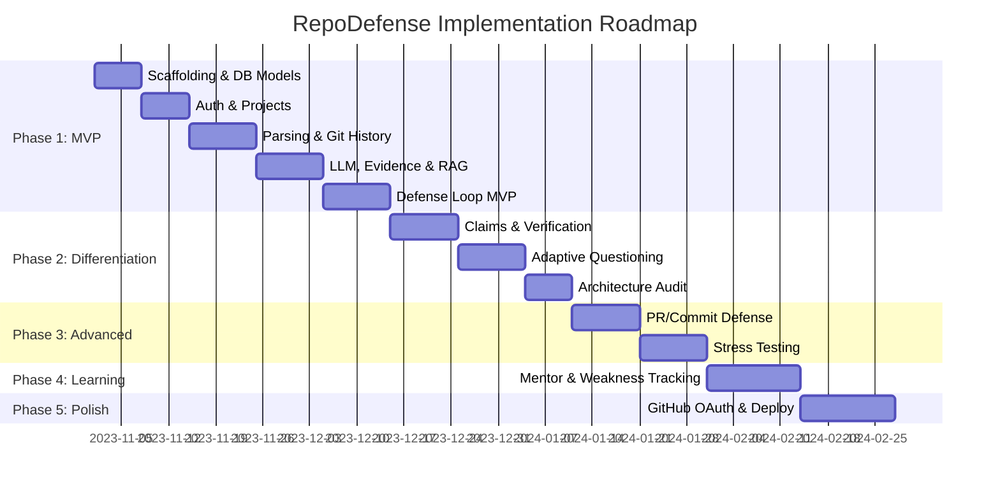

# Implementation Plan & Roadmap

> **Product:** RepoDefense  
> **Tagline:** "Prove that you understand — and can defend — the software you built."  
> **Core Loop:** Evidence → Claim → Defense → Stress Test → Evaluation → Mentor → Re-test

## 1. Project North Star

RepoDefense is an AI-powered system designed to interrogate developers on the codebases they have built, acting as a rigorous technical interviewer. The core value proposition is verifying technical depth and actual contribution. By grounding questions in extracted code evidence, the platform ensures the defense is relevant, specific, and uncheatable. 

This document serves as the daily operational roadmap. It breaks down the architecture and product requirements into small, actionable, and independently verifiable milestones.

**CANONICAL TECH STACK (use exactly these):**
- **Frontend:** Next.js 15 (App Router) + TypeScript + shadcn/ui + Tailwind CSS (Deploy: Vercel)
- **Backend:** FastAPI (Python 3.12+) (Deploy: Render)
- **Database:** PostgreSQL 17 + pgvector (Host: Supabase - free tier)
- **Auth:** Supabase Auth
- **Cache/Queue:** Redis (Host: Upstash - serverless)
- **Background Jobs:** ARQ (async-native, Redis-based)
- **LLM Abstraction:** LiteLLM (Primary: FreeLLMAPI)
- **Embeddings:** all-MiniLM-L6-v2 via sentence-transformers (local, free)
- **AST Parsing:** Tree-sitter (multi-language, deterministic)
- **CI/CD:** GitHub Actions
- **Monitoring:** structlog + Sentry (free tier)

## 2. Implementation Philosophy

- **Build in small verified slices:** Never attempt to build a monolithic feature all at once. Slice features vertically (DB to UI).
- **Independently testable:** Every milestone must result in a state that can be tested, demonstrated, and verified.
- **Contracts first:** Define API schemas (Pydantic models) and database schemas before writing business logic or UI components.
- **Manual verification checkpoints:** Automated tests are critical, but human eyes on the UI or API responses (via Swagger) confirm true success.
- **Safe for AI-assisted coding:** The milestones are intentionally scoped to fit within the context window and capability level of current coding AIs.

## 3. Implementation Roadmap Overview



## 4. PHASE 1 — CORE MVP
**Goal:** Working repository-grounded defense system, demoable.

### Milestone 1.1: Project Scaffolding
- **Goal:** Set up the complete project structure with both frontend and backend running locally.
- **Sub-tasks:**
  - [x] **Step 1.1a: FastAPI Project Scaffold & Health Check** (FastAPI app, Pydantic v2 settings, CORS, `/api/health`, pytest)
  - [x] **Step 1.1b: Local Infrastructure & Docker Compose** (PostgreSQL 17 + pgvector, Upstash/local Redis, `.env.example`, Dockerfile)
  - [x] **Step 1.1c: Next.js 15 Frontend Scaffolding & Landing Page** (Next.js 15 App Router, TypeScript, Tailwind CSS, shadcn/ui)
- **Components:**
  - Initialize Next.js 15 project with App Router, TypeScript, Tailwind, shadcn/ui.
  - Initialize FastAPI project with proper folder structure.
  - Docker Compose for local PostgreSQL 17 + Redis.
  - Basic health check endpoints.
  - CORS configuration.
  - Environment variable structure (`.env.example`).
- **Dependencies:** None
- **Tests:** Health check endpoint returns 200, frontend renders, Docker containers start.
- **Acceptance:** Both apps running locally, connected to local DB and Redis.
- **Manual verification:** Visit localhost, see frontend; hit `/docs`, see FastAPI swagger.
- **AI Coding Prompt:** "Create a new Next.js 15 project with App Router, TypeScript, Tailwind CSS, and shadcn/ui. Include a basic landing page with the heading 'RepoDefense'. Also create a FastAPI project with a health check endpoint at `/api/health`. Set up `docker-compose.yml` with PostgreSQL 17 and Redis."

### Milestone 1.2: Database Models & Migrations
- **Goal:** Core database schema with SQLAlchemy models and Alembic migrations.
- **Sub-tasks:**
  - [x] **Step 1.2a: SQLAlchemy Async Engine & Core Tenancy Models** (`User`, `Project`, `RepositorySnapshot`, async session factory, CRUD tests)
  - [x] **Step 1.2b: Code Analysis & pgvector Vector Models + Alembic Migrations** (`AnalyzedFile`, `CodeSymbol`, `Dependency`, `Evidence`, `CodeEmbedding`, pgvector HNSW)
- **Components:**
  - SQLAlchemy models for: `User`, `Project`, `RepositorySnapshot`, `AnalyzedFile`, `CodeSymbol`, `Dependency`, `Evidence`, `CodeEmbedding`.
  - Alembic migration setup.
  - pgvector extension enabled in migration.
  - Pydantic schemas for API request/response.
- **Dependencies:** 1.1
- **Tests:** Migrations run cleanly, models can CRUD.
- **Acceptance:** All Phase 1 tables created with correct types and indexes.
- **AI Coding Prompt:** "Create async SQLAlchemy models for the following entities: User, Project, RepositorySnapshot, AnalyzedFile, CodeSymbol, Dependency, Evidence, CodeEmbedding. Use the asyncpg driver. Set up Alembic for migrations and create an initial migration that enables the pgvector extension."

### Milestone 1.3: Authentication
- **Goal:** User can sign up and sign in.
- **Sub-tasks:**
  - [x] **Step 1.3a: FastAPI Supabase JWT Auth Dependency & Protected Current User Route** (security.py, get_current_user, TokenPayload, UserResponse, GET /api/v1/auth/me)
  - [x] **Step 1.3b: Next.js 15 Supabase Auth Client, Auth Pages & Session State** (Next.js Supabase auth client, login/signup forms, session state, protected route redirect)
- **Components:**
  - Supabase Auth integration (backend JWT verification).
  - Frontend auth flow (sign up, sign in, sign out).
  - Protected API routes.
  - Auth middleware in FastAPI.
- **Dependencies:** 1.1, 1.2
- **Tests:** Auth flow works, protected endpoints reject unauthenticated requests.
- **Acceptance:** User can sign up, sign in, see dashboard.
- **AI Coding Prompt:** "Integrate Supabase Auth with the Next.js frontend using @supabase/supabase-js. Create sign-in and sign-up pages. In FastAPI, create a dependency that verifies Supabase JWT tokens. Create a protected `/api/auth/me` endpoint."

### Milestone 1.4: Project Creation & GitHub URL Input
- **Goal:** User can submit a GitHub repo URL and create a project.
- **Sub-tasks:**
  - [x] **Step 1.4a: FastAPI Projects API & GitHub URL Validation** (schemas/project.py, api/v1/projects.py, URL regex validation, duplicate conflict, tenant isolation)
  - [x] **Step 1.4b: Next.js 15 Project Dashboard & Add Repository Form** (/dashboard, project listing cards, Add Repository modal, form validation)
- **Components:**
  - POST `/api/projects` endpoint.
  - URL validation (GitHub URLs only).
  - Project creation in DB.
  - Frontend "Add Project" page with URL input.
  - Project list on dashboard.
- **Dependencies:** 1.3
- **Tests:** Valid URLs accepted, invalid rejected, project created in DB.
- **Acceptance:** User can add a project, see it on dashboard.
- **AI Coding Prompt:** "Create a FastAPI endpoint `POST /api/projects` that accepts a GitHub URL, validates it, and creates a Project record in the database. In Next.js, create a dashboard page with a list of projects and an 'Add Project' form."

### Milestone 1.5: Repository Cloning & Security Filter
- **Goal:** Safely clone a GitHub repository and filter files.
- **Sub-tasks:**
  - [x] **Step 1.5a: Untrusted Code Sanitizer, Path Traversal Defense & Secret Scanner** (traversal.py, secrets.py, sanitizer.py, binary exclusion, quota limits)
  - [x] **Step 1.5b: ARQ Background Worker & Git Shallow Clone Pipeline** (ARQ worker pool, Upstash Redis queue, git shallow clone, project status update)
- **Components:**
  - Shallow git clone (`--depth=1`).
  - Repository size validation (max 500MB).
  - File count validation (max 10,000).
  - File extension whitelist.
  - Path traversal prevention.
  - Secret detection (basic regex patterns).
  - Binary file exclusion.
  - ARQ background task for cloning.
- **Dependencies:** 1.4
- **Tests:** Clone succeeds for valid repos, rejects oversized repos, filters binary files, detects test secrets.
- **Acceptance:** Repo cloned safely into temporary workspace, only allowed files kept.
- **AI Coding Prompt:** "Implement an ARQ background task in Python to clone a GitHub repository securely. Use a shallow clone. Enforce limits: 500MB max size, 10,000 files max. Add filtering to ignore binary files, enforce an extension whitelist, and run basic regex checks for secrets. Return the path to the sanitized workspace."

### Milestone 1.6: File Scanning & Language Detection
- **Goal:** [x] Scan cloned repo, detect languages, extract file metadata, persist `AnalyzedFile` records.
- **Components:**
  - Directory tree walker.
  - Language detection (file extension mapping + linguist-like detection).
  - File metadata extraction (size, lines, type classification).
  - Store `AnalyzedFile` records.
- **Dependencies:** 1.5
- **Tests:** File tree matches expected structure, languages detected correctly.
- **Acceptance:** All source files cataloged with correct metadata.
- **AI Coding Prompt:** "Write a Python module to walk a directory tree and catalog files. For each file, determine the programming language based on the extension, count lines, and calculate size. Save this data using the `AnalyzedFile` SQLAlchemy model."

### Milestone 1.7: AST Parsing & Symbol Extraction
- **Goal:** [x] Parse source files with Tree-sitter, extract functions/classes/imports.
- **Sub-tasks:**
  - [x] **Step 1.7a: Tree-sitter Base Engine & Python AST Symbol Extractor** (base.py, python.py, SymbolMetadata, CodeSymbol persistence)
  - [x] **Step 1.7b: TypeScript/JavaScript AST Parser & Cloner Worker Pipeline** (typescript.py, endpoint detection, worker AST parsing pipeline)
- **Components:**
  - Tree-sitter integration for Python, JavaScript, TypeScript, Java, Go.
  - Function extraction (name, params, return type, line range).
  - Class extraction (name, methods, line range).
  - Import/dependency extraction.
  - Endpoint detection (Flask/FastAPI/Express route decorators).
  - Store `CodeSymbol` records.
- **Dependencies:** 1.6
- **Tests:** Known files produce expected symbols.
- **Acceptance:** Symbols extracted for all supported languages.
- **AI Coding Prompt:** "Integrate Tree-sitter in Python to parse Python, TS, and JS files. Extract all function and class definitions (names and line ranges) and imports. Store these as `CodeSymbol` records in the database."

### Milestone 1.8: Dependency & Config Extraction
- **Goal:** [x] Parse dependency files and configuration.
- **Sub-tasks:**
  - [x] **Step 1.8a: Python & Node.js Manifest Parsers & Database Persistence** (base.py, python.py, node.py, DependencyMetadata, Dependency persistence)
  - [x] **Step 1.8b: Container, Infrastructure & CI/CD Config Extraction & Cloner Worker Pipeline** (Dockerfile, docker-compose.yml, CI workflows, cloner worker integration)
- **Components:**
  - `requirements.txt`, `Pipfile`, `pyproject.toml` parsing.
  - `package.json` parsing.
  - `Dockerfile` parsing.
  - `docker-compose.yml` parsing.
  - CI/CD config detection.
  - Store `Dependency` records.
- **Dependencies:** 1.6
- **Tests:** Known dependency files produce correct dependency lists.
- **Acceptance:** All dependencies cataloged with versions.
- **AI Coding Prompt:** "Write a Python parser that reads `package.json` and `requirements.txt` from a directory. Extract package names and versions, and save them as `Dependency` database records associated with the project."

### Milestone 1.9: Git History Analysis
- **Goal:** [x] Extract commit history and contributor data.
- **Sub-tasks:**
  - [x] **Step 1.9: Git Commit & Contributor History Analyzer** (git.py, DELIMITER unit separator, ContributorStats, clone depth=100, cloner worker integration)
- **Components:**
  - Git log parsing (commit hash, author, date, message, files changed).
  - Contributor extraction (unique authors, commit counts).
  - Store records.
- **Dependencies:** 1.5
- **Tests:** Commit history matches expected data.
- **Acceptance:** Commits and contributors stored correctly.
- **AI Coding Prompt:** "Using standard Python libraries or running the `git` CLI via subprocess, extract the last 100 commits from a local git repository. Parse the hash, author name, date, and commit message. Calculate commit counts per author."

### Milestone 1.10: LLM Integration & Project Summary
- **Goal:** Generate AI-powered project summary using analyzed data.
- **Components:**
  - LiteLLM client wrapper (retries, timeouts).
  - LLM provider configuration (FreeLLMAPI).
  - Project summary prompt template.
  - Structured output parsing (Pydantic).
  - Summary stored in `RepositorySnapshot`.
- **Dependencies:** 1.6, 1.7, 1.8, 1.9
- **Tests:** Summary generated for test repo, contains expected topics.
- **Acceptance:** Project summary page shows coherent summary with tech stack, architecture hints.
- **AI Coding Prompt:** "Create a LiteLLM wrapper in Python. Write a prompt that takes the list of dependencies, file summaries, and top contributors, and asks the LLM to output a Pydantic model representing a high-level project summary. Save this summary to `RepositorySnapshot`."

### Milestone 1.11: Evidence Extraction
- **Goal:** [x] Extract structured evidence items from analysis results.
- **Sub-tasks:**
  - [x] **Step 1.11: Deterministic Evidence Extractor & Worker Pipeline** (evidence.py schemas & analyzer, framework/database/auth/endpoint/queue/infra rules, cloner worker integration, 83/83 tests passing)
- **Components:**
  - Evidence extraction rules (deterministic).
  - Store `Evidence` records with source file references.
- **Dependencies:** 1.7, 1.8, 1.10
- **Tests:** Known repos produce expected evidence items.
- **Acceptance:** Evidence items stored with correct types and source references.
- **AI Coding Prompt:** "Write a Python script that iterates over `AnalyzedFile`, `Dependency`, and `CodeSymbol` records to generate `Evidence` records. For example, if 'express' is a dependency, generate a 'Framework' evidence record pointing to `package.json`."

### Milestone 1.12: Embedding Generation & RAG Setup
- **Goal:** Generate embeddings and set up retrieval pipeline.
- **Sub-tasks:**
  - [x] **Step 1.12a: AST-Aware Code Chunking Engine** (chunk.py schemas & chunker.py analyzer, Tree-sitter boundary alignment, module header isolation, oversized sliding-window subchunking, 7/7 tests)
  - [ ] **Step 1.12b: Local Embeddings & pgvector Retrieval Pipeline** (sentence-transformers all-MiniLM-L6-v2, CodeEmbedding models, pgvector cosine distance search, ARQ worker integration)
- **Components:**
  - `sentence-transformers` integration (`all-MiniLM-L6-v2`).
  - Code-aware chunking (function/class boundaries).
  - File summary embeddings.
  - pgvector HNSW index.
  - Retrieval function: query → filter → vector search → results.
- **Dependencies:** 1.7, 1.10, 1.11
- **Tests:** Semantic search returns relevant code for known queries.
- **Acceptance:** RAG retrieves relevant evidence for test questions.
- **AI Coding Prompt:** "Use `sentence-transformers` with the `all-MiniLM-L6-v2` model to generate embeddings for chunks of source code. Store the vector data in the `CodeEmbedding` table using pgvector. Write a retrieval function that takes a string query, embeds it, and returns the top 5 most similar code chunks."

### Milestone 1.13: Question Generation
- **Goal:** Generate evidence-grounded questions about the repository.
- **Components:**
  - Question generation prompt template.
  - Evidence-based question generation.
  - Question categorization.
  - Structured question output (Pydantic).
- **Dependencies:** 1.11, 1.12
- **Tests:** Generated questions reference actual project features.
- **Acceptance:** Questions are relevant, non-hallucinated, and cite evidence.
- **AI Coding Prompt:** "Using LiteLLM, write a prompt that takes retrieved `Evidence` records and asks the LLM to generate 3 technical interview questions about the codebase. Enforce a structured Pydantic output containing the question text, category, and cited evidence ID."

### Milestone 1.14: Defense Session — Core Loop
- **Goal:** User can start a defense session and answer questions.
- **Components:**
  - Defense session creation (`POST /projects/{id}/defense/start`).
  - Interview state machine.
  - Answer submission (`POST /sessions/{id}/answer`).
  - Basic answer evaluation (LLM evaluates against evidence).
  - Score per answer.
  - Frontend defense session UI.
- **Dependencies:** 1.12, 1.13
- **Tests:** Full defense loop works for test repo.
- **Acceptance:** User can complete a 5-question defense session.
- **AI Coding Prompt:** "Build the Next.js UI for a chat-like defense session. Implement the FastAPI endpoints to start a session, get the next question, submit an answer, and return the LLM's evaluation and score for that answer."

### Milestone 1.15: Evidence Display
- **Goal:** Show evidence behind each question.
- **Components:**
  - Evidence panel in defense session UI.
  - File references with paths and line numbers.
  - Evidence type badges.
- **Dependencies:** 1.14
- **Tests:** Evidence correctly linked to questions.
- **Acceptance:** User can see why each question was asked.
- **AI Coding Prompt:** "Update the defense session UI in Next.js to include a side panel. When a question is displayed, fetch and render the `Evidence` records associated with it, displaying the file path, lines of code, and a badge for the evidence type."

### Milestone 1.16: Basic Defense Report
- **Goal:** Generate a structured report after defense session.
- **Components:**
  - Report generation prompt template.
  - Score aggregation per topic.
  - Strengths and weaknesses identification.
  - Report UI page.
- **Dependencies:** 1.14
- **Tests:** Report generated with correct scores.
- **Acceptance:** User sees a comprehensive report after completing defense.
- **AI Coding Prompt:** "Create a FastAPI endpoint that aggregates the scores from a completed defense session. Prompt LiteLLM to generate a summary of strengths and weaknesses based on the answers. Build a Next.js page to display this report."

### Milestone 1.17: Project Overview Page
- **Goal:** Polished project overview showing analysis results.
- **Components:**
  - Project summary display.
  - Tech stack visualization.
  - File tree explorer.
  - Dependency and contributor lists.
  - "Start Defense" button.
- **Dependencies:** 1.10, 1.11, 1.15
- **Tests:** All analysis data renders correctly.
- **Acceptance:** Project page is informative and polished enough to demo.
- **AI Coding Prompt:** "Build a Next.js Project Overview page. Fetch project metadata, the AI-generated summary, a list of dependencies, and contributors from the FastAPI backend. Include a prominent 'Start Defense' button."

### Milestone 1.18: MVP Polish & Deploy
- **Goal:** Deploy MVP to production.
- **Components:**
  - Supabase project setup (production).
  - Vercel deployment (frontend).
  - Render deployment (backend + worker).
  - Upstash Redis setup.
  - Environment variables configured.
  - Landing page polish.
  - GitHub Actions CI.
- **Dependencies:** All 1.x milestones
- **Tests:** E2E test passes in production.
- **Acceptance:** MVP is live, demo flow works end-to-end.
- **AI Coding Prompt:** "Create a GitHub Actions workflow that runs `flake8`, `mypy`, and `pytest` for the FastAPI backend, and `npm run lint` and `npm run build` for the Next.js frontend on every PR."

## 5. PHASE 2 — DIFFERENTIATION
**Goal:** Resume claims, adaptive questioning, pushback, architecture audit.

### Milestone 2.1: Resume Claim Extraction
- **Goal:** User can upload a resume/text and extract claims.
- **Components:**
  - PDF/text parsing.
  - LLM extraction of technical claims.
- **Dependencies:** Phase 1
- **Tests:** Extracts accurate claims from sample resume.
- **Acceptance:** Claims listed in UI.
- **AI Coding Prompt:** "Create an endpoint to upload a text block (resume content). Use LiteLLM to extract bullet points representing technical claims. Return them as a Pydantic list."

### Milestone 2.2: Claim-Evidence Verification Engine
- **Goal:** Map resume claims to codebase evidence.
- **Components:**
  - RAG pipeline to find evidence supporting a claim.
  - LLM evaluation (Supported/Contradicted/Unverifiable).
- **Dependencies:** 2.1
- **Tests:** Accurately evaluates test claims against test repo.
- **Acceptance:** Claims are scored against codebase truth.
- **AI Coding Prompt:** "Write a Python service that takes a claim, embeds it, queries the pgvector database for related code chunks, and asks the LLM to determine if the codebase supports the claim."

### Milestone 2.3: Claim Verification UI (Evidence Graph View)
- **Goal:** Visual display of claims and supporting evidence.
- **Components:**
  - Next.js UI showing claim status.
  - Expandable evidence graph.
- **Dependencies:** 2.2
- **AI Coding Prompt:** "Create a Next.js component to display a list of claims. Use color coding (green for supported, red for contradicted) and allow expanding each row to see the exact code snippets used as evidence."

### Milestone 2.4: Adaptive Questioning State Machine
- **Goal:** Questions change based on previous answers.
- **Components:**
  - State machine tracking confidence per topic.
  - Dynamic difficulty adjustment.
- **Dependencies:** 1.14
- **AI Coding Prompt:** "Update the defense session state machine. If an answer scores below 50%, the next generated question should drill down into the same topic at a simpler level. If >90%, increase difficulty."

### Milestone 2.5: AI Pushback Logic
- **Goal:** The AI challenges vague or incorrect answers.
- **Components:**
  - "Pushback" prompt template.
  - Multi-turn conversation support per question.
- **Dependencies:** 2.4
- **AI Coding Prompt:** "Modify the answer evaluation endpoint. If the user's answer is vague, instead of proceeding to the next question, have the LLM generate a follow-up question asking for clarification based on specific code evidence."

### Milestone 2.6: Coverage Tracking
- **Goal:** Track which files/modules have been tested.
- **Components:**
  - Database tracking of evidence used in sessions.
  - UI visualization of "Tested" vs "Untested" areas.
- **Dependencies:** 1.15
- **AI Coding Prompt:** "Add a column to track which `Evidence` items have been used in a defense session. Create a Next.js heatmap component visualizing repository coverage."

### Milestone 2.7: Ownership Analysis Engine
- **Goal:** Determine who actually wrote complex parts.
- **Components:**
  - `git blame` integration.
  - Heuristics correlating complexity with authorship.
- **Dependencies:** 1.9
- **AI Coding Prompt:** "Write a Python script that runs `git blame` on files to attribute line ownership. Cross-reference this with the extracted `CodeSymbol` data to determine the primary author of specific functions."

### Milestone 2.8: Architecture Audit & Detection
- **Goal:** Detect overarching patterns (e.g., MVC, Microservices).
- **Components:**
  - Directory structure analysis.
  - Dependency clustering.
- **Dependencies:** 1.8
- **AI Coding Prompt:** "Analyze the extracted dependencies and file paths to identify standard architecture patterns (e.g., if 'django' is present and specific folder structures exist, classify as MVC). Store in `RepositorySnapshot`."

### Milestone 2.9: Architecture Diagram (Mermaid Generation)
- **Goal:** Automatically generate an architecture diagram.
- **Components:**
  - LLM prompt to generate Mermaid syntax from evidence.
  - Mermaid rendering in Next.js.
- **Dependencies:** 2.8
- **AI Coding Prompt:** "Write an LLM prompt that takes project dependencies and core modules and outputs a Mermaid.js flowchart. Create a Next.js component to render this Mermaid string safely."

### Milestone 2.10: Dependency/Technology Audit
- **Goal:** Identify outdated or insecure tech.
- **Components:**
  - Basic vulnerability DB or simple version heuristic.
- **Dependencies:** 1.8
- **AI Coding Prompt:** "Create a basic check that flags common outdated dependencies (e.g., React < 16) from the `Dependency` table and suggests modern alternatives."

### Milestone 2.11: Enhanced Defense Report
- **Goal:** Combine Phase 1 report with claim verification and architecture.
- **Components:**
  - PDF export of report.
  - Comprehensive scoring UI.
- **Dependencies:** 2.2, 2.9
- **AI Coding Prompt:** "Expand the Next.js Report page to include the verified claims section and the Mermaid architecture diagram. Add a 'Print to PDF' styled CSS."

### Milestone 2.12: Phase 2 Polish & Deploy
- **Goal:** Polish UI, optimize queries.
- **Components:** Database indexing, UI transitions.

## 6. PHASE 3 — ADVANCED DEFENSE
**Goal:** PR/commit defense, stress testing, incident simulation.

### Milestone 3.1: PR Fetch & Analysis
- **Goal:** Analyze specific Pull Requests instead of whole repos.
- **Components:** GitHub API integration, Diff parsing.
- **Dependencies:** 1.4
- **AI Coding Prompt:** "Create a FastAPI endpoint that takes a GitHub PR URL, fetches the diff via the GitHub REST API, and parses the added/removed lines into a structured format."

### Milestone 3.2: PR Defense Session
- **Goal:** Interrogate user strictly on their PR changes.
- **Components:** Questions scoped to diffs.
- **Dependencies:** 3.1
- **AI Coding Prompt:** "Modify the question generation prompt to focus exclusively on the 'Why' behind code changes in a provided git diff, rather than the whole repository."

### Milestone 3.3: Commit Defense
- **Goal:** Similar to PR, but for a single commit hash.

### Milestone 3.4: Incident/Failure Simulation Engine
- **Goal:** Generate hypothetical failure scenarios.
- **Components:** "What breaks if X fails?" LLM logic.
- **Dependencies:** 2.8
- **AI Coding Prompt:** "Given a database model or API endpoint evidence, prompt the LLM to generate a hypothetical production incident (e.g., 'The DB connection drops here') and ask the user how the current code handles it."

### Milestone 3.5: Stress Test / What-If Mode
- **Goal:** Questions focused on scale and constraints.
- **Components:** Scaling-focused question templates.
- **Dependencies:** 1.13

### Milestone 3.6: Architecture Defense Mode
- **Goal:** Interrogate high-level design decisions.
- **Components:** Questions based on architecture diagrams.
- **Dependencies:** 2.9

### Milestone 3.7: Enhanced Analytics & Visualizations
- **Goal:** Dashboard charts of performance.
- **Components:** Recharts or similar Next.js library.
- **Dependencies:** 1.16

### Milestone 3.8: Phase 3 Polish & Deploy

## 7. PHASE 4 — LEARNING LOOP
**Goal:** Mentor mode, progress tracking, re-testing.

### Milestone 4.1: Weakness Tracking System
- **Goal:** DB schema to track consistently missed topics.
- **Components:** `UserSkill` model.
- **Dependencies:** 1.14

### Milestone 4.2: Mentor Mode — Teaching Content
- **Goal:** Instead of scoring, explain the answer.
- **Components:** "Mentor" LLM prompt that provides code examples.
- **Dependencies:** 4.1

### Milestone 4.3: Mentor Mode — Mini Challenges
- **Goal:** Generate small coding challenges to fix gaps.
- **Components:** Challenge generation logic.
- **Dependencies:** 4.2

### Milestone 4.4: Progress Dashboard
- **Goal:** View improvement over time.
- **Components:** Timeline charts in UI.
- **Dependencies:** 4.1

### Milestone 4.5: Targeted Re-Testing
- **Goal:** Generate a session focusing only on previous failures.
- **Components:** Filtered question generation.
- **Dependencies:** 4.1

### Milestone 4.6: Skill Gap Analysis
- **Goal:** Compare user skills to standard senior engineer expectations.
- **Components:** Baseline comparison logic.
- **Dependencies:** 4.4

### Milestone 4.7: Phase 4 Polish & Deploy

## 8. PHASE 5 — POLISH / OPTIONAL

### Milestone 5.1: GitHub OAuth App
- **Goal:** Proper GitHub App integration for private repo access.

### Milestone 5.2: Shareable Defense Reports
- **Goal:** Public links for verified defense scores.

### Milestone 5.3: Enhanced Onboarding
- **Goal:** Tooltips, tours, and empty states.

### Milestone 5.4: Accessibility
- **Goal:** ARIA labels, keyboard navigation, contrast checks.

### Milestone 5.5: Voice Interaction (optional)
- **Goal:** Web Speech API integration for spoken defense.

## 9. AI Coding Prompt Strategy (DELIVERABLE 17)

### Prompt Architecture
- **File-level prompts vs feature-level prompts:** Always prefer file-level or small module-level prompts. Do not ask for "a whole feature". Break the feature down into DB, Backend API, and Frontend UI.
- **When to include context:** Always include the Pydantic schema when asking for an API endpoint. Include the DB model when asking for a Pydantic schema.
- **When to regenerate vs patch:** If an AI messes up a complex function, it's often better to ask it to regenerate just that function in a new file, rather than trying to patch line-by-line.

### Recommended Prompt Sequence
1. **DB Models:** Define the raw state.
2. **Pydantic Schemas:** Define the contracts.
3. **FastAPI Endpoints:** Implement logic returning mock data (matching Pydantic).
4. **Integration logic:** Replace mock data with actual DB/LLM calls.
5. **Next.js UI:** Fetch data and render.

### Anti-Patterns
- **Don't:** "Build the entire backend."
- **Don't:** "Create all the database models at once."
- **Don't:** Paste entire spec and expect working code.
- **Do:** Build one feature at a time.
- **Do:** Include interface contracts in prompts.
- **Do:** Ask for tests alongside implementation.
- **Do:** Specify exact file paths and naming conventions.

### Maintaining Consistency
- Keep `implementation_plan.md` updated as the anchor.
- Create interface files before implementations.
- Review generated code against architecture before accepting.

## 10. Deployment Plan (DELIVERABLE 19)

### Local Development
- **Database:** Docker Compose (PostgreSQL 17, Redis).
- **Frontend:** Next.js dev server (`npm run dev`).
- **Backend:** FastAPI with uvicorn (`uvicorn app.main:app --reload`).
- **Config:** `.env` and `.env.local`.

### Staging
- **Frontend:** Vercel preview deployments (automatic on PR).
- **Backend:** Render preview environments or staging branch.
- **Database:** Supabase staging project.

### Production
- **Frontend:** Vercel production.
- **Backend:** Render production.
- **Database:** Supabase production project.
- **Cache/Queue:** Upstash Redis production.
- **Monitoring:** Sentry production project.

### Environment Variables
List of required environment variables across systems:
```bash
# Supabase
SUPABASE_URL=
SUPABASE_ANON_KEY=
SUPABASE_SERVICE_ROLE_KEY=
DATABASE_URL= # Direct connection string

# Upstash Redis
REDIS_URL=

# LLM
FREELLMAPI_BASE_URL=
FREELLMAPI_API_KEY=

# Monitoring
SENTRY_DSN=

# Auth
JWT_SECRET= # If not using Supabase exclusively for token verification

# GitHub (Optional for higher limits)
GITHUB_API_TOKEN=
```

### CI/CD Pipeline
- **GitHub Actions workflow:**
  - **On PR:** lint (flake8, eslint), type check (mypy, tsc), unit tests (pytest, jest).
  - **On merge to main:** deploy to staging.
  - **On release tag:** deploy to production.

### Cost Analysis
Estimate monthly costs at different scales (optimizing for free tiers initially):
- **Solo developer:** $0/month (Vercel Free, Render Free, Supabase Free, Upstash Free).
- **10 users:** ~$0-5/month (possible LLM API usage if stepping outside FreeLLMAPI).
- **100 users:** ~$10-25/month (Upgrading Supabase or Render for compute/storage).
- **1000 users:** ~$50-100/month (Pro tiers across Vercel, Render, Supabase).

## 11. Estimated Timeline
Realistic timeline for a solo developer using AI-assisted coding:
- **Phase 1 (Core MVP):** 4-6 weeks
- **Phase 2 (Differentiation):** 3-4 weeks
- **Phase 3 (Advanced Defense):** 3-4 weeks
- **Phase 4 (Learning Loop):** 2-3 weeks
- **Phase 5 (Polish):** 2-4 weeks (as needed)
